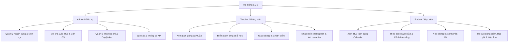
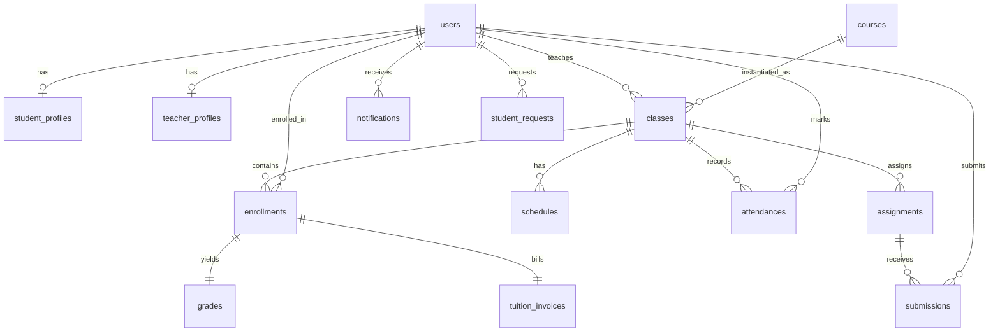

# TÀI LIỆU ĐẶC TẢ YÊU CẦU & THIẾT KẾ HỆ THỐNG
# HỆ THỐNG QUẢN LÝ GIÁO DỤC (EDUCATION MANAGEMENT SYSTEM - EMS)

> **Mô hình học hỏi & cải tiến:** Kế thừa các chuẩn nghiệp vụ thực tế từ Cổng thông tin đào tạo Đại học FPT (**FAP - FPT Academic Portal** - `https://fap.fpt.edu.vn/`).  
> **Quy mô nhóm phát triển:** 5 thành viên  
> **Công nghệ sử dụng (Tech Stack):** 
> - **Backend:** Express.js + Prisma ORM (Node.js)
> - **Frontend:** React + Vite + Ant Design (v5)
> - **Database:** MySQL 8.0
> - **DevOps / Môi trường:** Docker & Docker Compose  
> **Định hướng phạm vi (Scope):** MVP hoàn chỉnh gồm 12 module chính, tập trung vào luồng nghiệp vụ cốt lõi (Core Business Flow), tích hợp giải pháp chống xung đột lịch học, cảnh báo chuyên cần tự động, quản lý đơn từ học vụ trực tuyến, tối ưu hóa để 5 thành viên phát triển song song không xung đột.

---

## MỤC LỤC
1. [Phần 1: Khảo sát & Học hỏi từ Hệ thống Mẫu (FAP FPT)](#phần-1-khảo-sát--học-hỏi-từ-hệ-thống-mẫu-fap-fpt)
2. [Phần 2: Tổng quan & Phân quyền Hệ thống (Actors & Roles)](#phần-2-tổng-quan--phân-quyền-hệ-thống-actors--roles)
3. [Phần 3: Đặc tả Yêu cầu Chức năng Chi tiết (12 Modules)](#phần-3-đặc-tả-yêu-cầu-chức-năng-chi-tiết-12-modules)
4. [Phần 4: Yêu cầu Phi Chức năng (Non-Functional Requirements)](#phần-4-yêu-cầu-phi-chức-năng-non-functional-requirements)
5. [Phần 5: Thiết kế Cơ sở Dữ liệu MySQL (Database Schema - 14 Bảng)](#phần-5-thiết-kế-cơ-sở-dữ-liệu-mysql-database-schema---14-bảng)
6. [Phần 6: Danh sách RESTful API Endpoints Chuẩn hóa](#phần-6-danh-sách-restful-api-endpoints-chuẩn-hóa)
7. [Phần 7: Kiến trúc Thư mục Monorepo & Cấu hình Docker](#phần-7-kiến-trúc-thư-mục-monorepo--cấu-hình-docker)
8. [Phần 8: Phân công Nhiệm vụ & Kế hoạch Triển khai (5 Thành viên)](#phần-8-phân-công-nhiệm-vụ--kế-hoạch-triển-khai-5-thành-viên)

---

## PHẦN 1: KHẢO SÁT & HỌC HỎI TỪ HỆ THỐNG MẪU (FAP FPT)

Dựa trên phân tích thực tế và khảo sát kiến trúc cổng học vụ FAP (`fap.fpt.edu.vn`), hệ thống EMS kế thừa và cải tiến các điểm then chốt sau:

### 1. Hệ thống Nhận diện & Trải nghiệm Người dùng (Design System)
* **Bảng màu chủ đạo (Color Palette):**
  * `Primary Color`: Màu cam FPT `#F26F21` kết hợp sắc độ nhấn `#FA742B` thể hiện sự năng động, gắn liền với khối giáo dục công nghệ.
  * `Neutral Background`: Nền sáng `#F0F2F5` / `#FFFFFF` cho khả năng đọc tốt khi hiển thị danh sách và bảng điểm dày đặc.
  * `Semantic Status Colors`:
    * Xanh lục (`#52C41A`): Điểm danh *PRESENT* (Có mặt), Môn học *PASSED* (Đạt), Học phí *PAID*.
    * Đỏ (`#FF4D4F`): Điểm danh *ABSENT* (Vắng), Môn học *NOT PASSED*, Cảnh báo cấm thi (>20% vắng).
    * Cam/Vàng (`#FA8C16` / `#FAAD14`): Trạng thái *LATE* (Đi muộn), Đơn từ *PENDING* (Chờ duyệt), Học phí *PARTIAL*.
* **Bố cục (Layout Paradigm):**
  * **Table-Centric Interface:** Kế thừa cách tổ chức thông tin dạng lưới chuẩn hóa của FAP cho Thời khóa biểu, Điểm danh, Bảng điểm.
  * **Breadcrumbs Navigation:** Đặt ngay dưới Header để người dùng dễ dàng định vị cấp bậc danh mục (`Trang chủ > Lớp học phần > Bảng điểm`).
  * **Cải tiến Responsive:** Khắc phục nhược điểm của FAP cũ (chủ yếu là giao diện cố định cho Desktop) bằng cách ứng dụng hệ thống Ant Design Grid (Row/Col) và cuộn ngang thông minh trên Mobile.

### 2. Chuẩn hóa Nghiệp vụ Học vụ Kế thừa từ FAP
* **Chuẩn ca học theo Slot:** Phân chia ngày học thành 6 ca cố định (mỗi ca 2 giờ 20 phút gồm 15 phút giải lao) thay vì giờ giấc tự do, giúp tối ưu hóa thuật toán phát hiện trùng lịch.
* **Quy chế Chuyên cần 20%:** Tự động tính tỷ lệ vắng và khóa điều kiện thi kết thúc môn nếu sinh viên vắng từ 20% tổng số buổi trở lên.
* **Cơ chế Đơn từ Học vụ Trực tuyến (Online Applications):** Cho phép sinh viên gửi yêu cầu trực tiếp trên hệ thống (Xin nghỉ phép, phúc khảo điểm, xác nhận sinh viên) thay vì xử lý giấy tờ thủ công.

---

## PHẦN 2: TỔNG QUAN & PHÂN QUYỀN HỆ THỐNG (ACTORS & ROLES)

Hệ thống áp dụng cơ chế phân quyền dựa trên vai trò (**RBAC - Role-Based Access Control**) với 3 nhóm người dùng cố định:



### 1. Admin (Giáo vụ / Quản trị viên)
* Quản lý toàn bộ danh mục gốc: Hồ sơ Học viên, Hồ sơ Giảng viên, Môn học/Khóa học gốc (Course), Lớp học phần (Class).
* Xếp lịch học theo Slot, kiểm tra trùng phòng học và trùng lịch giảng viên.
* Thêm học viên vào lớp (tự động khởi tạo công nợ học phí và bảng điểm).
* Quản lý thu học phí, phê duyệt các đơn từ trực tuyến và phát hành thông báo toàn trường.
* Theo dõi Dashboard tổng quan về doanh thu, sĩ số đào tạo và tỷ lệ qua môn.

### 2. Teacher (Giảng viên)
* Xem lịch giảng dạy hàng tuần (Calendar View) và danh sách các lớp học phần được phân công.
* Thực hiện điểm danh học viên theo từng buổi học trực tiếp trên lớp.
* Quản lý bài tập: Giao bài, tải tài liệu đề bài, duyệt bài nộp của học viên, chấm điểm và để lại lời phê.
* Nhập điểm thành phần (Chuyên cần, Giữa kỳ, Cuối kỳ) và xuất bảng điểm tổng kết ra Excel.

### 3. Student (Học viên)
* Xem lịch học cá nhân theo tuần trực quan theo từng Slot và phòng học.
* Theo dõi lịch sử điểm danh từng buổi và tỷ lệ % vắng mặt để chủ động phòng tránh nguy cơ cấm thi.
* Nộp bài tập trực tuyến, theo dõi hạn nộp (Deadline) và xem điểm đánh giá từ giảng viên.
* Tra cứu bảng điểm tổng kết, điểm trung bình tích lũy (GPA).
* Tra cứu công nợ học phí, quét mã VietQR để thanh toán.
* Gửi các mẫu đơn học vụ online (Xin nghỉ phép, phúc khảo điểm, xin giấy xác nhận).

---

## PHẦN 3: ĐẶC TẢ YÊU CẦU CHỨC NĂNG CHI TIẾT (12 MODULES)

---

### CỤM 1: QUẢN TRỊ HỒ SƠ & ĐÀO TẠO (Phụ trách: Member 1)

#### 1. Student Management (Quản lý Học viên)
* **UC1.1 - Danh sách & Tìm kiếm:** Xem danh sách học viên có phân trang server-side, bộ lọc trạng thái (Đang học, Bảo lưu, Đã tốt nghiệp), tìm kiếm tức thời theo Mã SV, Họ tên, Email, Số điện thoại.
* **UC1.2 - Thêm/Sửa/Khóa tài khoản:** Tạo tài khoản học viên mới kèm thông tin hồ sơ (Ngày sinh, Giới tính, Địa chỉ, Năm nhập học). Hệ thống tự sinh mã học viên chuẩn (VD: `STU2026001`). Cho phép khóa/mở khóa tài khoản khi học viên bảo lưu.
* **UC1.3 - Import/Export Excel:** Hỗ trợ nhập hàng loạt danh sách sinh viên từ file `.xlsx` theo mẫu định sẵn và xuất danh sách học viên ra file Excel.
* **UC1.4 - Hồ sơ chi tiết 360 độ:** Xem toàn diện thông tin một học viên trên 1 màn hình: Thông tin cá nhân, các lớp đã học, bảng điểm tổng kết và lịch sử đóng học phí.

#### 2. Teacher Management (Quản lý Giảng viên)
* **UC2.1 - Quản lý hồ sơ giảng viên:** Thêm mới, cập nhật thông tin cá nhân, học vị (Cử nhân, Thạc sĩ, Tiến sĩ), chuyên ngành đào tạo và tiểu sử tóm tắt.
* **UC2.2 - Tra cứu lịch dạy & Lớp phụ trách:** Tra cứu nhanh danh sách các lớp học phần giảng viên đang phụ trách hoặc đã từng giảng dạy trong các học kỳ trước.

#### 3. Course Management (Quản lý Môn học / Khóa học gốc)
* **UC3.1 - Quản lý danh mục môn học:** CRUD môn học gồm: Mã môn (VD: `PRN231`, `CSD201`), Tên môn học, Số tín chỉ, Tổng số buổi học (thường là 30 buổi cho môn 3 tín chỉ), Mức học phí cơ bản (`base_tuition_fee`), Mô tả chi tiết và đường dẫn tải Đề cương môn học (Syllabus URL).
* **Ràng buộc nghiệp vụ:** Không cho phép xóa cứng (Hard Delete) môn học nếu môn học đó đã có ít nhất một Lớp học phần (`classes`) được tạo ra.

---

### CỤM 2: TỔ CHỨC LỚP HỌC & THỜI KHÓA BIỂU (Phụ trách: Member 2)

#### 4. Class Management (Quản lý Lớp học phần)
* **UC4.1 - Mở lớp học phần:** Tạo lớp mới từ một Môn học có sẵn, chọn Học kỳ (VD: `SP26`, `SU26`, `FA26`), phân công 1 Giảng viên phụ trách, thiết lập sĩ số tối đa (`max_students`, mặc định 30) và trạng thái lớp (`UPCOMING`, `ONGOING`, `COMPLETED`).
* **UC4.2 - Quản lý danh sách học viên trong lớp (Enrollment):** Thêm hoặc xóa học viên vào lớp.
* **Ràng buộc nghiệp vụ:**
  * Không cho phép thêm học viên vượt quá sĩ số tối đa `max_students`.
  * **Kiểm tra trùng lịch học viên (Cross-Module Conflict Check):** Trước khi thêm vào lớp, hệ thống tự động quét lịch học của học viên: Nếu học viên đang học một lớp khác trong cùng Học kỳ (`semester`) có lịch trùng Thứ (`day_of_week`) và Ca học (`shift`), hệ thống sẽ chặn ghi danh và thông báo xung đột cụ thể.
  * **Trigger nghiệp vụ tự động:** Ngay khi một học viên được thêm vào lớp (`enrollment`), hệ thống tự động:
    1. Tạo 1 bản ghi bảng điểm trống (`grades`) liên kết với học viên.
    2. Tạo 1 hóa đơn học phí (`tuition_invoices`) tương ứng với `base_tuition_fee` của môn học đó.

#### 5. Schedule Management (Quản lý Thời khóa biểu - Chuẩn Slot FAP)
* **UC5.1 - Chuẩn hóa khung giờ theo 6 Slot học chuẩn:**
  * **Slot 1:** 07:30 – 09:50
  * **Slot 2:** 10:00 – 12:20
  * **Slot 3:** 12:50 – 15:10
  * **Slot 4:** 15:20 – 17:40
  * **Slot 5:** 18:00 – 20:20
  * **Slot 6:** 20:30 – 22:50
* **UC5.2 - Xếp lịch học cho lớp:** Gán lịch học định kỳ theo Thứ trong tuần (Thứ 2 -> Chủ nhật), Ca học (Slot 1-6) và Phòng học (VD: `BE-301`, `AL-205`, `Lab-01`).
* **UC5.3 - Thuật toán Kiểm tra Xung đột Lịch (Conflict Detection):** Khi Admin lưu lịch học, hệ thống tự động quét và chặn lưu nếu phát hiện:
  * **Trùng phòng học:** Phòng học đã có lớp khác sử dụng vào cùng Thứ, cùng Ca học trong cùng Học kỳ.
  * **Trùng giảng viên:** Giảng viên của lớp đang có lịch dạy lớp khác vào cùng Thứ và Ca học đó.
* **UC5.4 - Thời khóa biểu dạng ma trận tuần (Calendar View):** Hiển thị lưới 7 cột (Thứ 2 đến Chủ nhật) x 6 hàng (Slot 1 đến Slot 6). Từng ô hiển thị rõ: Mã môn, Tên lớp, Phòng học, Giảng viên và Trạng thái điểm danh.

---

### CỤM 3: VẬN HÀNH LỚP HỌC (Phụ trách: Member 3)

#### 6. Attendance Management (Quản lý Điểm danh & Cảnh báo Chuyên cần)
* **UC6.1 - Điểm danh theo buổi học:** Giảng viên chọn lớp và ngày học. Giao diện hiển thị toàn bộ danh sách học viên trong lớp (mặc định chọn trạng thái `PRESENT` - Có mặt). Giảng viên tích chọn chuyển trạng thái với các trường hợp:
  * `PRESENT`: Có mặt
  * `ABSENT_EXCUSED`: Vắng có phép (được cập nhật tự động khi đơn xin phép học vụ được duyệt)
  * `ABSENT_UNEXCUSED`: Vắng không phép
  * `LATE`: Đi muộn
  * Kèm ô nhập ghi chú cho từng sinh viên.
* **UC6.2 - Cơ chế Tính toán & Cảnh báo Chuyên cần chuẩn FAP:**
  * Công thức tỷ lệ vắng:
    $$\text{Tỷ lệ vắng (\%)} = \frac{\text{Số buổi vắng không phép}}{\text{Tổng số buổi học của môn}} \times 100\%$$
  * **Quy tắc cảnh báo màu trực quan:**
    * Vắng $\le 10\%$: Màu xanh (An toàn).
    * $10\% < \text{Vắng} < 20\%$: Màu vàng/cam (Cảnh báo nguy cơ).
    * Vắng $\ge 20\%$: Màu đỏ đậm kèm gắn cờ **CẤM THI (NOT QUALIFIED FOR EXAM)**. Khi đã bị cấm thi, hệ thống tự động khóa quyền dự thi cuối kỳ và ghi nhận trạng thái môn là `NOT PASSED`.
  * **Đồng bộ cờ Cấm thi & Điểm số (Cross-Module Logic):** Khi Member 3 lưu điểm danh hoặc Member 5 duyệt đơn nghỉ phép, hệ thống gọi hàm helper tính lại tỷ lệ vắng không phép. Nếu $\ge 20\%$ trên `total_sessions`, tự động cập nhật `grades.is_banned = true` và `grades.is_passed = false`.

#### 7. Assignment Management (Quản lý Bài tập)
* **UC7.1 - Giao bài tập:** Giảng viên tạo bài tập mới cho lớp gồm Tiêu đề, Hướng dẫn yêu cầu, File đính kèm tài liệu đề bài (PDF/Docx/Zip) và Hạn nộp cụ thể (`due_date`).
* **UC7.2 - Nộp bài tập trực tuyến:** Học viên tải lên file bài làm (.zip, .rar, .pdf, tối đa 25MB). Ràng buộc `UNIQUE(assignment_id, student_id)` để chống trùng lặp dữ liệu nộp bài. Hệ thống đối chiếu thời gian nộp so với `due_date`:
  * Nếu nộp đúng hạn: Ghi nhận trạng thái `SUBMITTED`.
  * Nếu nộp quá hạn: Ghi nhận trạng thái `LATE_SUBMITTED` kèm số phút nộp muộn.
* **UC7.3 - Chấm bài & Phản hồi:** Giảng viên tải bài làm của học viên, nhập điểm số (thang điểm 10.0) và lời nhận xét chi tiết (`teacher_feedback`).

---

### CỤM 4: KHẢO THÍ & TÀI CHÍNH (Phụ trách: Member 4)

#### 8. Exam & Grade Management (Quản lý Thi & Điểm số)
* **UC8.1 - Bảng điểm lớp học (Editable Data Grid):** Giảng viên nhập điểm trực tiếp trên bảng dạng lưới cho các cột thành phần:
  * Điểm Chuyên cần (`attendance_score`, trọng số 10%): Hệ thống tự động gợi ý điểm chuyên cần dựa trên số buổi có mặt (đi đủ = 10 điểm, vắng bị trừ điểm tương ứng) đồng thời cho phép giảng viên ghi đè linh hoạt trên lưới.
  * Điểm Giữa kỳ (`midterm_score`, trọng số 30%)
  * Điểm Cuối kỳ (`final_score`, trọng số 60%)
* **UC8.2 - Công thức tính Điểm Tổng kết & Xét Qua môn:**
  * Công thức điểm tổng kết:
    $$\text{total\_score} = \text{attendance\_score} \times 0.1 + \text{midterm\_score} \times 0.3 + \text{final\_score} \times 0.6$$
  * Làm tròn đến 1 chữ số thập phân.
  * **Điều kiện Xét Qua môn (`is_passed = true`):**
    1. Không bị cấm thi do vắng mặt quá 20% buổi học.
    2. Điểm thi Cuối kỳ (`final_score`) phải đạt tối thiểu từ **3.5 điểm** trở lên.
    3. Điểm tổng kết (`total_score`) phải đạt từ **4.0 điểm** trở lên.
* **UC8.3 - Import/Export Điểm Excel:** Cung cấp file mẫu Excel chuẩn để giảng viên nhập điểm ngoại tuyến và tải lên một lần; cho phép xuất bảng điểm chính thức có chữ ký số giáo vụ.
* **UC8.4 - Bảng điểm cá nhân & Tra cứu GPA (Student):** Học viên tra cứu điểm chi tiết các môn từng kỳ, điểm trung bình học kỳ (Semester GPA) và điểm trung bình tích lũy toàn khóa (Cumulative GPA).

#### 9. Tuition Management (Quản lý Học phí)
* **UC9.1 - Quản lý Công nợ:** Tự động tạo hóa đơn học phí tương ứng khi học viên được ghi danh vào lớp.
* **UC9.2 - Ghi nhận Thanh toán:** Admin cập nhật số tiền thực thu (học viên có thể đóng trước 1 phần hoặc đóng đủ). Hệ thống tự động cập nhật trạng thái hóa đơn:
  * `UNPAID`: Chưa đóng đồng nào.
  * `PARTIAL`: Đã đóng một phần.
  * `PAID`: Đã hoàn thành 100% học phí.
* **UC9.3 - Thanh toán VietQR & In Biên lai:**
  * Tạo chuỗi mã thanh toán VietQR động chuẩn NAPAS247 (chứa Số tài khoản trường, Số tiền nợ và Nội dung chuyển khoản cú pháp `[MaSV] [MaLop]`).
  * Cho phép in phiếu thu / biên lai điện tử trực tiếp trên trình duyệt.

---

### CỤM 5: TƯƠNG TÁC, ĐƠN TỪ & BÁO CÁO (Phụ trách: Member 5)

#### 10. Notification Management (Quản lý Thông báo)
* **UC10.1 - Thông báo Hệ thống:** Admin tạo thông báo gửi toàn trường hoặc gửi riêng theo từng lớp học phần (tiêu đề, nội dung, tệp đính kèm).
* **UC10.2 - Trigger Thông báo Tự động (In-App Notification Bell):** Hệ thống tự động đẩy thông báo lên thanh Header khi phát sinh các sự kiện:
  * Giảng viên vừa đăng bài tập mới hoặc cập nhật hạn nộp.
  * Giảng viên vừa công bố điểm thành phần hoặc điểm tổng kết.
  * Hệ thống phát hành hóa đơn học phí mới hoặc nhắc nợ đến hạn.
* **UC10.3 - Quản lý Trạng thái Đọc:** Người dùng xem danh sách thông báo, đánh dấu từng tin hoặc toàn bộ là đã đọc (`is_read = true`).

#### 11. Online Applications / Requests (Đơn từ Học vụ Trực tuyến - Tính năng FAP)
* **UC11.1 - Nộp Đơn Online:** Học viên tạo yêu cầu trực tuyến theo các biểu mẫu chuẩn hóa:
  * *Đơn xin nghỉ học có phép:* Học viên chọn Lớp học phần, Ngày buổi học cần xin nghỉ (`session_date`) và tải lên tệp minh chứng y tế/giấy tờ. Khi được duyệt, đúng buổi học ngày đó sẽ tự động chuyển sang `ABSENT_EXCUSED` (không bị tính vào tỷ lệ cấm thi).
  * *Đơn phúc khảo điểm thi:* Xin chấm lại bài thi kết thúc môn.
  * *Đơn xin cấp Giấy xác nhận sinh viên:* Tự động sinh file PDF có dấu mộc điện tử để bổ sung hồ sơ vay vốn hoặc tạm hoãn nghĩa vụ quân sự.
* **UC11.2 - Quy trình Phê duyệt Đơn (Admin Workflow):** Giáo vụ xem danh sách đơn, xem minh chứng, chọn `APPROVED` (Chấp thuận) hoặc `REJECTED` (Từ chối kèm lý do). Trạng thái đơn được cập nhật trực tiếp đến học viên qua Notification.
  * **Trigger nghiệp vụ tự động (Cross-Module Sync):** Khi duyệt `APPROVED` đơn xin nghỉ phép, hệ thống cập nhật bản ghi trong `attendances` (theo đúng `class_id`, `student_id`, `session_date`) thành `ABSENT_EXCUSED` và tự động tính lại tỷ lệ vắng (gỡ cờ cấm thi `is_banned = false` trong `grades` nếu tỷ lệ vắng giảm xuống dưới 20%).

#### 12. Report & Analytics (Báo cáo & Thống kê)
* **UC12.1 - Admin Dashboard:**
  * 4 thẻ thống kê KPI: Tổng số Học viên, Tổng số Giảng viên, Số lớp đang mở trong kỳ, Tổng doanh thu học phí tháng này.
  * Biểu đồ Doanh thu (Bar Chart): So sánh tiền học phí đã thu vs. Còn công nợ qua các tháng.
  * Biểu đồ Học lực (Pie Chart): Tỷ lệ học viên Qua môn vs. Học lại trên toàn trường.
* **UC12.2 - Student & Teacher Dashboard:**
  * Hiển thị nhanh Lịch học/Lịch dạy hôm nay.
  * Danh sách bài tập sắp đến hạn nộp (Upcoming Deadlines trong 48 giờ tới).
  * Biểu đồ xu hướng điểm số GPA qua từng kỳ học của sinh viên.

---

## PHẦN 4: YÊU CẦU PHI CHỨC NĂNG (NON-FUNCTIONAL REQUIREMENTS)

### 1. Bảo mật Hệ thống (Security)
* **Mã hóa mật khẩu:** Mật khẩu người dùng được băm 1 chiều bằng thuật toán `bcryptjs` với salt rounds $\ge 10$. Tuyệt đối không lưu mật khẩu dạng plaintext.
* **Xác thực & Phân quyền:** Sử dụng `JSON Web Token (JWT)` với thời hạn Access Token là 24 giờ.
* **Role-Based Middleware:** Tất cả các Route nhạy cảm (nhập điểm, tạo lớp, thu tiền, duyệt đơn) đều bắt buộc đi qua Middleware kiểm tra tính hợp lệ của Token và quyền hạn (`RoleGuard`).
* **Input Validation & Sanitization:** Kiểm tra tính hợp lệ dữ liệu đầu vào bằng thư viện `Joi` hoặc `Zod` trước khi xử lý tầng CSDL.

### 2. Hiệu năng & Trải nghiệm Người dùng (UX/UI Standards)
* **Bộ thư viện UI thống nhất:** Toàn bộ 5 thành viên tuân thủ sử dụng **Ant Design (v5)** trên nền React để tạo trải nghiệm thị giác đồng bộ, sắc nét và chuyên nghiệp.
* **Phân trang Bắt buộc (Server-side Pagination):** Mọi bảng dữ liệu có khả năng mở rộng lớn (Danh sách học viên, Môn học, Bảng điểm, Hóa đơn) đều phải hỗ trợ phân trang ở tầng API Backend (`page`, `pageSize`, `search`).
* **Phản hồi tức thì (Feedback Mechanism):** Sử dụng các component `message.success()`, `notification.error()`, `Spin` tải trang của Ant Design để người dùng luôn nắm bắt được trạng thái thao tác.

### 3. Tính Đóng gói & Triển khai Nhất quán (Portability)
* Sử dụng `Docker` và `docker-compose.yml` để chuẩn hóa môi trường Database MySQL 8.0 và công cụ quản trị giao diện (phpMyAdmin). Thành viên chỉ cần chạy 1 lệnh duy nhất `docker-compose up -d` là có đầy đủ môi trường sẵn sàng.

---

## PHẦN 5: THIẾT KẾ CƠ SỞ DỮ LIỆU MYSQL (DATABASE SCHEMA - 14 BẢNG)



Dưới đây là đặc tả chi tiết 14 bảng quan hệ chuẩn hóa cho MySQL 8.0:

| STT | Tên bảng | Khóa chính (PK) | Khóa ngoại (FK) & Ràng buộc chính | Các cột dữ liệu cốt lõi | Phụ trách |
| :---: | :--- | :--- | :--- | :--- | :---: |
| 1 | **users** | `id` (INT, AI) | `code` (UNIQUE), `email` (UNIQUE) | `password_hash`, `full_name`, `role` (`ADMIN`, `TEACHER`, `STUDENT`), `phone`, `avatar`, `status`, `created_at` | Member 1 |
| 2 | **student_profiles** | `user_id` (INT) | FK -> `users(id)` ON DELETE CASCADE | `dob` (DATE), `gender` (`MALE`, `FEMALE`, `OTHER`), `address`, `enrollment_year` | Member 1 |
| 3 | **teacher_profiles** | `user_id` (INT) | FK -> `users(id)` ON DELETE CASCADE | `degree` (Cử nhân, ThS, TS), `specialty`, `bio` | Member 1 |
| 4 | **courses** | `id` (INT, AI) | `course_code` (UNIQUE) | `name`, `credits`, `total_sessions`, `base_tuition_fee` (DECIMAL 12,2), `description`, `syllabus_url`, `status` (`ACTIVE`, `INACTIVE`), `created_at` | Member 1 |
| 5 | **classes** | `id` (INT, AI) | `class_code` (UNIQUE), `course_id` -> `courses(id)`, `teacher_id` -> `users(id)` | `semester` (VD: `SP26`), `max_students`, `status` (`UPCOMING`, `ONGOING`, `COMPLETED`), `created_at` | Member 2 |
| 6 | **enrollments** | `id` (INT, AI) | `class_id` -> `classes(id)`, `student_id` -> `users(id)`, UNIQUE(`class_id`, `student_id`) | `enrolled_at`, `status` (`ACTIVE`, `DROPPED`) | Member 2 |
| 7 | **schedules** | `id` (INT, AI) | `class_id` -> `classes(id)` ON DELETE CASCADE | `day_of_week` (TINYINT 2-8), `shift` (Slot 1-6), `start_time` (TIME), `end_time` (TIME), `room` | Member 2 |
| 8 | **attendances** | `id` (INT, AI) | `class_id` -> `classes(id)`, `student_id` -> `users(id)`, UNIQUE(`class_id`, `student_id`, `session_date`) | `session_date` (DATE), `status` (`PRESENT`, `ABSENT_EXCUSED`, `ABSENT_UNEXCUSED`, `LATE`), `note` | Member 3 |
| 9 | **assignments** | `id` (INT, AI) | `class_id` -> `classes(id)` ON DELETE CASCADE | `title`, `description`, `file_url`, `due_date` (DATETIME), `created_at` | Member 3 |
| 10 | **submissions** | `id` (INT, AI) | `assignment_id` -> `assignments(id)`, `student_id` -> `users(id)`, UNIQUE(`assignment_id`, `student_id`) | `file_url`, `submitted_at`, `status` (`SUBMITTED`, `LATE_SUBMITTED`), `score` (DECIMAL 4,2), `teacher_feedback` | Member 3 |
| 11 | **grades** | `id` (INT, AI) | `enrollment_id` -> `enrollments(id)` (UNIQUE) | `attendance_score`, `midterm_score`, `final_score`, `total_score`, `is_passed` (BOOLEAN), `is_banned` (BOOLEAN) | Member 4 |
| 12 | **tuition_invoices** | `id` (INT, AI) | `student_id` -> `users(id)`, `enrollment_id` -> `enrollments(id)` | `amount`, `paid_amount`, `due_date`, `status` (`UNPAID`, `PARTIAL`, `PAID`), `paid_at` | Member 4 |
| 13 | **notifications** | `id` (INT, AI) | `user_id` -> `users(id)` (Nullable nếu gửi toàn trường) | `title`, `message`, `type` (`ASSIGNMENT`, `GRADE`, `TUITION`, `REQUEST`, `SYSTEM`), `is_read` (BOOLEAN), `created_at` | Member 5 |
| 14 | **student_requests** | `id` (INT, AI) | `student_id` -> `users(id)`, `class_id` -> `classes(id)` (Nullable) | `request_type` (`ABSENCE`, `REMARK`, `CONFIRMATION`), `session_date` (DATE, Nullable), `reason`, `attachment_url`, `status` (`PENDING`, `APPROVED`, `REJECTED`), `admin_response`, `created_at` | Member 5 |

---

## PHẦN 6: DANH SÁCH RESTFUL API ENDPOINTS CHUẨN HÓA

Mọi API tuân thủ tiền tố `/api/v1` và trả về cấu trúc JSON phản hồi đồng nhất:
```json
{
  "success": true,
  "message": "Thao tác thực hiện thành công",
  "data": {}
}
```

### 1. Cụm Auth, Người dùng & Môn học (Member 1)
* `POST /api/v1/auth/login` - Đăng nhập tài khoản, trả về JWT Token và Role info.
* `GET /api/v1/auth/me` - Lấy thông tin cá nhân của phiên đăng nhập hiện tại.
* `GET /api/v1/students` - Lấy danh sách sinh viên (phân trang, lọc theo trạng thái, tìm kiếm).
* `POST /api/v1/students` - Thêm mới học viên thủ công.
* `POST /api/v1/students/import` - Import danh sách học viên từ file Excel.
* `GET /api/v1/students/:id/profile-360` - Xem hồ sơ chi tiết 360 độ của học viên.
* `GET /api/v1/teachers` - Danh sách giảng viên kèm học vị, chuyên ngành.
* `POST /api/v1/teachers` - Thêm mới hồ sơ giảng viên.
* `GET /api/v1/courses` - Danh mục môn học (có đính kèm link Syllabus).
* `POST /api/v1/courses` - Tạo môn học mới.

### 2. Cụm Lớp học & Thời khóa biểu (Member 2)
* `GET /api/v1/classes` - Danh sách lớp học phần (lọc theo học kỳ, giảng viên, môn học).
* `POST /api/v1/classes` - Mở lớp học phần mới.
* `POST /api/v1/classes/:id/enrollments` - Thêm học viên vào lớp (Tự tạo bản ghi `grades` & `tuition_invoices`).
* `DELETE /api/v1/classes/:id/enrollments/:studentId` - Hủy ghi danh học viên khỏi lớp.
* `POST /api/v1/classes/:id/schedules` - Xếp lịch học theo ca Slot kèm thuật toán kiểm tra xung đột trùng phòng/trùng giảng viên.
* `GET /api/v1/schedules/my-schedule` - Lấy thời khóa biểu tuần của Giảng viên hoặc Sinh viên đang đăng nhập.

### 3. Cụm Điểm danh & Bài tập (Member 3)
* `GET /api/v1/classes/:id/attendances?date=YYYY-MM-DD` - Lấy bảng điểm danh lớp theo ngày học.
* `POST /api/v1/classes/:id/attendances` - Lưu dữ liệu điểm danh cả lớp trong một buổi học.
* `GET /api/v1/classes/:id/attendance-summary` - Thống kê tỷ lệ chuyên cần cả kỳ của lớp, gắn cờ cảnh báo cấm thi.
* `GET /api/v1/classes/:id/assignments` - Lấy danh sách bài tập của lớp học phần.
* `POST /api/v1/classes/:id/assignments` - Giảng viên tạo bài tập mới kèm tải file đề bài.
* `POST /api/v1/assignments/:id/submissions` - Học viên tải bài làm nộp lên hệ thống.
* `PATCH /api/v1/submissions/:id/grade` - Giảng viên chấm điểm và nhập nhận xét bài tập.

### 4. Cụm Bảng điểm & Học phí (Member 4)
* `GET /api/v1/classes/:id/grades` - Bảng điểm đầy đủ của lớp học phần (Chuyên cần, Giữa kỳ, Cuối kỳ).
* `PUT /api/v1/classes/:id/grades` - Cập nhật điểm thành phần hàng loạt, tự động tính tổng kết và xét qua môn.
* `GET /api/v1/students/my-grades` - Học viên xem kết quả học tập cá nhân và điểm tích lũy GPA.
* `GET /api/v1/tuition-invoices` - Danh sách hóa đơn học phí (lọc theo trạng thái nợ).
* `PATCH /api/v1/tuition-invoices/:id/pay` - Ghi nhận thanh toán học phí và cập nhật trạng thái hóa đơn.
* `GET /api/v1/tuition-invoices/:id/vietqr` - Lấy chuỗi dữ liệu tạo mã thanh toán VietQR động.

### 5. Cụm Đơn từ, Thông báo & Phân tích (Member 5)
* `GET /api/v1/notifications` - Danh sách thông báo của người dùng.
* `POST /api/v1/notifications/broadcast` - Admin gửi thông báo toàn trường hoặc gửi riêng theo lớp.
* `PATCH /api/v1/notifications/:id/read` - Đánh dấu thông báo là đã đọc.
* `POST /api/v1/requests` - Học viên gửi đơn online (Xin nghỉ phép, phúc khảo điểm, xác nhận sinh viên).
* `GET /api/v1/requests` - Danh sách đơn từ chờ duyệt (dành cho Admin).
* `PATCH /api/v1/requests/:id/review` - Admin duyệt hoặc từ chối đơn học vụ (tự động cập nhật điểm danh nếu duyệt đơn nghỉ học).
* `GET /api/v1/analytics/admin-overview` - Thống kê 4 thẻ KPI, biểu đồ doanh thu và biểu đồ tỷ lệ qua môn.
* `GET /api/v1/analytics/student-overview` - Dashboard học viên: Lịch học hôm nay, hạn nộp bài tập sắp tới, biểu đồ GPA.

---

## PHẦN 7: KIẾN TRÚC THƯ MỤC MONOREPO & CẤU HÌNH DOCKER

### 1. Cấu trúc Thư mục Dự án Monorepo
Hệ thống được tổ chức dạng Monorepo để 5 thành viên có thể vừa phát triển Backend vừa phát triển Frontend mà không gặp xung đột mã nguồn (Git Merge Conflict):

```text
ems-project/
├── docker-compose.yml        # Cấu hình MySQL 8.0 & phpMyAdmin
├── .gitignore
├── README.md
├── backend/                  # Ứng dụng Backend Express.js
│   ├── Dockerfile
│   ├── package.json
│   ├── .env.example
│   ├── prisma/
│   │   ├── schema.prisma     # Định nghĩa 14 bảng CSDL
│   │   └── seed.js           # Dữ liệu khởi tạo (1 Admin, 5 GV, 25 SV, 6 Môn, 4 Lớp)
│   └── src/
│       ├── config/           # Cấu hình Database, JWT, Upload file (Multer)
│       ├── middlewares/      # auth.middleware.js, role.middleware.js, validate.middleware.js
│       ├── utils/            # formatResponse.js, vietqrGenerator.js
│       ├── modules/          # 5 cụm module độc lập
│       │   ├── users-courses/          # Member 1
│       │   ├── classes-schedules/      # Member 2
│       │   ├── attendance-assignments/ # Member 3
│       │   ├── grades-tuition/         # Member 4
│       │   └── notifications-analytics/# Member 5
│       └── app.js            # Điểm khởi chạy Express Server
└── frontend/                 # Ứng dụng Frontend React + Vite + Ant Design
    ├── Dockerfile
    ├── package.json
    ├── vite.config.js
    └── src/
        ├── api/              # Axios instance & Interceptors gắn JWT
        ├── assets/           # Logo FPT-EMS, icons
        ├── components/       # Header, Sidebar, Breadcrumb, NotificationBell
        ├── layouts/          # MainLayout, AuthLayout
        └── pages/            # Màn hình chức năng tương ứng 5 cụm
            ├── auth/
            ├── users-courses/          # Member 1
            ├── classes-schedules/      # Member 2
            ├── attendance-assignments/ # Member 3
            ├── grades-tuition/         # Member 4
            └── notifications-analytics/# Member 5
```

### 2. File Cấu hình `docker-compose.yml` Chuẩn hóa

```yaml
version: '3.8'

services:
  mysql_db:
    image: mysql:8.0
    container_name: ems_mysql
    restart: always
    environment:
      MYSQL_ROOT_PASSWORD: rootpassword
      MYSQL_DATABASE: ems_db
      MYSQL_USER: ems_user
      MYSQL_PASSWORD: ems_password
    ports:
      - "3307:3306"
    volumes:
      - mysql_data:/var/lib/mysql

  phpmyadmin:
    image: phpmyadmin/phpmyadmin
    container_name: ems_phpmyadmin
    restart: always
    ports:
      - "8080:80"
    environment:
      PMA_HOST: mysql_db
      MYSQL_ROOT_PASSWORD: rootpassword
    depends_on:
      - mysql_db

volumes:
  mysql_data:
```

---

## PHẦN 8: PHÂN CÔNG NHIỆM VỤ & KẾ HOẠCH TRIỂN KHAI (5 THÀNH VIÊN)

### 1. Bảng Phân công Trách nhiệm Chi tiết

| Thành viên | Cụm Module Phụ trách | Các Bảng DB Làm việc Chính | Đầu việc Trọng tâm (Core Tasks) |
| :--- | :--- | :--- | :--- |
| **Member 1 (Team Leader)** | Auth, Student, Teacher, Course | `users`, `student_profiles`, `teacher_profiles`, `courses` | - Dựng khung Monorepo, cấu hình Docker & Prisma.<br>- Xây dựng xác thực JWT, Role-Based Middleware.<br>- CRUD Học viên, Giảng viên, Môn học.<br>- Viết tính năng Import/Export danh sách sinh viên Excel. |
| **Member 2** | Class, Schedule | `classes`, `enrollments`, `schedules` | - Nghiệp vụ Mở lớp học phần, Ghi danh học viên vào lớp.<br>- Trigger tự động tạo bản ghi Grade và Tuition.<br>- **Thuật toán kiểm tra trùng phòng học & trùng giảng viên**.<br>- Giao diện Thời khóa biểu tuần dạng ma trận Slot 1-6. |
| **Member 3** | Attendance, Assignment | `attendances`, `assignments`, `submissions` | - Giao diện Điểm danh lớp học theo ngày.<br>- **Công thức tính % vắng mặt & cảnh báo Cấm thi (>20%)**.<br>- Chức năng Giao bài tập, Upload đề bài và Nộp bài trực tuyến.<br>- Giao diện Giảng viên chấm điểm & nhận xét bài tập. |
| **Member 4** | Exam & Grade, Tuition | `grades`, `tuition_invoices` | - Giao diện Bảng điểm dạng lưới có thể chỉnh sửa trực tiếp (Editable Table).<br>- **Công thức tính điểm tổng kết & Xét điều kiện qua môn tự động**.<br>- Quản lý hóa đơn công nợ, ghi nhận thanh toán học phí.<br>- Tích hợp tạo mã VietQR và xuất biên lai thu tiền. |
| **Member 5** | Notification, Requests, Analytics | `notifications`, `student_requests` + View tổng hợp | - Module Thông báo: Quả chuông in-app & hàm trigger tự động.<br>- **Module Đơn từ học vụ online: Xin nghỉ phép, phúc khảo, cấp giấy xác nhận**.<br>- Tích hợp duyệt đơn nghỉ phép tự động sang bảng điểm danh.<br>- Thiết kế Dashboard biểu đồ phân tích (Recharts) cho Admin và Sinh viên. |

### 2. Lộ trình Thực hiện Dự án (Timeline 4 - 6 Tuần)

* **Tuần 1: Khởi tạo & Đồng bộ Nền tảng (Foundation Week)**
  * Leader (Member 1) khởi tạo cấu trúc Monorepo, cấu hình `docker-compose.yml`, viết file `schema.prisma` cho 14 bảng và tạo file `seed.js` cung cấp dữ liệu mẫu phong phú.
  * Thống nhất quy ước đặt tên nhánh Git (`feat/module-name`), quy chuẩn commit và chuẩn mã lỗi JSON trả về.
  * Tất cả thành viên kéo code về, chạy `docker-compose up -d` và chạy lệnh seed để có ngay CSDL giống hệt nhau.

* **Tuần 2: Phát triển Backend API & Giao diện Cơ bản (CRUD Phase)**
  * Các thành viên triển khai toàn bộ các API CRUD và giao diện danh sách/biểu mẫu cơ bản cho cụm module mình phụ trách (sử dụng Ant Design Table, Form, Modal).
  * Kiểm thử các API bằng Postman/Thunder Client.

* **Tuần 3: Xử lý Nghiệp vụ Nâng cao (Core Logic & Automation)**
  * **Member 2:** Hoàn thiện thuật toán chống xung đột lịch học và giao diện ma trận tuần.
  * **Member 3:** Hoàn thiện cơ chế cảnh báo cấm thi 20% và upload file bài tập.
  * **Member 4:** Hoàn thiện công thức tính điểm tổng kết tự động và mã thanh toán VietQR.
  * **Member 5:** Tích hợp quy trình duyệt đơn online và biểu đồ phân tích Dashboard.

* **Tuần 4: Tích hợp Luồng Nghiệp vụ Đầu-Cuối (End-to-End Integration) & Kiểm thử**
  * Ghép nối toàn bộ chu trình học vụ khép kín:
    $$\text{Tạo Môn} \rightarrow \text{Mở Lớp} \rightarrow \text{Xếp TKB} \rightarrow \text{Ghi danh SV} \rightarrow \text{Điểm danh / Nộp bài} \rightarrow \text{Chấm điểm} \rightarrow \text{Thu học phí} \rightarrow \text{Báo cáo}$$
  * Kiểm thử phân quyền nghiêm ngặt: Sinh viên không thể vào trang Giảng viên/Admin; Giảng viên chỉ sửa được điểm lớp mình dạy.
  * Sửa lỗi giao diện, tối ưu tốc độ và đóng gói hoàn thiện tài liệu đồ án.
