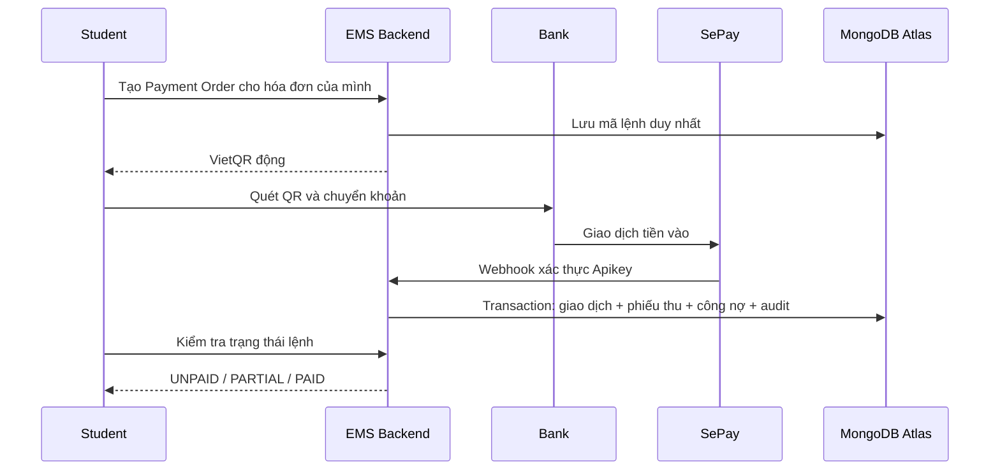
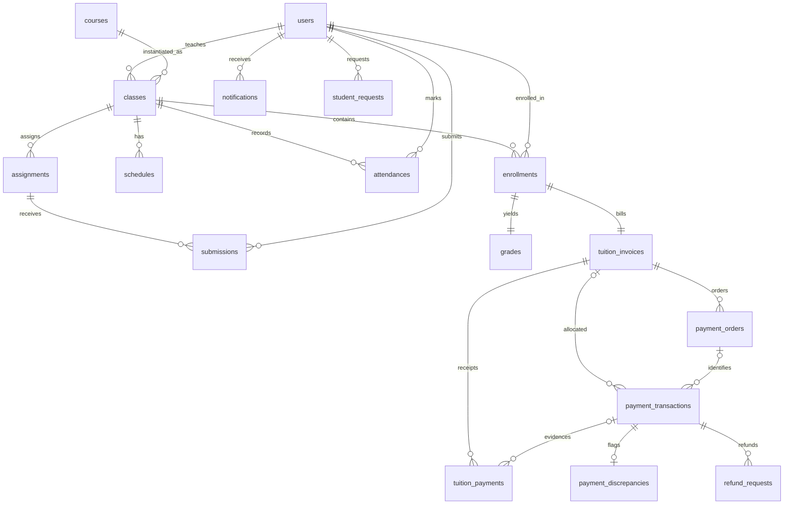

# TÀI LIỆU ĐẶC TẢ YÊU CẦU & THIẾT KẾ HỆ THỐNG
# HỆ THỐNG QUẢN LÝ GIÁO DỤC (EDUCATION MANAGEMENT SYSTEM - EMS)

> **Mô hình học hỏi & cải tiến:** Kế thừa các chuẩn nghiệp vụ thực tế từ Cổng thông tin đào tạo Đại học FPT (**FAP - FPT Academic Portal** - `https://fap.fpt.edu.vn/`).  
> **Quy mô nhóm phát triển:** 5 thành viên (Mỗi thành viên phụ trách 1 Actor chính từ A → Z)  
> **Công nghệ sử dụng (Tech Stack):** 
> - **Backend:** Express.js + Mongoose ODM (Node.js)
> - **Frontend:** React + Vite + Ant Design (v5)
> - **Database:** MongoDB Atlas (replica set — hỗ trợ multi-document transaction)
> - **DevOps / Môi trường:** Docker & Docker Compose  
> **Định hướng phạm vi (Scope):** MVP hoàn chỉnh gồm 12 module chính, tập trung vào luồng nghiệp vụ cốt lõi (Core Business Flow), tích hợp giải pháp chống xung đột lịch học, cảnh báo chuyên cần tự động, quản lý đơn từ học vụ trực tuyến, phân tách theo **5 Actor chuẩn hóa** (`SYSTEM ADMIN`, `ACADEMIC STAFF`, `ACCOUNTANT`, `TEACHER`, `STUDENT`) để 5 thành viên phát triển song song không xung đột.

---

## MỤC LỤC
1. [Phần 1: Khảo sát & Học hỏi từ Hệ thống Mẫu (FAP FPT)](#phần-1-khảo-sát--học-hỏi-từ-hệ-thống-mẫu-fap-fpt)
2. [Phần 2: Tổng quan & Phân quyền Hệ thống (5 Actors & Roles)](#phần-2-tổng-quan--phân-quyền-hệ-thống-5-actors--roles)
3. [Phần 3: Đặc tả Yêu cầu Chức năng Chi tiết (12 Modules theo 5 Actor)](#phần-3-đặc-tả-yêu-cầu-chức-năng-chi-tiết-12-modules-theo-5-actor)
4. [Phần 4: Yêu cầu Phi Chức năng (Non-Functional Requirements)](#phần-4-yêu-cầu-phi-chức-năng-non-functional-requirements)
5. [Phần 5: Thiết kế Cơ sở Dữ liệu MongoDB (Database Schema - 18 Collection)](#phần-5-thiết-kế-cơ-sở-dữ-liệu-mongodb-database-schema---18-collection)
6. [Phần 6: Danh sách RESTful API Endpoints Chuẩn hóa (Theo 5 Actor)](#phần-6-danh-sách-restful-api-endpoints-chuẩn-hóa-theo-5-actor)
7. [Phần 7: Kiến trúc Thư mục Monorepo & Cấu hình Docker](#phần-7-kiến-trúc-thư-mục-monorepo--cấu-hình-docker)
8. [Phần 8: Phân công Nhiệm vụ & Kế hoạch Triển khai (5 Thành viên theo 5 Actor)](#phần-8-phân-công-nhiệm-vụ--kế-hoạch-triển-khai-5-thành-viên-theo-5-actor)

---

## PHẦN 1: KHẢO SÁT & HỌC HỎI TỪ HỆ THỐNG MẪU (FAP FPT)

Dựa trên phân tích thực tế và khảo sát kiến trúc cổng học vụ FAP (`fap.fpt.edu.vn`), hệ thống EMS kế thừa và cải tiến các điểm then chốt sau:

### 1. Hệ thống Nhận diện & Trải nghiệm Người dùng (Design System)
* **Bảng màu chủ đạo (Color Palette):**
  * `Primary Color`: Màu cam FPT `#F26F21` kết hợp sắc độ nhấn `#FA742B` thể hiện sự năng động, gắn liền với khối giáo dục công nghệ.
  * `Neutral Background`: Nền sáng `#F0F2F5` / `#FFFFFF` cho khả năng đọc tốt khi hiển thị danh sách và bảng điểm dày đặc.
  * `Semantic Status Colors`:
    * Xanh lục (`#52C41A`): Điểm danh *PRESENT* (Có mặt), Môn học *PASSED* (Đạt), Học phí *PAID*.
    * Đỏ (`#FF4D4F`): Điểm danh *ABSENT* (Vắng), Môn học *NOT PASSED*, Cảnh báo cấm thi (>20% vắng).
    * Cam/Vàng (`#FA8C16` / `#FAAD14`): Trạng thái *LATE* (Đi muộn), Đơn từ *PENDING* (Chờ duyệt), Học phí *PARTIAL*.
* **Bố cục (Layout Paradigm):**
  * **Table-Centric Interface:** Kế thừa cách tổ chức thông tin dạng lưới chuẩn hóa của FAP cho Thời khóa biểu, Điểm danh, Bảng điểm.
  * **Breadcrumbs Navigation:** Đặt ngay dưới Header để người dùng dễ dàng định vị cấp bậc danh mục (`Trang chủ > Lớp học phần > Bảng điểm`).
  * **Cải tiến Responsive:** Khắc phục nhược điểm của FAP cũ (chủ yếu là giao diện cố định cho Desktop) bằng cách ứng dụng hệ thống Ant Design Grid (Row/Col) và cuộn ngang thông minh trên Mobile.

### 2. Chuẩn hóa Nghiệp vụ Học vụ Kế thừa từ FAP
* **Tách bạch 5 Vai trò Vận hành:** Thay vì gộp chung một Admin duy nhất, hệ thống tách rõ **System Admin** (Quản trị tài khoản & hệ thống), **Academic Staff** (Giáo vụ đào tạo, xếp lịch & duyệt đơn học vụ), **Accountant** (Kế toán công nợ, thanh toán tự động SePay/VietQR, đối soát & hoàn tiền), **Teacher** (Giảng viên) và **Student** (Học viên).
* **Chuẩn ca học theo Slot:** Phân chia ngày học thành 6 ca cố định (hoặc theo ca Sáng/Chiều chuẩn hóa) giúp tối ưu hóa thuật toán phát hiện trùng phòng (`P101`, `P102`) và trùng giảng viên (`TEA001`).
* **Quy chế Chuyên cần 20%:** Tự động tính tỷ lệ vắng và phát cảnh báo / khóa điều kiện thi kết thúc môn nếu học viên vắng vượt ngưỡng 20% tổng số buổi.
* **Cơ chế Đơn từ Học vụ Trực tuyến (Online Applications):** Cho phép học viên gửi yêu cầu trực tiếp trên hệ thống (Xin nghỉ phép, phúc khảo điểm, xác nhận sinh viên) và đồng bộ tự động sang bảng điểm danh khi Giáo vụ phê duyệt.

---

## PHẦN 2: TỔNG QUAN & PHÂN QUYỀN HỆ THỐNG (5 ACTORS & ROLES)

Hệ thống áp dụng cơ chế phân quyền dựa trên vai trò (**RBAC - Role-Based Access Control**) với **5 nhóm Actor chính** (cùng các Actor hệ thống phụ trợ: *Payment System - SePay (VietQR + Webhook)* và *File Storage - X1*):

```mermaid
graph TD
    EMS[Hệ thống EMS] --> A1[1. SYSTEM ADMIN - Người 1]
    EMS --> A2[2. ACADEMIC STAFF - Người 2]
    EMS --> A3[3. ACCOUNTANT - Người 3]
    EMS --> A4[4. TEACHER - Người 4]
    EMS --> A5[5. STUDENT - Người 5]
    
    A1 --> A1_1[Xác thực JWT & Phân quyền 5 Roles]
    A1 --> A1_2[Khóa / Mở khóa Tài khoản người dùng]
    A1 --> A1_3[Phát Thông báo toàn hệ thống SYSTEM]
    A1 --> A1_4[Dashboard Tổng quan 4 KPI & Tỷ lệ qua môn]

    A2 --> A2_1[Quản lý Hồ sơ HV, GV & Import/Export Excel]
    A2 --> A2_2[Quản lý Môn học, Mở lớp & Ghi danh Enrollment]
    A2 --> A2_3[Xếp TKB theo Slot & Kiểm tra trùng Phòng/GV]
    A2 --> A2_4[Duyệt Đơn từ Học vụ & Xem Bảng điểm lớp]

    A3 --> A3_1[Quản lý & Tra cứu Công nợ Học phí tự động]
    A3 --> A3_2[Thanh toán tự động qua SePay Webhook UNPAID -> PARTIAL -> PAID]
    A3 --> A3_3[Đối soát SePay, Xử lý sai lệch & Hoàn tiền]
    A3 --> A3_4[Nhắc nợ TUITION & Báo cáo Tài chính]

    A4 --> A4_1[Xem Lịch dạy tuần & Teacher Dashboard]
    A4 --> A4_2[Điểm danh buổi học & Cảnh báo vắng > 20%]
    A4 --> A4_3[Giao Bài tập BT01 & Chấm điểm/Nhận xét]
    A4 --> A4_4[Nhập Bảng điểm lưới 3 cột, Tính điểm & Công bố]

    A5 --> A5_1[Xem Student Dashboard & TKB Lưới tuần]
    A5 --> A5_2[Theo dõi Điểm danh cá nhân & Tỷ lệ chuyên cần]
    A5 --> A5_3[Nộp Bài tập trực tuyến & Xem điểm/Nhận xét GV]
    A5 --> A5_4[Tra cứu Điểm/GPA, Công nợ VietQR & Nộp đơn Online]
```



### 1. SYSTEM ADMIN (Quản trị hệ thống — Phụ trách: Người 1)
* Quản lý xác thực đăng nhập (`DF01`), cấp phát JWT token và kiểm tra phân quyền Role cho toàn bộ 5 Actor (`UC0.1`, `DF02`).
* Quản lý tài khoản người dùng trong hệ thống: Khóa / Mở khóa tài khoản (`is_active`), thay đổi phân quyền vai trò (`UC1.2a*`, `DF03a`), chặn tự khóa tài khoản quản trị hiện hành (`ADM001`).
* Tạo và phát hành thông báo toàn hệ thống hoặc theo lớp học cụ thể (loại `SYSTEM` - `UC10.1`, `DF08a`).
* Theo dõi Dashboard tổng quan hệ thống: 4 thẻ KPI tổng (Tổng HV, Tổng GV, Số lớp đang mở, Tổng doanh thu) và Biểu đồ tròn tỷ lệ qua môn / trượt môn (`UC11.1a`, `DF12a`).

### 2. ACADEMIC STAFF (Giáo vụ đào tạo — Phụ trách: Người 2)
* Quản lý danh mục Hồ sơ Học viên (`STU2026001`..`004`): Tìm kiếm (`UC1.1`), Thêm/Sửa kèm tự sinh mã (`UC1.2b`, `DF03b`), Import/Export Excel (`UC1.3`, `DF04`, `DF10`) và Xem hồ sơ 360° (`UC1.4`, `DF09`).
* Quản lý Hồ sơ Giảng viên (`TEA001`, `TEA002` - `UC2.1`) và tra cứu lịch dạy / lớp phụ trách (`UC2.2`).
* Quản lý danh mục Môn học gốc (`WEB101`, `JS201`, số buổi, học phí cơ bản, file syllabus - `UC3.1`, `DF05`).
* Mở lớp học phần (`WEB101-2026A-01`), gán giảng viên, thiết lập sĩ số tối đa (`UC4.1`, `DF06`) và quản lý ghi danh học viên (`Enrollment` - `UC4.2`, `DF07`, `DF11`) — tự động khởi tạo bản ghi điểm trống và hóa đơn học phí.
* Xếp lịch học theo Slot/Ca (`UC5.1`, `DF13`), kiểm tra xung đột trùng phòng học (`P101`, `P102`) và trùng giảng viên (`UC5.2`, `DF14`), xuất thời khóa biểu lưới tuần (`UC5.3`, `DF15`).
* Xem bảng điểm lớp ở chế độ chỉ đọc (`UC8.5*`, `DF09`) và phê duyệt các đơn từ học vụ trực tuyến của học viên (`UC11.2`).

### 3. ACCOUNTANT (Kế toán tài chính — Phụ trách: Người 3)
* Quản lý công nợ học phí: tra cứu theo sinh viên, lớp, môn, học kỳ, trạng thái `UNPAID`/`PARTIAL`/`PAID`, quá hạn; xem chi tiết hóa đơn, phiếu thu, lệnh thanh toán và giao dịch ngân hàng (UC9.1). Hóa đơn do hệ thống tự tạo khi Giáo vụ ghi danh (UC4.2).
* Thanh toán **tự động** qua SePay: sinh viên tạo Payment Order + VietQR động; SePay gửi webhook khi tiền vào tài khoản; backend xác thực và tự phân bổ vào công nợ (UC-PAY.1, UC-PAY.2). Kế toán không nhập tiền và không thể tự đánh dấu `PAID`.
* Theo dõi lịch sử giao dịch SePay chỉ đọc (UC9.2), đối soát với SePay User API theo SePay ID hoặc theo khoảng ngày (UC9.3), xử lý sai lệch chuyển thiếu/thừa/trùng/sai mã/webhook thiếu có ghi chú và audit log (UC9.4).
* Tạo, duyệt/từ chối yêu cầu hoàn tiền và ghi nhận mã chuyển khoản hoàn thủ công (UC9.5); gửi nhắc nợ qua Notification (UC9.6); báo cáo tài chính theo năm/khoảng thời gian (UC9.7).

### 4. TEACHER (Giảng viên — Phụ trách: Người 4)
* Tra cứu lịch giảng dạy, danh sách lớp phụ trách (`UC2.2`, `DF20`), xem Thời khóa biểu dạng lưới tuần (`UC5.3`, `DF15`) và Teacher Dashboard (`UC11.2`, `DF31`).
* Thực hiện điểm danh học viên theo từng buổi học (`UC6.1`, `DF16`) và theo dõi thống kê chuyên cần, nhận cảnh báo khi học viên vắng vượt ngưỡng > 20% (`UC6.2`, `DF22`).
* Giao bài tập mới (`BT01`), tải file đề bài lên File Storage (`UC7.1`, `DF17`, `DF36` — kích hoạt Trigger 1 thông báo `ASSIGNMENT`), xem danh sách bài nộp kèm cờ nộp muộn (`DF21`), chấm điểm và nhận xét (`UC7.3`, `DF18`).
* Nhập bảng điểm thi kết thúc học phần dạng lưới 3 cột (Chuyên cần 10%, Giữa kỳ 30%, Cuối kỳ 60% - `UC8.1`, `DF19`), kích hoạt tự tính điểm tổng kết & xét qua môn (`UC8.2`), Import/Export bảng điểm Excel (`UC8.3`, `DF23`) và Công bố điểm (kích hoạt Trigger 2 thông báo `GRADE`).
* Xem và đánh dấu đã đọc thông báo (`UC10.3`).

### 5. STUDENT (Học viên — Phụ trách: Người 5)
* Xem Student Dashboard (`UC11.2`, `DF31`) và Thời khóa biểu cá nhân dạng lưới tuần (`UC5.3`, `DF15`).
* Xem lịch sử điểm danh cá nhân (`UC6.3*`, `DF26`) và theo dõi tỷ lệ % chuyên cần cùng cảnh báo vắng học (`UC6.2`).
* Tải đề bài tập (`BT01`), nộp file bài làm trực tuyến lên File Storage kèm kiểm tra hạn nộp (`UC7.2`, `DF24`), xem điểm bài tập và nhận xét từ giảng viên (`UC7.4*`, `DF27`).
* Tra cứu kết quả học tập từng môn và điểm trung bình tích lũy GPA (`UC8.4`, `DF28`).
* Kiểm tra công nợ học phí cá nhân (`UC9.4*`, `DF30`) và mở mã VietQR động theo số tiền còn nợ để thanh toán (`UC-PAY.1`, `DF33`).
* Nhận thông báo trên quả chuông (`DF29`), đánh dấu đã đọc (`UC10.3`, `DF25`) và gửi các mẫu đơn học vụ trực tuyến (Xin nghỉ phép, phúc khảo điểm, xác nhận sinh viên - `UC11.1`).

---

## PHẦN 3: ĐẶC TẢ YÊU CẦU CHỨC NĂNG CHI TIẾT (12 MODULES THEO 5 ACTOR)

---

### PHÂN HỆ 1: QUẢN TRỊ HỆ THỐNG, TÀI KHOẢN & THÔNG BÁO TOÀN TRƯỜNG (Actor: SYSTEM ADMIN — Phụ trách: Người 1)

#### 1. Authentication & User Account Management (Xác thực & Quản lý Tài khoản)
* **UC0.1 - Đăng nhập / Xem thông tin cá nhân & Phân quyền:** Mọi Actor (`A1..A5`) đăng nhập bằng mã/email và mật khẩu (`DF01`). Hệ thống xác thực JWT và trả về thông tin tài khoản kèm `role` (`SYSTEM_ADMIN`, `ACADEMIC_STAFF`, `ACCOUNTANT`, `TEACHER`, `STUDENT`) (`DF02`).
* **UC1.2a\* - Quản lý tài khoản người dùng (Khóa / Mở khóa & Phân quyền):** System Admin (tài khoản `ADM001`) tìm kiếm tài khoản trong bảng `users` (`D1`) (VD: `STU2026003` hoặc `TEA002`), chọn thao tác Khóa hoặc Mở khóa (`is_active` / `status`) và cập nhật quyền (`DF03a`).
  * *Ràng buộc nghiệp vụ:* Nếu System Admin tự khóa chính tài khoản `ADM001` đang đăng nhập → Hệ thống chặn và báo lỗi không được tự khóa tài khoản quản trị hiện hành. Nếu khóa tài khoản khác thành công, thu hồi phiên đăng nhập của tài khoản đó.

#### 2. System Notification & System Overview Dashboard (Thông báo Hệ thống & Dashboard Tổng quan)
* **UC10.1 - Tạo thông báo toàn hệ thống / theo lớp (Loại `SYSTEM`):** System Admin chọn phạm vi nhận (Toàn hệ thống hoặc một lớp cụ thể như `WEB101-2026A-01`), nhập tiêu đề và nội dung thông báo (`DF08a`). Hệ thống tạo bản ghi loại `SYSTEM` vào bảng `notifications` (`D13`) và cập nhật số thông báo chưa đọc trên quả chuông của Teacher và Student (`DF29`).
* **UC11.1a - Xem Dashboard tổng quan hệ thống (`DF12a`):**
  * **4 thẻ thống kê KPI tổng:** Tổng số Học viên, Tổng số Giảng viên, Tổng số lớp đang mở, Tổng doanh thu học phí.
  * **Biểu đồ Học lực (Pie Chart):** Tỷ lệ học viên Qua môn vs. Trượt môn trên toàn hệ thống (tổng hợp từ `D1`, `D5`, `D11`, `D12`).

---

### PHÂN HỆ 2: QUẢN LÝ ĐÀO TẠO, MỞ LỚP, THỜI KHÓA BIỂU & DUYỆT ĐƠN (Actor: ACADEMIC STAFF — Phụ trách: Người 2)

#### 3. Student & Teacher Profile Management (Quản lý Hồ sơ Học viên & Giảng viên)
* **UC1.1 - Danh sách & Tìm kiếm học viên:** Xem danh sách học viên có phân trang server-side, bộ lọc trạng thái (Đang học, Bảo lưu, Đã tốt nghiệp), tìm kiếm theo Mã SV, Họ tên, Email, SĐT.
* **UC1.2b - Thêm / Sửa hồ sơ học viên:** Giáo vụ thêm mới hoặc cập nhật hồ sơ cá nhân (Ngày sinh, Giới tính, Địa chỉ, Năm nhập học) (`DF03b`). Hệ thống kiểm tra trùng Email/SĐT và tự động sinh mã học viên chuẩn (VD: `STU2026001`..`004`), lưu vào `D1 (users)` và `D2 (student_profiles)`.
* **UC1.3 - Import / Export Excel danh sách học viên:** Nhập hàng loạt học viên từ file `.xlsx` (`DF04`) và xuất danh sách học viên ra file Excel (`DF10`).
* **UC1.4 - Xem hồ sơ chi tiết 360° học viên:** Xem toàn diện thông tin một học viên trên 1 màn hình: Hồ sơ cá nhân, các lớp đã tham gia, điểm số và tình trạng học phí (`DF09`).
* **UC2.1 - Quản lý hồ sơ giảng viên:** Thêm mới, cập nhật thông tin giảng viên (`TEA001`, `TEA002`), lưu học vị (Cử nhân, Thạc sĩ, Tiến sĩ), chuyên ngành và tiểu sử vào `D3 (teacher_profiles)` (`DF03b`, `DF09`).
* **UC2.2 - Tra cứu lịch dạy & Lớp phụ trách:** Giáo vụ (và Giảng viên) tra cứu danh sách các lớp học phần và lịch giảng dạy của giảng viên.

#### 4. Course & Class Management (Quản lý Môn học & Lớp học phần)
* **UC3.1 - Quản lý danh mục môn học:** CRUD môn học gồm Mã môn (VD: `WEB101`, `JS201`), Tên môn, Số tín chỉ, Tổng số buổi học (VD: 30 buổi), Mức học phí cơ bản (`base_tuition_fee`, VD: `3.000.000 đ`), Mô tả và tải file Đề cương (`syllabus_url`) lên File Storage (`X1`) (`DF05`, `DF36`).
  * *Ràng buộc nghiệp vụ:* Chặn xóa cứng môn học nếu môn học đó đã có Lớp học phần (`D5`) được mở.
* **UC4.1 - Mở lớp học phần:** Tạo lớp mới từ môn học có sẵn (VD: `WEB101-2026A-01`, kỳ `2026A`), gán 1 Giảng viên phụ trách (`TEA001`), thiết lập sĩ số tối đa (`max_students = 3` để dễ test hoặc mặc định 30) và trạng thái lớp (`UPCOMING`, `ONGOING`, `COMPLETED`) (`DF06`).
* **UC4.2 - Quản lý Enrollment (Thêm/Xóa học viên vào lớp):** Giáo vụ thêm/xóa học viên (`STU2026001`..`004`) vào lớp (`DF07`).
  * *Ràng buộc nghiệp vụ & 3 bước tự động bắt buộc:*
    1. **Kiểm tra sĩ số & Trùng lịch:** Kiểm tra sĩ số hiện tại `< max_students`. Nếu lớp đã đủ 3/3 mà thêm tiếp `STU2026004` → Báo lỗi `"Vượt sĩ số 3/3"` (`DF11`), không tạo bản ghi nào. Đồng thời kiểm tra học viên không bị trùng ca học với lớp khác trong cùng kỳ.
    2. **Tự tạo bảng điểm trống:** Khi ghi danh hợp lệ vào `D6 (enrollments)` với trạng thái `ACTIVE`, tự động tạo 1 bản ghi điểm trống trong `D11 (grades)`.
    3. **Tự tạo hóa đơn học phí:** Tự động tạo 1 hóa đơn học phí trạng thái `UNPAID` với `amount = base_tuition_fee` (`3.000.000 đ`) trong `D12 (tuition_invoices)` (chuyển giao sang Người 3 - Kế toán).
* **UC3.2 - Khung chương trình đào tạo & Điều kiện tiên quyết (FAP Curriculum):** Giáo vụ tra cứu toàn bộ lộ trình đào tạo chuẩn 9 học kỳ chuyên ngành Kỹ thuật phần mềm (SE) kế thừa từ FAP (`fap.fpt.edu.vn/Curriculum`), bao gồm danh mục môn học, số tín chỉ và điều kiện tiên quyết (`prerequisites`).
* **UC4.3 - Sắp xếp lớp học phần thông minh theo điều kiện tiên quyết (Prerequisite Advisor & Batch Enrollment):** Giáo vụ chọn một lớp học phần cần xếp học sinh cho kỳ kế tiếp:
  * Hệ thống tự động phân loại toàn bộ học viên thành 2 nhóm:
    1. **Đủ điều kiện (Eligible):** Đã PASS toàn bộ môn tiên quyết, môn thuộc kỳ ≤ kỳ hiện tại của sinh viên trong khung, chưa từng PASS môn này, không đang học môn này ở lớp khác (bất kỳ kỳ nào) mà chưa có kết quả, không trùng lịch, lớp còn chỗ và chưa kết thúc. Sinh viên học lại môn trượt được đánh dấu `isRetake`.
    2. **Chưa đủ điều kiện (Ineligible):** Nêu rõ lý do cụ thể (chưa hoàn thành môn tiên quyết, vượt kỳ hiện tại, đang học môn ở lớp khác, trùng lịch, đã đạt môn, lớp đầy/đã kết thúc).
  * Giáo vụ thực hiện xếp lớp hàng loạt (Batch Enrollment) các sinh viên đủ điều kiện chỉ với 1-click hoặc đặc cách ghi danh có cảnh báo xác nhận. Mỗi sinh viên được kiểm tra lại trong transaction riêng và nhận kết quả/lỗi riêng. Đặc cách (`forceEnroll`) chỉ bỏ qua tiên quyết và vượt kỳ; không bỏ qua sĩ số, trùng ghi danh, trùng lịch, đã đạt môn hoặc đang học môn.
* **UC4.4 - Thống kê phân bố sinh viên theo kỳ khung chương trình:** Giáo vụ xem số sinh viên đang ở từng kỳ 1–9 (cùng quy tắc tính kỳ với UC13.1), danh sách môn đang học, tín chỉ đã đạt và môn cần học lại của từng sinh viên; chọn sinh viên để mở tiến độ chi tiết.
* **UC8.5\* - Xem bảng điểm lớp (Chỉ đọc):** Giáo vụ xem bảng điểm tổng hợp của các lớp học phần ở chế độ Read-only (`DF09`).

#### 5. Schedule Management (Quản lý Thời khóa biểu & Kiểm tra Xung đột)
* **UC5.1 - Xếp lịch học cho lớp (Chuẩn Slot/Ca):** Giáo vụ gán lịch học định kỳ theo Thứ trong tuần (Thứ 2 -> Chủ nhật), Ca học / Slot (VD: Sáng `07:30–09:30`, Chiều `13:30–15:30` hoặc Slot 1–6) và Phòng học (`P101`, `P102`) (`DF13`).
* **UC5.2 - Kiểm tra xung đột lịch (Conflict Detection):** Khi Giáo vụ lưu lịch học vào `D7 (schedules)`, hệ thống tự động quét và chặn lưu nếu phát hiện (`DF14`):
  * **Lỗi trùng phòng học:** Xếp lớp `JS201-2026A-01` vào Thứ 2 Sáng `07:30–09:30` tại `P101` (đã có lớp `WEB101` học) → Báo `"Lỗi trùng phòng P101"`.
  * **Lỗi trùng giảng viên:** Xếp lớp `JS201-2026A-02` (do `TEA001` dạy) vào Thứ 2 Sáng `07:30–09:30` tại `P102` → Báo `"Lỗi trùng giảng viên TEA001"`.
* **UC5.3 - Xem thời khóa biểu dạng lưới tuần (Calendar View):** Hiển thị thời khóa biểu trực quan dạng lưới tuần (`DF15`) cho Academic Staff, Teacher và Student.

---

### PHÂN HỆ 3: QUẢN LÝ CÔNG NỢ HỌC PHÍ, THANH TOÁN SEPAY/VIETQR, ĐỐI SOÁT & BÁO CÁO TÀI CHÍNH (Actor: ACCOUNTANT — Phụ trách: Người 3)

#### 6. Tuition & Financial Analytics — Accountant + SePay
* **UC9.1 – View & Manage Tuition Debts:** Hóa đơn được tạo nguyên tử cùng ghi danh (UC4.2), trạng thái `UNPAID`/`PARTIAL`/`PAID`. Kế toán tìm theo mã/tên/email sinh viên, mã lớp, mã môn; lọc học kỳ, trạng thái (nhiều giá trị), quá hạn; xem tổng phải thu, đã thu, còn nợ và chi tiết hóa đơn (phiếu thu, lệnh thanh toán, giao dịch SePay). Không có API cho kế toán sửa `paid_amount` hoặc đánh dấu `PAID`.
* **UC9.2 – View Payment Transactions:** Lịch sử giao dịch SePay chỉ đọc, phân trang server-side, tìm theo SePay ID, mã tham chiếu ngân hàng, mã thanh toán, mã/tên sinh viên; lọc trạng thái `MATCHED`/`UNMATCHED`/`DISCREPANCY` và khoảng thời gian. Chi tiết hiển thị sinh viên, hóa đơn, tiền vào, tiền phân bổ, nội dung chuyển khoản, sai lệch, hoàn tiền và audit trail. Không có API sửa/xóa giao dịch.
* **UC9.3 – Reconcile Payments:** Truy vấn SePay User API v1 bằng `SEPAY_API_TOKEN` (dữ liệu độc lập với webhook): (a) theo SePay ID; (b) theo khoảng ngày ≤ 31 ngày. So sánh số tiền, tài khoản, ngân hàng và mã tham chiếu: `MATCHED` khi khớp; `UNMATCHED` khi ngân hàng có nhưng EMS chưa ghi nhận; `DISCREPANCY` khi sai số tiền/tham chiếu hoặc EMS có mà SePay không có trong khoảng ngày. Kết quả lưu vào `payment_audit_logs` (`RECONCILE`, `RECONCILE_RANGE`), **không cộng tiền**. Thiếu cấu hình/lỗi API trả lỗi 503/502, không tạo kết quả giả. Có thể chạy lại bất kỳ lúc nào.
* **UC9.4 – Resolve Payment Discrepancies:** Sai lệch được tạo tự động: `UNDERPAYMENT` (chuyển thiếu — hóa đơn giữ `PARTIAL`), `OVERPAYMENT_OR_DUPLICATE` (chuyển thừa/chuyển hai lần — chỉ phân bổ tối đa công nợ, phần còn lại chờ hoàn), `UNKNOWN_PAYMENT_CODE` (sai/thiếu mã, nhiều mã). Kế toán ghi chú (bắt buộc), ghép giao dịch chưa phân bổ vào hóa đơn đúng (chỉ một lần, không vượt nợ, không ghép khi đang có yêu cầu hoàn) và đóng `RESOLVED` khi tiền đã phân bổ + đã hoàn khớp số tiền vào (chuyển thiếu cần hóa đơn `PAID`). Giao dịch đến ngân hàng nhưng webhook thất bại được khôi phục bằng dữ liệu SePay API (`recover-payment`), không nhận số tiền từ frontend. Webhook trễ vẫn xử lý độc lập trình duyệt; webhook gửi trùng không cộng lại. Mọi thao tác có audit log.
* **UC9.5 – Process Refund Requests:** `PENDING → APPROVED/REJECTED`; `APPROVED → COMPLETED` kèm mã chuyển khoản hoàn thủ công (unique). Số tiền yêu cầu ở trạng thái `PENDING/APPROVED/COMPLETED` được giữ chỗ, tổng không vượt phần tiền chưa phân bổ của giao dịch gốc; không hoàn hai lần. Chưa triển khai hoàn phần đã phân bổ vào học phí (hủy khóa/hủy ghi danh) vì chưa có quy định đủ điều kiện của nhà trường. Không tích hợp API chuyển tiền tự động.
* **UC9.6 – Send Tuition Reminders:** Gửi thông báo loại `TUITION` qua Notification Module cho các hóa đơn được chọn/quá hạn; chỉ chọn hóa đơn chưa `PAID` trong transaction (hóa đơn vừa được thanh toán đồng thời sẽ không bị nhắc) — đồng bộ UC10.2 Trigger 3.
* **UC9.7 – View Financial Reports:** Dashboard/Báo cáo doanh thu (`/analytics/tuition-revenue`): tổng phải thu, đã thu, còn nợ, quá hạn, biểu đồ đã thu theo tháng (theo ngày phiếu thu) và phát sinh/còn nợ theo tháng, theo môn, danh sách nợ. Tổng hợp giao dịch (`/accountant/summary` theo năm hoặc `from/to`): tiền vào ngân hàng, tiền phân bổ, tiền đã hoàn, số sai lệch đang mở. Tiền hoàn chỉ là tiền dư chưa từng phân bổ nên không trừ lần nữa khỏi `paid_amount`.
* **UC-PAY.1 – Payment Order & VietQR (dùng chung):** Student chỉ tạo/xem lệnh cho hóa đơn của mình; Accountant tạo lệnh hỗ trợ. Mã `EMS` + 24 ký tự hex ngẫu nhiên (unique). Backend kiểm tra hóa đơn, số tiền nguyên VND, `0 < amount ≤ còn nợ`, chặn hóa đơn đã `PAID`. VietQR (img.vietqr.io) chứa tài khoản nhận, số tiền và nội dung là mã lệnh. Tạo QR **không** làm thay đổi công nợ.
* **UC-PAY.2 – Webhook SePay:** `POST /payments/sepay/webhook` xác thực header `Authorization: Apikey <SEPAY_WEBHOOK_API_KEY>` (so sánh timing-safe), chỉ nhận `transferType = in`, đúng số tài khoản `VIETQR_ACCOUNT_NO` và ngân hàng `SEPAY_BANK_NAME`. Trong một transaction MongoDB: kiểm tra trùng `provider_id` (unique) → lưu `payment_transactions` → tìm Payment Order theo đúng 1 mã `EMS…` → khóa hóa đơn (`lockVersion`) → phân bổ tối đa số còn nợ, cập nhật `paid_amount`/trạng thái, tạo phiếu thu `SEPAY-<id>` (unique), thông báo và audit. Giao dịch không khớp/thừa được lưu để kế toán xử lý. Webhook trùng trả `duplicate`, cùng ID nhưng khác dữ liệu trả 409. Không cần Student mở trang.




---

### PHÂN HỆ 4: VẬN HÀNH LỚP HỌC, ĐIỂM DANH, BÀI TẬP & KHẢO THÍ (Actor: TEACHER — Phụ trách: Người 4)

#### 7. Attendance Management (Quản lý Điểm danh & Cảnh báo Chuyên cần > 20%)
* **UC6.1 - Điểm danh theo buổi học:** Giảng viên chọn lớp phụ trách (VD: `WEB101-2026A-01`) và ngày học (`DF20`), hệ thống hiển thị danh sách học viên của lớp từ `D6`, `D8` (mặc định trạng thái `PRESENT` - Có mặt). Giảng viên tích chọn các trường hợp `ABSENT_EXCUSED` (Vắng có phép), `ABSENT_UNEXCUSED` (Vắng không phép), `LATE` (Đi muộn), nhập ghi chú và lưu vào `D8 (attendances)` (`DF16`).
* **UC6.2 - Thống kê chuyên cần và cảnh báo vắng (> 20%):**
  * Công thức tính tỷ lệ vắng:
    $$\text{Tỷ lệ vắng (\%)} = \frac{\text{Số buổi vắng không phép}}{\text{Tổng số buổi học của môn}} \times 100\%$$
  * Khi học viên vắng vượt ngưỡng 20% (VD: `STU2026003` vắng 3/10 buổi = 30% > 20%), hệ thống phát cảnh báo chuyên cần màu đỏ (`DF22`) cho Giảng viên và Học viên, đồng thời hỗ trợ gắn cờ cấm thi (`is_banned = true`).

#### 8. Assignment Management (Giao Bài tập & Chấm điểm - Phía Giảng viên)
* **UC7.1 - Giao bài tập mới (`BT01`):** Giảng viên tạo bài tập mới gồm Tiêu đề, Hướng dẫn, Hạn nộp (VD: `02/11/2026 23:59`) và tải file đề đính kèm lên **File Storage (X1)** (`DF17`, `DF36`, lưu vào `D9`).
  * Tự động kích hoạt **UC10.2 (Trigger 1)**: Ghi thông báo loại `ASSIGNMENT` vào `D13` gửi tới toàn bộ học viên trong lớp.
* **UC7.3 - Chấm điểm và nhận xét bài tập:** Giảng viên xem danh sách bài nộp của học viên từ `D10` kèm thời gian nộp và cờ nộp muộn (`DF21`), tải file bài làm từ `X1`, chấm điểm (thang 10) và nhập lời phê `teacher_feedback` (`DF18`).

#### 9. Exam & Grade Management (Nhập Điểm thi & Công bố Điểm - Phía Giảng viên)
* **UC8.1 - Nhập bảng điểm thi kết thúc học phần dạng lưới (Editable Grid):** Giảng viên mở bảng điểm lớp (`DF23`) và nhập 3 cột điểm thành phần (thang 0..10): Chuyên cần (`attendance_score` - 10%), Giữa kỳ (`midterm_score` - 30%), Cuối kỳ (`final_score` - 60%) (`DF19`) (VD: `STU2026001`: 9/7/8; `STU2026002`: 10/3/4; `STU2026003`: 8/2/3).
* **UC8.2 - Tự tính điểm tổng kết và xét qua môn:**
  * Công thức điểm tổng kết (làm tròn 1 chữ số thập phân):
    $$\text{total\_score} = 0.1 \times \text{CC} + 0.3 \times \text{GK} + 0.6 \times \text{CK}$$
  * Tự động xét trạng thái Qua môn: `is_passed = true` nếu `total_score >= 4.0` (và không bị cấm thi) (VD: `7.8`, `4.3` → Qua môn; `3.2` → Học lại), lưu vào `D11 (grades)`.
* **UC8.3 - Import / Export bảng điểm Excel:** Hỗ trợ tải file mẫu Excel để nhập điểm nhanh và xuất bảng điểm lớp ra file Excel (`X2`) (`DF23`).
* **Công bố điểm & UC10.2 (Trigger 2):** Khi Giảng viên bấm nút **Công bố điểm** (`DF19`), hệ thống tự động chạy Trigger 2 tạo thông báo loại `GRADE` vào `D13` gửi tới học viên.
* **UC10.3 & UC11.2 (Teacher):** Giảng viên xem Teacher Dashboard (`DF31`) và xem/đánh dấu đã đọc thông báo.

---

### PHÂN HỆ 5: CỔNG THÔNG TIN HỌC VIÊN, NỘP BÀI, TRA CỨU & ĐƠN TỪ ONLINE (Actor: STUDENT — Phụ trách: Người 5)

#### 10. Student Learning & Submission Portal (Chuyên cần & Nộp Bài tập - Phía Học viên)
* **UC11.2 & UC5.3 (Student):** Học viên (`STU2026001`, `STU2026002`) xem Student Dashboard (lịch học hôm nay, deadline `BT01` sắp hết hạn, biểu đồ GPA - `DF31`) và Thời khóa biểu tuần dạng lưới (`DF15`).
* **UC6.3\* & UC6.2 - Xem lịch sử điểm danh cá nhân & Tỷ lệ chuyên cần:** Học viên xem chi tiết lịch sử điểm danh từng buổi và tỷ lệ % chuyên cần cá nhân (`DF26` đọc từ `D7`, `D8`).
* **UC7.2 - Nộp bài tập trực tuyến (`BT01`):** Học viên mở bài tập `BT01`, tải file đề từ `X1` (`DF27`) và tải file bài làm lên nộp trực tuyến (`DF24`). Hệ thống đối chiếu thời gian nộp với hạn `02/11/2026 23:59`:
  * `STU2026001` nộp trước hạn → Lưu file vào `X1`, ghi `D10 (submissions)` trạng thái `SUBMITTED` (Đúng hạn).
  * `STU2026002` nộp lúc `03/11/2026 08:00` (sau hạn) → Lưu file vào `X1`, ghi `D10` kèm cờ Nộp muộn `LATE_SUBMITTED` (hoặc từ chối nộp nếu cấu hình chặn).
* **UC7.4\* - Xem nhận xét và điểm bài tập:** Học viên xem điểm bài tập và nhận xét `teacher_feedback` của giảng viên (`DF27` từ `D10`).

#### 11. Student Grade, Tuition & Notification Lookup (Tra cứu Điểm, GPA, Học phí & Thông báo)
* **UC8.4 - Tra cứu kết quả học tập và GPA:** Học viên nhận thông báo `GRADE`, tra cứu bảng điểm từng môn (VD: `WEB101`: `7.8` - Qua môn) và điểm trung bình tích lũy GPA (`DF28` từ `D11`).
* **UC9.4\* & UC-PAY.1 - Kiểm tra công nợ học phí cá nhân & Quét mã VietQR:** Học viên kiểm tra công nợ cá nhân (`DF30` từ `D12`: tổng phải thu `3.000.000 đ`, đã đóng `1.000.000 đ`, còn nợ `2.000.000 đ`, trạng thái `PARTIAL`) và bấm hiển thị mã VietQR động theo đúng số tiền còn nợ (`2.000.000 đ`) để chuyển khoản ngân hàng.
* **UC10.3 - Xem và đánh dấu thông báo đã đọc:** Học viên nhận thông báo trên quả chuông (`DF29` từ `D13`) và bấm đánh dấu đã đọc (`DF25` → cập nhật `is_read = true`).

* **UC13.1 - Tra cứu Khung chương trình đào tạo & Tiến độ học vụ cá nhân (Curriculum & Academic Standing):** Học viên tra cứu toàn bộ khung chương trình đào tạo 9 học kỳ chuẩn FAP FPT, theo dõi tiến độ tích lũy tín chỉ (VD: `24/89 TC`), học kỳ hiện tại theo khung (kỳ sớm nhất còn môn chưa có kết quả — môn trượt/cấm thi không giữ sinh viên ở lại kỳ cũ) và trạng thái trực quan của từng môn học:
  * `PASSED`: Đã hoàn thành môn học kèm điểm tổng kết.
  * `STUDYING`: Đang học trong học kỳ hiện tại.
  * `ELIGIBLE`: Đã thỏa mãn điều kiện tiên quyết và không vượt kỳ hiện tại, đủ điều kiện xếp lớp.
  * `LOCKED`: Chưa đủ điều kiện đăng ký do còn thiếu môn tiên quyết.
  * `FAILED`: Chưa đạt môn học, cần đăng ký học lại.

#### 12. Online Academic Requests (Đơn từ Học vụ Trực tuyến - Kế thừa FAP)
* **UC11.1 (Request) - Học viên gửi đơn học vụ trực tuyến:** Học viên tạo yêu cầu trực tuyến (Xin nghỉ học có phép đính kèm minh chứng cho buổi học `session_date`, Đơn phúc khảo điểm, Đơn xin xác nhận sinh viên) lưu vào `D14 (student_requests)`.
* **UC11.2 (Request) - Giáo vụ (`ACADEMIC STAFF`) phê duyệt đơn:** Giáo vụ xem danh sách đơn, chọn `APPROVED` hoặc `REJECTED`. Khi duyệt `APPROVED` đơn xin nghỉ phép, hệ thống tự động cập nhật buổi học tương ứng trong `D8 (attendances)` thành `ABSENT_EXCUSED` và tính lại tỷ lệ chuyên cần cho học viên.

---

## PHẦN 4: YÊU CẦU PHI CHỨC NĂNG (NON-FUNCTIONAL REQUIREMENTS)

### 1. Bảo mật & Phân quyền 5 Actor (Security)
* **Mã hóa mật khẩu:** Mật khẩu người dùng lưu trong MongoDB phải được băm bằng `bcryptjs` với `salt rounds >= 10`.
* **Xác thực & Phân quyền 5 Role:** Sử dụng `JSON Web Token (JWT)`. Tất cả các API đều bắt buộc đi qua `role.middleware.js` kiểm tra chính xác quyền của 5 Actor: `SYSTEM_ADMIN`, `ACADEMIC_STAFF`, `ACCOUNTANT`, `TEACHER`, `STUDENT`.
* **Input Validation:** Kiểm tra tính hợp lệ dữ liệu đầu vào (miền điểm `0..10`, số tiền thu `0 < thu <= nợ`, kiểm tra không tự khóa `ADM001`).

### 2. Hiệu năng & Trải nghiệm Người dùng (UX/UI Standards)
* **Bộ thư viện UI thống nhất:** Toàn bộ 5 thành viên sử dụng **Ant Design (v5)** trên nền React để đảm bảo giao diện đồng nhất.
* **Phân trang Bắt buộc (Server-side Pagination):** Các danh sách lớn (Users, Students, Courses, Classes, Tuition Invoices) bắt buộc hỗ trợ phân trang từ phía Backend.

### 3. Tính Đóng gói & Triển khai Nhất quán (Portability)
* Database chính là **MongoDB Atlas** dùng chung qua biến `MONGODB_URI`. Khi cần chạy offline, `docker-compose.yml` cung cấp MongoDB 7 single-node replica set (hỗ trợ transaction) để cả 5 thành viên khởi chạy môi trường giống hệt nhau bằng `docker-compose up -d`.

---

## PHẦN 5: THIẾT KẾ CƠ SỞ DỮ LIỆU MONGODB (DATABASE SCHEMA - 18 COLLECTION)

> Từ 04/11/2026 hệ thống chuyển từ MySQL/TiDB + Prisma sang **MongoDB Atlas + Mongoose** (định nghĩa tại `backend/src/models/index.js`). Mã kho D1–D19 được giữ nguyên để đối chiếu với các luồng dữ liệu (DF) và Use Case; `student_profiles` (D2) và `teacher_profiles` (D3) được **nhúng** thành `studentProfile`/`teacherProfile` trong document `users`.

**Quy ước triển khai chung:**
* Mỗi document có `_id` (ObjectId) và `id` (Number, **unique**, tự tăng qua collection kỹ thuật `counters`) để giữ nguyên hợp đồng API dùng ID số với frontend.
* Tham chiếu lưu dạng ID số và được nạp bằng *virtual populate*. MongoDB không có khóa ngoại: toàn vẹn tham chiếu được kiểm tra ở tầng service (vd: không xóa ghi danh đã có lịch sử thanh toán; giao dịch thanh toán không có API sửa/xóa).
* Tên trường trong code dùng camelCase (`paidAmount`); bảng dưới ghi theo tên nghiệp vụ. Tiền VND lưu số nguyên, thời gian lưu `Date` (UTC), giờ học lưu chuỗi `HH:mm`.
* Thao tác ghi nhiều document (ghi danh, webhook, phân bổ, hoàn tiền, nhắc nợ, điểm danh, nhập điểm) chạy trong **multi-document transaction**; trường `lockVersion` được tăng để khóa document, transaction xung đột tự retry (thay cho `SELECT … FOR UPDATE`).



Dưới đây là đặc tả 18 collection nghiệp vụ (D1, D4–D19, D12b; D2/D3 nhúng trong D1) và collection kỹ thuật `counters`:

| Mã kho | Collection | Khóa / Index unique | Tham chiếu (logic) | Các trường dữ liệu cốt lõi | Phụ trách chính |
| :---: | :--- | :--- | :--- | :--- | :--- |
| **D1** (+D2, D3) | **users** | `id`, `code`, `email` | — | `password_hash` (bcrypt, không trả qua API), `full_name`, `role` (`ADMIN`, `TEACHER`, `STUDENT`, `ACCOUNTANT` — `ADMIN` đại diện SYSTEM_ADMIN + ACADEMIC_STAFF), `phone`, `avatar`, `status` (`ACTIVE`, `INACTIVE`, `SUSPENDED`), `studentProfile` {`dob`, `gender`, `address`, `enrollment_year`}, `teacherProfile` {`degree`, `specialty`, `bio`}, `created_at`, `updated_at` | **Người 1** *(Người 2 tạo SV/GV)* |
| **D4** | **courses** | `id`, `course_code` | — | `name`, `credits`, `total_sessions`, `base_tuition_fee` (VND), `description`, `syllabus_url`, `status` (`ACTIVE`, `INACTIVE`), `created_at` | **Người 2** |
| **D5** | **classes** | `id`, `class_code` | `course_id` → courses, `teacher_id` → users | `semester` (`SP26`, `SU26`, `FA26`), `max_students`, `status` (`UPCOMING`, `ONGOING`, `COMPLETED`), `created_at` | **Người 2** |
| **D6** | **enrollments** | `id`, (`class_id`, `student_id`) | `class_id` → classes, `student_id` → users | `enrolled_at`, `status` (`ACTIVE`, `DROPPED`) | **Người 2** |
| **D7** | **schedules** | `id` | `class_id` → classes | `day_of_week` (2–8), `shift` (Slot 1–6), `start_time`/`end_time` (`HH:mm`), `room` | **Người 2** |
| **D8** | **attendances** | `id`, (`class_id`, `student_id`, `session_date`) | `class_id`, `student_id` | `session_date`, `status` (`PRESENT`, `ABSENT_EXCUSED`, `ABSENT_UNEXCUSED`, `LATE`), `note` | **Người 4** *(Người 5 xem)* |
| **D9** | **assignments** | `id` | `class_id` → classes | `title`, `description`, `file_url`, `due_date`, `created_at` | **Người 4** *(Người 5 xem)* |
| **D10** | **submissions** | `id`, (`assignment_id`, `student_id`) | `assignment_id`, `student_id` | `file_url`, `submitted_at`, `status` (`SUBMITTED`, `LATE_SUBMITTED`), `score` (0–10), `teacher_feedback` | **Người 5** nộp & **Người 4** chấm |
| **D11** | **grades** | `id`, `enrollment_id` | `enrollment_id` → enrollments (1–1) | `attendance_score`, `midterm_score`, `final_score`, `total_score`, `is_passed`, `is_banned` | **Người 4** nhập & **Người 5** xem |
| **D12** | **tuition_invoices** | `id`, `enrollment_id` | `student_id` → users, `enrollment_id` → enrollments | `amount`, `paid_amount`, `due_date`, `status` (`UNPAID`, `PARTIAL`, `PAID`), `paid_at`, `created_at` | **Người 3** *(Người 2 trigger tạo, Người 5 xem)* |
| **D12b** | **tuition_payments** | `id`, `receipt_no` | `invoice_id` → tuition_invoices, `transaction_id` → payment_transactions (nullable), `collected_by` | `amount`, `method` (`CASH`, `BANK_TRANSFER`, `VIETQR`), `note`, `paid_at`. Phiếu thu mới chỉ sinh từ giao dịch SePay đã xác minh (`SEPAY-<providerId>`); `OPENING-*` là số dư đầu kỳ của dữ liệu mẫu | **Người 3** |
| **D13** | **notifications** | `id` | `user_id` → users (null = toàn trường) | `title`, `message`, `type` (`ASSIGNMENT`, `GRADE`, `TUITION`, `REQUEST`, `SYSTEM`), `is_read`, `created_at` | **Người 1** dựng, **Người 1, 3, 4** phát, **Người 4, 5** nhận |
| **D14** | **student_requests** | `id` | `student_id` → users, `class_id` → classes (nullable) | `request_type` (`ABSENCE`, `REMARK`, `CONFIRMATION`), `session_date`, `reason`, `attachment_url`, `status` (`PENDING`, `APPROVED`, `REJECTED`), `admin_response`, `created_at` | **Người 5** gửi & **Người 2** duyệt |
| **D15** | **payment_orders** | `id`, `code` | `invoice_id` → tuition_invoices | `amount`, `created_by`, `created_at` | **Người 3** + Payment APIs |
| **D16** | **payment_transactions** | `id`, `provider_id` | `order_id` → payment_orders, `invoice_id` → tuition_invoices (nullable) | `reference`, `amount`, `applied_amount`, `status` (`MATCHED`, `UNMATCHED`, `DISCREPANCY`), `payload` (webhook gốc), `occurred_at`, `created_at`; bất biến qua API | **Người 3** (Webhook SePay) |
| **D17** | **payment_discrepancies** | `id`, `transaction_id` | `transaction_id` → payment_transactions | `reason` (`UNDERPAYMENT`, `OVERPAYMENT_OR_DUPLICATE`, `UNKNOWN_PAYMENT_CODE`), `status` (`OPEN`, `RESOLVED`), `note`, `created_at` | **Người 3** |
| **D18** | **refund_requests** | `id`, `reference` (unique khi có giá trị) | `transaction_id` → payment_transactions | `amount`, `reason`, `status` (`PENDING`, `APPROVED`, `REJECTED`, `COMPLETED`), `requested_by`, `created_at`, `completed_at` | **Người 3** |
| **D19** | **payment_audit_logs** | `id` | `actor_id` (null = webhook/hệ thống) | `action` (`APPLY_PAYMENT`, `RECOVER_BANK_PAYMENT`, `UNMATCHED_BANK_PAYMENT`, `REVIEW_DISCREPANCY`, `REQUEST_REFUND`, `REFUND_APPROVED/REJECTED/COMPLETED`, `RECONCILE`, `RECONCILE_RANGE`), `entity_id`, `details`, `created_at`; append-only | **Người 3** |
| — | **counters** | `_id` = tên collection | — | `seq`: bộ đếm cấp `id` số | Hạ tầng (Người 1) |


---

## PHẦN 6: DANH SÁCH RESTFUL API ENDPOINTS CHUẨN HÓA (THEO 5 ACTOR)

Mọi API tuân thủ tiền tố `/api/v1` và trả về cấu trúc JSON phản hồi đồng nhất:
```json
{
  "success": true,
  "message": "Thao tác thực hiện thành công",
  "data": {}
}
```

### 1. Cụm API của SYSTEM ADMIN (Phụ trách: Người 1)
* `POST /api/v1/auth/login` - Đăng nhập tài khoản cho mọi Actor, trả về JWT Token và Role (`DF01`, `DF02`).
* `GET /api/v1/auth/me` - Lấy thông tin cá nhân và phân quyền của phiên đăng nhập hiện tại.
* `GET /api/v1/users` - Danh sách toàn bộ tài khoản người dùng trong hệ thống (`SYSTEM_ADMIN`).
* `PATCH /api/v1/users/:id/status` - Khóa / Mở khóa tài khoản và cập nhật Role, chặn tự khóa `ADM001` (`SYSTEM_ADMIN` - `DF03a`).
* `POST /api/v1/notifications/broadcast` - Phát thông báo toàn hệ thống hoặc theo lớp loại `SYSTEM` (`SYSTEM_ADMIN` - `DF08a`).
* `GET /api/v1/analytics/system-overview` - Thống kê 4 thẻ KPI tổng và biểu đồ tròn tỷ lệ qua môn (`SYSTEM_ADMIN` - `DF12a`).

### 2. Cụm API của ACADEMIC STAFF / Giáo vụ (Phụ trách: Người 2)
* `GET /api/v1/students` / `POST /api/v1/students` / `PUT /api/v1/students/:id` - Danh sách, tìm kiếm, thêm/sửa hồ sơ học viên tự sinh mã `STU2026xxx` (`ACADEMIC_STAFF` - `DF03b`).
* `POST /api/v1/students/import` / `GET /api/v1/students/export` - Import/Export danh sách học viên bằng file Excel (`ACADEMIC_STAFF` - `DF04`, `DF10`).
* `GET /api/v1/students/:id/profile-360` - Xem hồ sơ chi tiết 360° của học viên (`ACADEMIC_STAFF` - `DF09`).
* `GET /api/v1/teachers` / `POST /api/v1/teachers` / `PUT /api/v1/teachers/:id` - Quản lý hồ sơ giảng viên (`ACADEMIC_STAFF` - `DF03b`, `DF09`).
* `GET /api/v1/courses` / `POST /api/v1/courses` / `DELETE /api/v1/courses/:id` - Quản lý danh mục môn học kèm upload Syllabus, chặn xóa môn đã có lớp (`ACADEMIC_STAFF` - `DF05`).
* `GET /api/v1/classes` / `POST /api/v1/classes` - Danh sách lớp và mở lớp học phần mới (`ACADEMIC_STAFF` - `DF06`).
* `POST /api/v1/classes/:id/enrollments` - Ghi danh học viên vào lớp: kiểm tra `max_students`, trùng ghi danh, đã đạt/đang học môn, tiên quyết, vượt kỳ, trùng lịch (body `forceEnroll` = đặc cách tiên quyết/vượt kỳ), tự tạo bản ghi `grades` trống & `tuition_invoices` `UNPAID` trong cùng transaction (`ACADEMIC_STAFF` - `DF07`, `DF11`).
* `DELETE /api/v1/classes/:id/enrollments/:studentId` - Xóa học viên khỏi lớp (`ACADEMIC_STAFF`).
* `POST /api/v1/classes/:id/schedules` - Xếp lịch học cho lớp kèm thuật toán kiểm tra trùng phòng (`P101`) / trùng giảng viên (`TEA001`) (`ACADEMIC_STAFF` - `DF13`, `DF14`).
* `GET /api/v1/schedules/weekly-grid` - Xem thời khóa biểu tuần dạng lưới (`ACADEMIC_STAFF`, `TEACHER`, `STUDENT` - `DF15`).
* `GET /api/v1/curriculum` - Lấy toàn bộ Khung chương trình đào tạo chuẩn 9 học kỳ SE (`ACADEMIC_STAFF`, `STUDENT`).
* `GET /api/v1/curriculum/student/:studentId` - Tra cứu tiến độ khung chương trình của một học viên bất kỳ (`ACADEMIC_STAFF`).
* `GET /api/v1/curriculum/eligible-students/:classId` - Phân loại danh sách học viên đủ điều kiện / chưa đủ điều kiện tiên quyết để xếp vào lớp (`ACADEMIC_STAFF`).
* `POST /api/v1/curriculum/batch-enroll/:classId` - Xếp lớp hàng loạt cho danh sách học viên đủ điều kiện, trả về lỗi theo từng sinh viên (`ACADEMIC_STAFF`).
* `GET /api/v1/curriculum/term-overview` - Thống kê phân bố sinh viên theo kỳ khung chương trình (`ACADEMIC_STAFF`).
* `GET /api/v1/requests` / `PATCH /api/v1/requests/:id/review` - Giáo vụ xem và phê duyệt đơn từ học vụ trực tuyến (`ACADEMIC_STAFF`).

### 3. Cụm API của ACCOUNTANT / Kế toán (Phụ trách: Người 3)
*Công nợ, phiếu thu, nhắc nợ, báo cáo (`backend/src/modules/grades-tuition/tuition.routes.js`):*
* `GET /api/v1/tuition-invoices` — Accountant/Admin xem công nợ; Student chỉ thấy hóa đơn của mình. Query: `search`, `classId`, `semester`, `status` (vd `UNPAID,PARTIAL`), `overdue=true`. Trả `summary` + `invoices`.
* `GET /api/v1/tuition-invoices/:id` — Chi tiết hóa đơn kèm phiếu thu, lệnh thanh toán, giao dịch SePay (Accountant/Admin hoặc Student sở hữu).
* `GET /api/v1/tuition-invoices/:id/vietqr` — Tương thích giao diện Student hiện có: tạo Payment Order theo số còn nợ và trả VietQR động; kiểm tra quyền sở hữu.
* `GET /api/v1/tuition-payments/:id/receipt` — Phiếu thu đã xác minh (Accountant/Admin hoặc Student sở hữu).
* `POST /api/v1/tuition-invoices/reminders` — Accountant; body `invoiceIds`, `onlyOverdue`, `note` (≤ 500 ký tự); bỏ qua hóa đơn `PAID`.
* `GET /api/v1/analytics/tuition-revenue` — Accountant/Admin; query `year`: KPI, biểu đồ tháng, theo môn, danh sách nợ, phiếu thu gần nhất.

*Thanh toán SePay & nghiệp vụ kế toán (`backend/src/modules/accountant`):*
* `POST /api/v1/payment-orders` — Student (hóa đơn của mình) hoặc Accountant; body `invoiceId`, `amount` (tùy chọn, mặc định = còn nợ). Trả mã lệnh + VietQR.
* `GET /api/v1/payment-orders/:id` — Student (của mình) hoặc Accountant; trạng thái hóa đơn mới nhất (`invoiceStatus`) và các giao dịch đã khớp (Student poll).
* `POST /api/v1/payments/sepay/webhook` — Chỉ SePay; header `Authorization: Apikey <key>`, không dùng JWT.
* `GET /api/v1/accountant/transactions` — query `search`, `status`, `from`, `to`, `page`, `pageSize` (≤ 100).
* `GET /api/v1/accountant/transactions/:id` — Chi tiết giao dịch (payload gốc, sai lệch, hoàn tiền, audit trail); chỉ đọc.
* `POST /api/v1/accountant/reconcile` — body `providerId`; đối soát một giao dịch với SePay API, lưu audit.
* `POST /api/v1/accountant/reconcile-range` — body `from`, `to` (YYYY-MM-DD, ≤ 31 ngày); đối soát hàng loạt, lưu audit, không cộng tiền.
* `POST /api/v1/accountant/recover-payment` — body `providerId`; ghi nhận giao dịch ngân hàng EMS còn thiếu bằng dữ liệu SePay API (idempotent, audit; bỏ qua số tiền client gửi).
* `GET /api/v1/accountant/discrepancies` — query `status`, `reason`, `page`, `pageSize`.
* `PATCH /api/v1/accountant/discrepancies/:id` — body `note` (bắt buộc), `invoiceId` (ghép giao dịch chưa phân bổ), `status` (`OPEN`/`RESOLVED`).
* `GET /api/v1/accountant/refunds` / `POST /api/v1/accountant/refunds` (`transactionId`, `amount`, `reason`) / `PATCH /api/v1/accountant/refunds/:id` (`status`, `reference` khi `COMPLETED`).
* `GET /api/v1/accountant/audit-logs` — query `action`, `page`, `pageSize`.
* `GET /api/v1/accountant/summary` — query `year` hoặc `from`/`to`: phải thu, đã thu, còn nợ, tiền vào ngân hàng, đã phân bổ, đã hoàn, số giao dịch, sai lệch đang mở.
* Quyền: mọi `/accountant/*` chỉ role `ACCOUNTANT`. Endpoint `PATCH /tuition-invoices/:id/pay` (nhập tiền thủ công) **đã loại bỏ**.


### 4. Cụm API của TEACHER / Giảng viên (Phụ trách: Người 4)
* `GET /api/v1/teachers/my-classes` - Lấy danh sách lớp phụ trách và lịch giảng dạy (`TEACHER` - `DF20`).
* `GET /api/v1/classes/:id/attendances?date=YYYY-MM-DD` - Lấy bảng điểm danh lớp theo ngày học (`TEACHER` - `DF20`).
* `POST /api/v1/classes/:id/attendances` - Lưu điểm danh buổi học và tự động kiểm tra cảnh báo vắng > 20% (`TEACHER` - `DF16`, `DF22`).
* `POST /api/v1/classes/:id/assignments` - Giao bài tập mới (`BT01`) kèm upload file đề lên File Storage & bắn thông báo `ASSIGNMENT` (`TEACHER` - `DF17`).
* `GET /api/v1/assignments/:id/submissions` - Xem danh sách bài nộp của học viên kèm cờ nộp muộn (`TEACHER` - `DF21`).
* `PATCH /api/v1/submissions/:id/grade` - Chấm điểm bài tập (thang 10) và nhập `teacher_feedback` (`TEACHER` - `DF18`).
* `GET /api/v1/classes/:id/grades` - Lấy bảng điểm lớp (`TEACHER`, `ACADEMIC_STAFF` chỉ đọc - `DF09`, `DF23`).
* `PUT /api/v1/classes/:id/grades` - Nhập điểm 3 cột dạng lưới, tự tính `total_score`, xét `is_passed` và Công bố điểm kèm bắn thông báo `GRADE` (`TEACHER` - `DF19`).
* `POST /api/v1/classes/:id/grades/import` / `GET /api/v1/classes/:id/grades/export` - Import/Export bảng điểm Excel (`TEACHER` - `DF23`).

### 5. Cụm API của STUDENT / Học viên (Phụ trách: Người 5)
* `GET /api/v1/analytics/dashboard` - Dashboard Học viên / Giảng viên: Lịch hôm nay, deadline sắp hết hạn, biểu đồ GPA (`STUDENT`, `TEACHER` - `DF31`).
* `GET /api/v1/students/my-attendances` - Xem lịch sử điểm danh cá nhân, tỷ lệ % chuyên cần và cảnh báo vắng (`STUDENT` - `DF26`).
* `GET /api/v1/classes/:id/assignments` - Xem đề bài tập, trạng thái nộp, điểm bài tập và nhận xét của giảng viên (`STUDENT`, `TEACHER` - `DF27`).
* `POST /api/v1/assignments/:id/submissions` - Học viên nộp file bài làm trực tuyến lên File Storage kèm kiểm tra hạn nộp (`STUDENT` - `DF24`).
* `GET /api/v1/students/my-grades` - Tra cứu bảng điểm từng môn và điểm trung bình tích lũy GPA (`STUDENT` - `DF28`).
* `GET /api/v1/curriculum/my-progress` - Tra cứu tiến độ Khung chương trình đào tạo cá nhân, số tín chỉ tích lũy, kỳ học hiện tại và trạng thái từng môn học (`STUDENT`).
* `GET /api/v1/students/my-tuition` - Kiểm tra công nợ học phí cá nhân và mở mã VietQR thanh toán (`STUDENT` - `DF30`).
* `GET /api/v1/notifications` / `PATCH /api/v1/notifications/:id/read` - Xem danh sách thông báo và đánh dấu đã đọc `is_read = true` (`STUDENT`, `TEACHER` - `DF25`, `DF29`).
* `POST /api/v1/requests` - Học viên gửi đơn từ học vụ trực tuyến (`STUDENT`).

---

## PHẦN 7: KIẾN TRÚC THƯ MỤC MONOREPO & CẤU HÌNH DOCKER

### 1. Cấu trúc Thư mục Dự án Monorepo (Chia theo 5 Actor)
Hệ thống được tổ chức dạng Monorepo tách thành 5 phân hệ tương ứng với **5 Actor chính** để 5 thành viên phát triển độc lập không gặp xung đột mã nguồn (Git Merge Conflict):

```text
ems-project/
├── docker-compose.yml        # MongoDB 7 replica set cục bộ (dự phòng khi không dùng Atlas)
├── .gitignore
├── README.md
├── backend/                  # Ứng dụng Backend Express.js
│   ├── Dockerfile
│   ├── package.json
│   ├── .env.example
│   ├── scripts/
│   │   └── seed.js           # Dữ liệu mẫu khớp khung chương trình (npm run seed / seed:reset)
│   ├── test/                 # node:test + mongodb-memory-server (replica set, transaction thật)
│   └── src/
│       ├── config/           # db.js (Mongoose, withTransaction, lockDoc), Upload file (Multer - File Storage X1)
│       ├── models/           # Mongoose models 18 collection (D1–D19) + counters
│       ├── middlewares/      # auth.middleware.js, role.middleware.js (5 Roles), validate.middleware.js
│       ├── utils/            # formatResponse.js, notify.util.js (D13), vietqrGenerator.js, excel.util.js (X2)
│       ├── modules/          # 5 cụm module độc lập theo đúng 5 Actor
│       │   ├── sysadmin/         # Người 1 (SYSTEM ADMIN): Auth, Users Lock/Role, Broadcast, System KPI
│       │   ├── academic-staff/   # Người 2 (ACADEMIC STAFF): Students, Teachers, Courses, Classes, Schedules, Requests Review
│       │   ├── accountant/       # Người 3 (ACCOUNTANT): Payment Orders, SePay Webhook, Transactions, Reconcile, Discrepancies, Refunds, Summary
│       │   ├── teacher/          # Người 4 (TEACHER): Attendances, Assignments, Submissions Grading, Class Grades
│       │   └── student/          # Người 5 (STUDENT): Student Dashboard, Submit Assignment, My Grades/GPA, My Tuition, Submit Request
│       └── app.js            # Điểm khởi chạy Express Server
└── frontend/                 # Ứng dụng Frontend React + Vite + Ant Design
    ├── Dockerfile
    ├── package.json
    ├── vite.config.js
    └── src/
        ├── api/              # Axios instance & Interceptors gắn JWT
        ├── assets/           # Logo FPT-EMS, icons
        ├── components/       # Header, Sidebar (render theo 5 Role), Breadcrumb, NotificationBell
        ├── layouts/          # MainLayout, AuthLayout
        └── pages/            # Màn hình chức năng tương ứng 5 Actor
            ├── auth/
            ├── sysadmin/         # Người 1 (SYSTEM ADMIN)
            ├── academic-staff/   # Người 2 (ACADEMIC STAFF)
            ├── accountant/       # Người 3 (ACCOUNTANT)
            ├── teacher/          # Người 4 (TEACHER)
            └── student/          # Người 5 (STUDENT)
```

### 2. File Cấu hình `docker-compose.yml` Chuẩn hóa

Môi trường chính dùng **MongoDB Atlas** (`MONGODB_URI` trong `backend/.env`). File compose chỉ là phương án chạy offline với MongoDB single-node replica set (bắt buộc để có transaction):

```yaml
version: '3.8'

services:
  mongo:
    image: mongo:7
    container_name: ems_mongo
    restart: always
    command: ["--replSet", "rs0", "--bind_ip_all"]
    ports:
      - "27017:27017"
    volumes:
      - mongo_data:/data/db
    healthcheck:
      test: ["CMD", "mongosh", "--quiet", "--eval", "try { rs.status().ok } catch (e) { rs.initiate({ _id: 'rs0', members: [{ _id: 0, host: 'localhost:27017' }] }).ok }"]
      interval: 10s
      timeout: 10s
      retries: 10
      start_period: 10s

volumes:
  mongo_data:
```

Chuỗi kết nối offline: `mongodb://localhost:27017/ems_db?replicaSet=rs0&directConnection=true`.


---

## PHẦN 8: PHÂN CÔNG NHIỆM VỤ & KẾ HOẠCH TRIỂN KHAI (5 THÀNH VIÊN THEO 5 ACTOR)

### 1. Bảng Phân công Trách nhiệm Chi tiết (Chuẩn hóa theo 5 Actor)

| Thành viên | Actor Phụ trách | Sơ đồ & Luồng Dữ liệu | Các Bảng DB Làm việc Chính | Đầu việc Trọng tâm (Core Tasks) |
| :--- | :--- | :--- | :--- | :--- |
| **Người 1 (Team Leader)** | **SYSTEM ADMIN** | `UC-SYSADMIN`, `BF-SYSADMIN`<br>(`DF01`, `DF02`, `DF03a`, `DF08a`, `DF12a`, `DF36`) | `D1 (users)`, `D13 (notifications)` | - Dựng khung Monorepo, cấu hình Docker, MongoDB Atlas/Mongoose & File Storage (`X1`).<br>- Xây dựng xác thực JWT & Middleware phân quyền 5 Roles (`UC0.1`).<br>- Quản lý tài khoản: Khóa/Mở khóa & đổi Role, chặn tự khóa `ADM001` (`UC1.2a*`).<br>- Tạo thông báo toàn hệ thống / theo lớp loại `SYSTEM` (`UC10.1`) & hàm `notify()`.<br>- Thiết kế System Admin Dashboard: 4 KPI tổng & biểu đồ tỷ lệ qua môn (`UC11.1a`). |
| **Người 2** | **ACADEMIC STAFF (Giáo vụ)** | `UC-ACADEMIC`, `BF-ACADEMIC`<br>(`DF03b`, `DF04`..`DF07`, `DF09`..`DF11`, `DF13`..`DF15`) | `D2 (student_profiles)`, `D3 (teacher_profiles)`, `D4 (courses)`, `D5 (classes)`, `D6 (enrollments)`, `D7 (schedules)`, `D14` | - Quản lý hồ sơ Học viên (`STU2026xxx`), Import/Export Excel, hồ sơ 360° (`UC1.1`..`UC1.4`).<br>- Quản lý hồ sơ Giảng viên (`UC2.1`, `UC2.2`) & danh mục Môn học (`UC3.1`).<br>- Mở lớp học phần (`UC4.1`) & Ghi danh học viên (`UC4.2` - kiểm tra sĩ số, tự sinh `grades` trống & `tuition_invoices` `UNPAID`).<br>- **Xếp TKB & Thuật toán kiểm tra trùng phòng (`P101`) / trùng GV (`TEA001`)** (`UC5.1`..`UC5.3`).<br>- Xem bảng điểm lớp chỉ đọc (`UC8.5*`) & Duyệt đơn học vụ online (`UC11.2`). |
| **Người 3** | **ACCOUNTANT (Kế toán)** | `UC-ACCOUNTANT`, `BF-ACCOUNTANT`<br>(`DF08b`, `DF12b`, `DF32`..`DF35`) | `D12`, `D12b`, `D13`, `D15`..`D19` | - Quản lý công nợ học phí & chi tiết hóa đơn (`UC9.1`).<br>- **Tích hợp SePay: Payment Order + VietQR động, Webhook xác thực Apikey, idempotency, transaction chống race condition** (`UC-PAY.1`, `UC-PAY.2`).<br>- Lịch sử giao dịch chỉ đọc (`UC9.2`), đối soát SePay API theo ID/khoảng ngày (`UC9.3`), xử lý sai lệch có audit (`UC9.4`).<br>- Hoàn tiền PENDING → APPROVED/REJECTED → COMPLETED (`UC9.5`), nhắc nợ `TUITION` (`UC9.6`), báo cáo tài chính (`UC9.7`). |
| **Người 4** | **TEACHER (Giảng viên)** | `UC-TEACHER`, `BF-TEACHER`<br>(`DF16`..`DF23`) | `D8 (attendances)`, `D9 (assignments)`, `D10 (submissions)`, `D11 (grades)` | - Giao diện Điểm danh theo buổi học & **Cảnh báo chuyên cần khi vắng > 20%** (`UC6.1`, `UC6.2`).<br>- Giao bài tập mới (`BT01`), upload file đề lên `X1` & kích hoạt thông báo `ASSIGNMENT` (`UC7.1`).<br>- Xem danh sách bài nộp kèm cờ nộp muộn, chấm điểm & nhận xét (`UC7.3`).<br>- **Bảng điểm lưới Editable 3 cột, tự tính điểm tổng kết (`0.1*CC + 0.3*GK + 0.6*CK`), xét qua môn (`>= 4.0`)**, Import/Export Excel & Công bố điểm kèm thông báo `GRADE` (`UC8.1`..`UC8.3`). |
| **Người 5** | **STUDENT (Học viên)** | `UC-STUDENT`, `BF-STUDENT`<br>(`DF24`..`DF28`, `DF30`, `DF31`) | Truy vấn & cập nhật `D7`..`D14` | - Thiết kế Student Dashboard (lịch hôm nay, deadline, biểu đồ GPA - `UC11.2`) & xem TKB tuần (`UC5.3`).<br>- Xem lịch sử điểm danh cá nhân & cảnh báo chuyên cần (`UC6.2`, `UC6.3*`).<br>- **Nộp bài tập trực tuyến kèm kiểm tra hạn nộp (Đúng hạn / Nộp muộn)** (`UC7.2`) & xem điểm/nhận xét GV (`UC7.4*`).<br>- Tra cứu bảng điểm từng môn & tính GPA tích lũy (`UC8.4`).<br>- Kiểm tra công nợ cá nhân & mở mã VietQR thanh toán (`UC9.4*`, `UC-PAY.1`).<br>- Nhận/đánh dấu đã đọc thông báo (`UC10.3`) & gửi đơn học vụ online (`UC11.1`). |

### 2. Lộ trình Thực hiện Dự án (Timeline 4 Tuần)

* **Tuần 1: Khởi tạo & Đồng bộ Nền tảng (Foundation Week)**
  * **Người 1 (System Admin)** khởi tạo cấu trúc Monorepo chia theo 5 Actor, cấu hình `docker-compose.yml`, định nghĩa models Mongoose (18 collection) và script `scripts/seed.js` chuẩn hóa dữ liệu mẫu (`ADM001`, Academic Staff, Accountant, `TEA001..002`, `STU2026001..004`, môn `WEB101`, `JS201`, phòng `P101`, `P102`).
  * Thống nhất quy ước đặt tên nhánh Git theo Actor (`feat/sysadmin`, `feat/academic-staff`, `feat/accountant`, `feat/teacher`, `feat/student`) và chuẩn JSON trả về.

* **Tuần 2: Phát triển Backend API & Giao diện Cơ bản theo 5 Actor (CRUD Phase)**
  * Từng thành viên xây dựng các API và màn hình Ant Design (Table, Form, Modal) cho Actor mình phụ trách.
  * Kiểm thử độc lập từng cụm API bằng Postman/Thunder Client với JWT của từng Role.

* **Tuần 3: Xử lý Nghiệp vụ Nâng cao & Trigger Liên Phân hệ (Core Logic & Automation)**
  * **Người 1:** Hoàn thiện khóa/mở khóa tài khoản, chặn tự khóa `ADM001` và hàm `notify()` dùng chung cho toàn hệ thống.
  * **Người 2:** Hoàn thiện thuật toán chống trùng phòng/trùng giảng viên (`UC5.2`) và trigger tự động sinh `grades` + `tuition_invoices` khi ghi danh học viên (`UC4.2`).
  * **Người 3:** Payment Order + VietQR động, webhook SePay xác thực và idempotency, quản lý công nợ, đối soát API, sai lệch, hoàn tiền và báo cáo (UC9.1–UC9.7).
  * **Người 4:** Hoàn thiện cảnh báo vắng > 20% (`UC6.2`), upload đề bài tập và công thức tự tính điểm tổng kết + công bố điểm (`UC8.2`).
  * **Người 5:** Hoàn thiện kiểm tra hạn nộp bài tập (`UC7.2`), tính GPA tích lũy (`UC8.4`), hiển thị VietQR công nợ cá nhân (`UC9.4*`) và gửi đơn học vụ online.

* **Tuần 4: Tích hợp Luồng Nghiệp vụ Đầu-Cuối (End-to-End Integration) & Kiểm thử**
  * Ghép nối toàn bộ chu trình học vụ khép kín xuyên suốt **5 Actor**:
    $$\text{System Admin (Cấp quyền)} \rightarrow \text{Academic Staff (Tạo Môn, Mở Lớp, Ghi danh, Xếp TKB)} \rightarrow \text{Accountant (Nhắc nợ, VietQR, Thu học phí)} \rightarrow \text{Teacher (Điểm danh, Giao bài, Chấm điểm, Công bố)} \rightarrow \text{Student (Nộp bài, Xem GPA, Quét QR đóng tiền)}$$
  * Kiểm thử phân quyền nghiêm ngặt giữa 5 Role (`SYSTEM_ADMIN`, `ACADEMIC_STAFF`, `ACCOUNTANT`, `TEACHER`, `STUDENT`), hoàn thiện tài liệu đặc tả và đóng gói đồ án.

## Đồng bộ triển khai: MongoDB Atlas, chia kỳ sinh viên, dữ liệu mẫu và thanh toán (04/11/2026)

### Chuyển đổi cơ sở dữ liệu sang MongoDB Atlas
* Toàn bộ backend dùng **Mongoose 8 + MongoDB Atlas**; Prisma, `tidb_schema.sql`, `TIDB_SETUP_GUIDE.md` và migration SQL đã gỡ bỏ. Kết nối qua `MONGODB_URI` (tùy chọn `MONGODB_DB`); server chỉ lắng nghe sau khi kết nối thành công, `GET /api/health` trả trạng thái `database`.
* Hợp đồng API (đường dẫn, ID số, cấu trúc JSON) giữ nguyên để frontend 5 actor không phải sửa. Role thực tế trong code: `ADMIN`/`TEACHER`/`STUDENT`/`ACCOUNTANT` (`ADMIN` gộp SYSTEM_ADMIN + ACADEMIC_STAFF). Cây thư mục theo actor ở phần 7 là định hướng; code giữ các cụm `users-courses`, `classes-schedules`, `attendance-assignments`, `grades-tuition`, `notifications-analytics`, `curriculum`, `accountant`.
* Dữ liệu cũ trên TiDB **không** được chuyển; Atlas được khởi tạo mới bằng script seed.

### Quy tắc chia kỳ theo khung chương trình
* Nguồn môn/kỳ/tín chỉ/tiên quyết: `backend/src/modules/curriculum/curriculumData.js` (khung mẫu nội bộ của dự án, chưa xác nhận là chương trình FPT chính thức). Hàm dùng chung `summarizeEnrollments` để tiến độ sinh viên, phân loại xếp lớp, ghi danh và thống kê theo kỳ luôn cùng một quy tắc.
* **Kỳ hiện tại = kỳ sớm nhất còn môn chưa có kết quả** (chưa học hoặc đang học). Môn đã có kết quả cuối (PASS, có điểm tổng kết, hoặc lớp đã `COMPLETED`) được tính là đã học xong lượt; vì vậy **trượt/cấm thi một môn không còn khóa sinh viên ở kỳ cũ** (lỗi bế tắc của quy tắc "kỳ sớm nhất còn môn chưa PASS" trước đây). Môn trượt hiển thị `FAILED` (học lại); tiên quyết vẫn bắt buộc PASS.
* Ghi danh (đơn lẻ và hàng loạt) kiểm tra trong transaction: role `STUDENT` + `ACTIVE`, lớp chưa kết thúc, sĩ số, trùng ghi danh, đã đạt môn, **đang học cùng môn ở lớp khác chưa có kết quả (bổ sung)**, tiên quyết, vượt kỳ, trùng lịch trong cùng kỳ lịch. Student và class được khóa bằng `lockVersion` nên hai yêu cầu đồng thời không vượt sĩ số.
* **Sửa đặc cách ghi danh:** giao diện Giáo vụ hỏi "Đặc cách ghi danh" khi thiếu tiên quyết nhưng API cũ không trả `data.canForce` và luôn chặn. Nay lỗi tiên quyết/vượt kỳ trả `data.canForce = true`; gửi lại với `forceEnroll: true` chỉ bỏ qua hai điều kiện này.
* Bổ sung `GET /curriculum/term-overview` + khối "Phân bố sinh viên theo kỳ" trên màn hình Khung chương trình của Giáo vụ; tiến độ sinh viên trả thêm `retakeCourses` và trạng thái từng kỳ (`COMPLETED`/`CURRENT`/`HAS_DEBT`/`UPCOMING`).
* Không xóa ghi danh có lịch sử thanh toán/lệnh đã phát hành, tránh mất dấu vết tài chính.

### Clean & tạo lại dữ liệu mẫu
* `npm run seed` (trong `backend`) chỉ xem trước. `npm run seed:reset` yêu cầu `MONGODB_URI` và `SEED_PASSWORD` (≥ 8 ký tự): sao lưu toàn bộ collection hiện có ra `backend/backups/ems-mongo-<timestamp>.json` (gitignored, kiểm tra lại nội dung), **xóa sạch** dữ liệu EMS + bộ đếm ID rồi tạo mới. Dừng backend trước khi chạy. Bước xóa/tạo không nằm trong một transaction (giới hạn kích thước transaction của Atlas); nếu lỗi giữa chừng chỉ cần chạy lại lệnh.
* Dữ liệu tạo mới (kỳ lịch tính theo thời điểm chạy, vd 04/11/2026 → `FA26`): 1 `ADMIN` (`admin@fpt.edu.vn`), 1 `ACCOUNTANT` (`ketoan@fpt.edu.vn`), 25 giảng viên (`gv001`…, mỗi giảng viên phụ trách 1 môn), 25 môn của khung, **27 sinh viên = 3 sinh viên × 9 kỳ** (`SE01001`…`SE09003`, email mã viết thường `@fpt.edu.vn`); mật khẩu chung = `SEED_PASSWORD`.
* Sinh viên kỳ K: đã PASS toàn bộ môn kỳ 1…K−1 (lớp `COMPLETED` ở đúng các kỳ lịch trước, điểm mẫu đạt) và đang học **đúng toàn bộ môn kỳ K** ở kỳ lịch hiện tại (lớp `ONGOING`). Mã lớp `<MÔN>-<KỲ LỊCH>-K<kỳ khung>`; lịch học không trùng phòng/giảng viên/sinh viên. Kiểm thử tự động xác nhận mọi sinh viên được hệ thống xếp đúng kỳ K.
* Mỗi ghi danh có 1 grade và 1 hóa đơn đúng học phí môn (tín chỉ × 1.400.000 đ). Hóa đơn kỳ hiện tại `UNPAID` (sinh viên đầu tiên mỗi khóa có hạn đã qua để thử nhắc nợ quá hạn). Hóa đơn các kỳ đã học được ghi `PAID` kèm phiếu thu `OPENING-<id>` (phương thức `CASH`, ghi chú "số dư đầu kỳ, không phải giao dịch SePay") để báo cáo không hiện nợ ảo; **không tạo payment_transactions/giao dịch SePay giả**.

### Cấu hình và giới hạn
* Biến môi trường: `MONGODB_URI`, `MONGODB_DB` (tùy chọn), `JWT_SECRET`, `VIETQR_BANK_ID`, `VIETQR_ACCOUNT_NO`, `VIETQR_ACCOUNT_NAME`, `SEPAY_BANK_NAME` (đúng giá trị `gateway` SePay gửi), `SEPAY_WEBHOOK_API_KEY`, `SEPAY_API_TOKEN` (đối soát/khôi phục), `SEED_PASSWORD`. Webhook HTTPS: `/api/v1/payments/sepay/webhook`, chọn chứng thực API Key trên SePay. Không đưa token lên frontend.
* Phần Payment của Student dùng POST /payment-orders để tạo QR riêng cho mỗi lần thanh toán; cửa sổ QR tự kiểm tra kết quả mỗi 5 giây, danh sách công nợ làm mới mỗi 15 giây. API GET VietQR cũ giữ để tương thích. Không tích hợp API chuyển tiền hoàn tự động; hoàn phần tiền đã phân bổ (hủy khóa/ghi danh) còn chờ chính sách nhà trường.
* **Chưa xác minh với hệ thống thật:** chưa có chuỗi kết nối Atlas, tài khoản ngân hàng và khóa SePay thật trong môi trường thực hiện → chưa chạy `seed:reset` trên Atlas và chưa nhận webhook thật. Mọi kiểm thử dùng MongoDB replica set trong bộ nhớ và webhook giả lập.
* Tham chiếu: [Webhook và Apikey SePay](https://docs.sepay.vn/tich-hop-webhooks.html), [API giao dịch SePay v1](https://docs.sepay.vn/api-giao-dich.html), [MongoDB transactions](https://www.mongodb.com/docs/manual/core/transactions/).

### Kết quả kiểm tra trong môi trường phát triển
* `npm test` (backend, Node test runner + mongodb-memory-server replica set): 29 bài kiểm thử đạt — quy tắc chia kỳ & dữ liệu seed (6), tầng model/transaction (2), thanh toán SePay (12: đủ, thiếu nhiều đợt, thừa, trùng, webhook đồng thời, sai mã, rollback, quyền tạo lệnh, ghép giao dịch, QR riêng và số tiền còn nợ), HTTP/RBAC/ghi danh/hoàn tiền/đối soát (5), smoke test toàn bộ endpoint chính của 5 actor trên dữ liệu seed (4).
* `npm run build` (frontend): đạt; Vite cảnh báo bundle > 500 kB (có từ trước).


## Accountant & Payment — phạm vi demo MVP (04/11/2026)

### Màn hình và phân công

- **Tổng quan & Báo cáo**: một trang duy nhất tại /dashboard cho ACCOUNTANT, có KPI, biểu đồ, danh sách nợ đầy đủ, xuất CSV và phiếu thu. Bỏ mục báo cáo trùng; /tuition-report của kế toán chuyển về /dashboard. Các vai trò khác giữ luồng cũ.
- **Công nợ học phí**: tìm/lọc hóa đơn, xem lịch sử và in phiếu thu, nhắc nợ. Kế toán không cần QR để tự chuyển tiền và không có nút tự đánh dấu đã trả. Trang làm mới mỗi 15 giây.
- **Giao dịch thanh toán**: mặc định chỉ có Lịch sử giao dịch và Cần kiểm tra. Bật “Hiện đối soát & hoàn tiền (mở rộng)” mới hiện nghiệp vụ nâng cao; không bắt buộc trong kịch bản demo cơ bản.
- **Payment phía sinh viên**: chỉ chủ hóa đơn thấy nút Thanh toán QR. Không thay đổi nghiệp vụ học vụ, hồ sơ, điểm hay đăng ký lớp. Các sửa đổi ở App/Sidebar/Dashboard chỉ thuộc nhánh ACCOUNTANT.

### Luồng thanh toán đơn giản

1. Sinh viên mở hóa đơn còn nợ → POST /payment-orders tạo một lệnh có mã EMS ngẫu nhiên duy nhất, số tiền bằng nợ còn lại và QR chứa đúng mã đó. Tạo/xem QR không làm thay đổi công nợ.
2. Sinh viên quét bằng ứng dụng ngân hàng rồi xác nhận chuyển khoản. Quét QR đơn thuần không chứng minh đã trả tiền. Một lệnh QR dành cho một lần thanh toán dự kiến; mỗi giao dịch ngân hàng thực tế còn có SePay ID riêng.
3. Khi tiền vào, webhook SePay đã xác thực tự ghi giao dịch, phân bổ vào hóa đơn, tạo phiếu thu và thông báo: UNPAID → PARTIAL hoặc PAID. Gửi lại cùng webhook không cộng tiền lần nữa.
4. Cửa sổ QR gọi GET /payment-orders/:id mỗi 5 giây, tự hiển thị kết quả và làm mới công nợ/phiếu thu; dừng kiểm tra khi PAID hoặc đóng cửa sổ. Lỗi mạng hiển thị cảnh báo và tự thử lại.
5. Sau khi nhận giao dịch, ẩn QR cũ. Nếu chuyển thiếu, đóng cửa sổ và tạo QR mới cho số tiền còn thiếu. Mã cũ vẫn được backend nhận diện khi webhook đến muộn; tiền dư không cộng vượt số nợ mà chuyển sang Cần kiểm tra.
6. Sai mã/chuyển thừa/chuyển trùng là ngoại lệ để kế toán kiểm tra. Đối soát API và quy trình hoàn tiền đã có được giữ ở phần mở rộng; MVP không thêm thanh toán tiền mặt, tự động chuyển tiền hoàn hoặc quy trình phê duyệt mới.

### Chạy demo không chuyển tiền thật

- Kiểm thử tự động: tại backend chạy **npm.cmd test**. Bộ payment dùng MongoDB replica set tạm thời, gửi webhook giả lập và kiểm tra đủ/thiếu/thừa/trùng, QR riêng, phân quyền, phiếu thu; không đụng dữ liệu ngân hàng thật.
- Demo trên giao diện: chỉ dùng một database demo riêng. Chạy backend/frontend như bình thường; cấu hình VIETQR_BANK_ID, VIETQR_ACCOUNT_NO, VIETQR_ACCOUNT_NAME, SEPAY_BANK_NAME và SEPAY_WEBHOOK_API_KEY trong backend/.env. Không cần SEPAY_API_TOKEN cho luồng cơ bản.
- Đăng nhập sinh viên, mở Thanh toán QR và sao chép mã EMS. Trong Postman gửi POST http://localhost:5000/api/v1/payments/sepay/webhook (đổi cổng theo PORT), header Authorization: Apikey <SEPAY_WEBHOOK_API_KEY>, Content-Type: application/json. Body mẫu bên dưới; thay accountNumber/gateway bằng đúng cấu hình demo, content bằng mã vừa tạo, transferAmount bằng số tiền QR. Mỗi giao dịch mới dùng một id và referenceCode mới; gửi lại đúng body để thử chống ghi trùng. Đây là mô phỏng tiền vào, không phải giao dịch ngân hàng thật.

```json
{
  "id": 900001,
  "gateway": "TestBank",
  "accountNumber": "TEST123",
  "transferType": "in",
  "transferAmount": 1000000,
  "transactionDate": "2026-11-04 10:00:00",
  "referenceCode": "DEMO-900001",
  "content": "EMS_THAY_BANG_MA_TREN_QR"
}
```

- Trong khoảng 5 giây cửa sổ QR hiện kết quả; vào công nợ xem phiếu thu. Mở tài khoản kế toán ở trình duyệt khác để kiểm tra công nợ tự cập nhật trong 15 giây và bấm Tải lại ở trang giao dịch/báo cáo.
- Với ngân hàng thật cần cấu hình webhook HTTPS trên SePay và tài khoản nhận đúng; VietQR tự nó không gửi xác nhận thanh toán. Chưa xác minh giao dịch ngân hàng thật trong đợt chỉnh sửa này.

Kiểm tra sau chỉnh sửa MVP: 29/29 backend tests đạt; frontend build thành công (còn cảnh báo kích thước bundle). Chưa chạy kiểm thử tương tác trình duyệt hoặc giao dịch ngân hàng thật.
