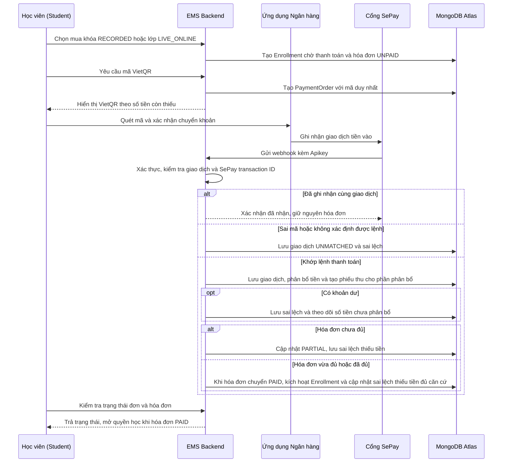
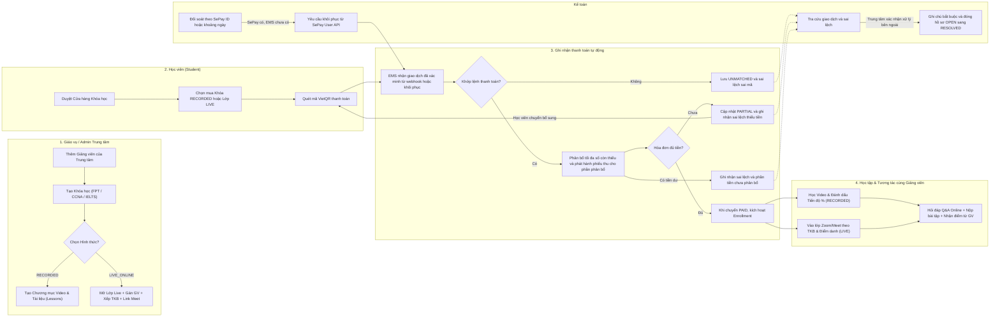
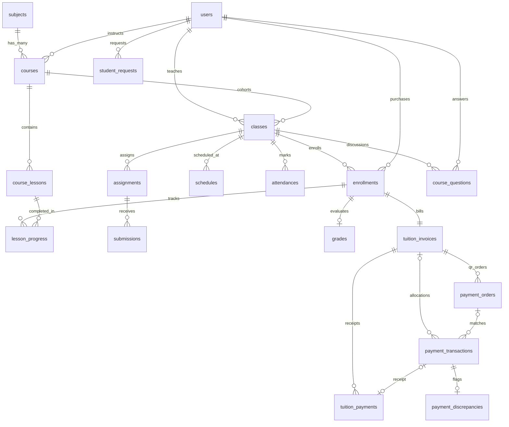

# TÀI LIỆU ĐẶC TẢ YÊU CẦU & THIẾT KẾ HỆ THỐNG
# HỆ THỐNG TRUNG TÂM QUẢN LÝ & KINH DOANH KHÓA HỌC (EDUCATION MANAGEMENT SYSTEM - EMS)
### *(Mô hình Trung tâm Đào tạo In-house: Ôn luyện Môn chuyên ngành FPT & Luyện thi Chứng chỉ Quốc tế CCNA, IELTS, TOEIC, AWS)*

> **Định hướng mô hình (Business Model — Hướng 1: In-house Training Center):**  
> Hệ thống quản lý vận hành và kinh doanh khóa học trực tuyến dành cho **Trung tâm Đào tạo có sẵn đội ngũ Giảng viên cơ hữu & thỉnh giảng**. Trung tâm làm chủ toàn bộ danh mục khóa học, chất lượng giảng dạy, lịch mở lớp và dòng tiền học phí.  
> **Hai hình thức khóa học cốt lõi (Dual Delivery Modes):**  
> 1. **`RECORDED` (Khóa học Video quay sẵn — Self-paced VOD):** Sau khi EMS xác nhận đủ học phí qua VietQR/SePay, học viên được truy cập video bài giảng theo chương mục, tải tài liệu, làm bài tập và theo dõi tiến độ hoàn thành (`0% → 100%`).
> 2. **`LIVE_ONLINE` (Khóa học có Giảng viên dạy trực tuyến — Live Interactive Cohort):** Học theo lớp/đợt mở lớp (`Class`) với Giảng viên phụ trách theo Thời khóa biểu định kỳ (qua Zoom / Google Meet), có điểm danh buổi học, giao & chấm bài tập, và **Kênh Hỏi đáp / Trao đổi trực tuyến (`Q&A / Discussion`)** trực tiếp với Giảng viên.  
> **Hai nhóm danh mục đào tạo trọng tâm (`Course Categories`):**  
> - **`FPT_SUBJECT` (Các môn chuyên ngành Đại học FPT):** `PRF192` (Lập trình C), `PRO192` (Java OOP), `CSD201` (Cấu trúc dữ liệu & Giải thuật), `DBI202` (Cơ sở dữ liệu SQL), `PRJ301` (Java Web), `SWP391` (Dự án phần mềm), `PRN231` (.NET API)...  
> - **`CERTIFICATE` (Luyện thi Chứng chỉ Quốc tế & Ngoại ngữ):** `CCNA (200-301)`, `IELTS Academic 6.5+`, `TOEIC 4 Kỹ năng 750+`, `AWS Certified Cloud Practitioner`, `JLPT N3/N2`...  
> **Quy mô nhóm phát triển:** 5 thành viên (Mỗi thành viên phụ trách 1 Actor chính từ A → Z)  
> **Công nghệ sử dụng (Tech Stack):**  
> - **Backend:** Express.js + Mongoose ODM (Node.js)  
> - **Frontend:** React + Vite + Ant Design (v5)  
> - **Database:** MongoDB Atlas (Replica Set — hỗ trợ Multi-document Transaction)  
> - **Thanh toán qua VietQR động:** SePay Webhook tự động ghi nhận tiền vào. Kế toán đối soát theo SePay ID hoặc khoảng ngày với SePay User API.
> - **DevOps / Môi trường:** Docker & Docker Compose  

---

## MỤC LỤC
1. [Phần 1: Tổng quan Mô hình Nghiệp vụ Trung tâm Khóa học (In-house Center)](#phần-1-tổng-quan-mô-hình-nghiệp-vụ-trung-tâm-khóa-học-in-house-center)
2. [Phần 2: Kiến trúc Phân quyền Hệ thống (5 Actors & Roles)](#phần-2-kiến-trúc-phân-quyền-hệ-thống-5-actors--roles)
3. [Phần 3: Đặc tả Yêu cầu Chức năng Chi tiết (12 Modules theo 5 Actor)](#phần-3-đặc-tả-yêu-cầu-chức-năng-chi-tiết-12-modules-theo-5-actor)
4. [Phần 4: Luồng Nghiệp vụ Trọng tâm (Core Business Workflows)](#phần-4-luồng-nghiệp-vụ-trọng-tâm-core-business-workflows)
5. [Phần 5: Yêu cầu Phi Chức năng (Non-Functional Requirements)](#phần-5-yêu-cầu-phi-chức-năng-non-functional-requirements)
6. [Phần 6: Thiết kế Cơ sở Dữ liệu MongoDB Atlas (Database Schema - 20 Collections)](#phần-6-thiết-kế-cơ-sở-dữ-liệu-mongodb-atlas-database-schema---20-collections)
7. [Phần 7: Danh sách RESTful API Endpoints Chuẩn hóa (Theo 5 Actor)](#phần-7-danh-sách-restful-api-endpoints-chuẩn-hóa-theo-5-actor)
8. [Phần 8: Kiến trúc Thư mục Monorepo & Cấu hình Docker](#phần-8-kiến-trúc-thư-mục-monorepo--cấu-hình-docker)
9. [Phần 9: Phân công Nhiệm vụ & Kế hoạch Triển khai (5 Thành viên theo 5 Actor)](#phần-9-phân-công-nhiệm-vụ--kế-hoạch-triển-khai-5-thành-viên-theo-5-actor)

---

## PHẦN 1: TỔNG QUAN MÔ HÌNH NGHIỆP VỤ TRUNG TÂM KHÓA HỌC (IN-HOUSE CENTER)

### 1. Định vị Sản phẩm & Lý do lựa chọn Hướng 1 (In-house Training Center)
Thay vì xây dựng một hệ thống quản lý đại học 9 học kỳ nặng nề về quy chế học vụ (ràng buộc điều kiện tiên quyết chồng chéo, xét học kỳ, đơn từ hành chính đại học), hệ thống được tinh gọn (**Scale Down**) thành **Nền tảng Quản lý & Kinh doanh Khóa học cho Trung tâm Đào tạo**:

* **Trung tâm chủ động 100% nguồn lực:**
  * Đội ngũ Giảng viên (`TEACHER`) là nhân sự cơ hữu hoặc giảng viên thỉnh giảng đã được Trung tâm tuyển chọn và cấp tài khoản trực tiếp trên hệ thống.
  * Quản trị viên / Giáo vụ (`ADMIN` / `ACADEMIC STAFF`) trực tiếp thiết kế danh mục khóa học, biên soạn chương trình, định giá học phí, mở lớp và phân công giảng viên phụ trách.
  * Học viên chuyển học phí trực tiếp vào **tài khoản ngân hàng của Trung tâm** qua VietQR. EMS ghi nhận tiền vào qua SePay Webhook. Kế toán (`ACCOUNTANT`) tra cứu hóa đơn, đối soát theo SePay ID hoặc khoảng ngày và theo dõi doanh thu cơ bản. Trung tâm hỗ trợ giao dịch sai lệch, xác minh và chuyển trả tiền ngoài EMS.

### 2. So sánh 2 Hình thức Khóa học trên Hệ thống (`RECORDED` vs. `LIVE_ONLINE`)

| Tiêu chí | Dạng 1: Khóa học Quay sẵn (`RECORDED`) | Dạng 2: Khóa học Giảng viên dạy Online (`LIVE_ONLINE`) |
| :--- | :--- | :--- |
| **Cách thức tổ chức** | Học mọi lúc mọi nơi qua hệ thống bài giảng Video & Tài liệu đính kèm được biên soạn sẵn (`course_lessons`). | Học theo lớp (`classes`) có lịch học cố định hàng tuần (Thứ/Slot) cùng Giảng viên qua nền tảng trực tuyến (`meetUrl` - Zoom / Google Meet). |
| **Luồng Mua & Kích hoạt** | Học viên chọn khóa học → Tạo đăng ký và hóa đơn → Thanh toán qua VietQR → EMS xác nhận đủ học phí và kích hoạt quyền học (`ACTIVE`). | Học viên chọn lớp đang tuyển sinh (`UPCOMING` / `ONGOING`, còn chỗ) → Thanh toán qua VietQR → EMS xác nhận đủ học phí và kích hoạt quyền học của lớp đã chọn. |
| **Theo dõi Tiến độ (`Progress`)** | Dựa trên số bài giảng video đã hoàn thành (`completedLessons / totalLessons × 100%`) kết hợp điểm bài tập tự luyện. | Dựa trên số buổi tham gia học trực tuyến (`Attendance`) + bài tập được giảng viên chấm (`Submissions`) + điểm tổng kết khóa (`Grades`). |
| **Tương tác Giảng viên - Học viên** | Đặt câu hỏi dưới từng bài học (`course_questions`), giảng viên phụ trách khóa học vào phản hồi giải đáp. | Hỏi đáp trực tiếp trong buổi học Live qua đường link phòng học trực tuyến **và** trao đổi tại bảng Thảo luận & Hỏi đáp (`Q&A`) của lớp. |
| **Ví dụ Khóa học tiêu biểu** | - *Master PRF192 - Lập trình C nền tảng (20 Video)*<br>- *PRO192 Java OOP thực chiến (24 Video)*<br>- *IELTS Foundation 5.0 - Ngữ pháp & Từ vựng* | - *Luyện thi CCNA 200-301 Live Lab cùng Chuyên gia*<br>- *IELTS Intensive 6.5+ (Lớp tối 2-4-6 chấm Writing/Speaking 1-1)*<br>- *Kèm đồ án PRJ301 / SWP391 Live Mentoring* |

### 3. Hệ thống Nhận diện & Trải nghiệm Người dùng (Design System)
* **Bảng màu chủ đạo (Color Palette):**
  * `Primary Color`: Cam năng động `#F26F21` / `#FA742B` (đặc trưng khối đào tạo công nghệ & luyện thi FPT).
  * `Neutral Background`: Nền sáng `#F0F2F5` / `#FFFFFF` giúp hiển thị rõ ràng thẻ khóa học (Course Cards), trình phát bài giảng (Lesson Player) và bảng lịch dạy.
  * `Semantic Status Colors`:
    * Xanh lục (`#52C41A`): Đã thanh toán (`PAID`), Đã hoàn thành bài học (`COMPLETED`), Có mặt (`PRESENT`), Đạt chứng nhận (`PASSED`).
    * Xanh dương (`#1677FF`): Khóa học `LIVE_ONLINE`, Đang học (`ONGOING` / `STUDYING`).
    * Tím (`#722ED1`): Khóa học `RECORDED` (Video quay sẵn), Chứng chỉ quốc tế (`CERTIFICATE`).
    * Cam/Đỏ (`#FA8C16` / `#FF4D4F`): Hóa đơn chờ thanh toán (`UNPAID`), Nộp bài muộn (`LATE_SUBMITTED`), Vắng học (`ABSENT`).

---

## PHẦN 2: KIẾN TRÚC PHÂN QUYỀN HỆ THỐNG (5 ACTORS & ROLES)

Hệ thống áp dụng cơ chế phân quyền dựa trên vai trò (**RBAC - Role-Based Access Control**) với **5 Actor chính** để 5 thành viên phát triển độc lập, rõ ràng:

```mermaid
graph TD
    EMS[Hệ thống Trung tâm Khóa học EMS] --> A1[1. SYSTEM ADMIN - Người 1]
    EMS --> A2[2. ACADEMIC STAFF - Người 2]
    EMS --> A3[3. ACCOUNTANT - Người 3]
    EMS --> A4[4. TEACHER - Người 4]
    EMS --> A5[5. STUDENT - Người 5]

    A1 --> A1_1[Xác thực JWT, Đăng ký HV & Phân quyền 5 Roles]
    A1 --> A1_2[Quản lý Tài khoản: Khóa / Mở khóa & Cấp quyền]
    A1 --> A1_3[Phát Thông báo toàn Trung tâm / theo Khóa học]
    A1 --> A1_4[Dashboard Tổng quan: Doanh thu, Số HV, Khóa bán chạy]

    A2 --> A2_1[Quản lý Hồ sơ Học viên, Giảng viên Trung tâm & Excel]
    A2 --> A2_2[Quản lý Khóa học FPT / CCNA / IELTS: RECORDED & LIVE]
    A2 --> A2_3[Biên soạn Chương mục Video Bài giảng & Mở lớp Live]
    A2 --> A2_4[Xếp lịch dạy Online theo Slot & Chống trùng Giảng viên]

    A3 --> A3_1[Tra cứu hóa đơn, phiếu thu và lịch sử giao dịch]
    A3 --> A3_2[Đối soát theo SePay ID hoặc khoảng ngày và khôi phục giao dịch bị nhỡ webhook]
    A3 --> A3_3[Theo dõi và đóng hồ sơ sai lệch]
    A3 --> A3_4[Xem báo cáo doanh thu cơ bản]

    A4 --> A4_1[Teacher Dashboard & Xem Lịch dạy Online hàng tuần]
    A4_1 --> A4_2[Quản lý Bài giảng, Tài liệu, Link phòng học Meet/Zoom]
    A4 --> A4_3[Điểm danh lớp Live, Giao bài tập & Chấm điểm/Nhận xét]
    A4 --> A4_4[Giải đáp thắc mắc Học viên trên Kênh Hỏi đáp Q&A]

    A5 --> A5_1[Cửa hàng Khóa học: Tìm kiếm & Mua khóa FPT / CCNA / IELTS]
    A5 --> A5_2[Thanh toán VietQR & Quản lý Khóa học của tôi]
    A5 --> A5_3[Học Video quay sẵn, Xem lịch Live & Theo dõi Tiến độ %]
    A5 --> A5_4[Nộp bài tập, Xem điểm & Hỏi đáp trực tuyến với Giảng viên]
```



### 1. SYSTEM ADMIN (Quản trị hệ thống — Phụ trách: Người 1)
* Quản lý xác thực đăng nhập, đăng ký tài khoản học viên mới, cấp phát JWT token và kiểm tra phân quyền cho toàn bộ 5 Actor (`UC0.1`, `UC0.2`).
* Quản lý toàn bộ tài khoản người dùng (`users`): Khóa / Mở khóa tài khoản (`status: ACTIVE / INACTIVE / SUSPENDED`), phân quyền vai trò (`UC1.1`), chặn tự khóa tài khoản quản trị hiện hành (`ADM001`).
* Phát hành thông báo toàn trung tâm hoặc gửi riêng theo từng khóa học/lớp học (`SYSTEM` - `UC10.1`).
* Theo dõi **System Admin Dashboard (`UC12.1`)**: 4 thẻ KPI tổng (Tổng Học viên, Tổng Giảng viên, Tổng Khóa học & Lớp đang mở, Tổng Doanh thu) cùng thống kê tỷ lệ hoàn thành khóa học và top khóa học bán chạy (FPT vs. Chứng chỉ CCNA/IELTS).

### 2. ACADEMIC STAFF (Giáo vụ & Quản lý Đào tạo Trung tâm — Phụ trách: Người 2)
* Quản lý danh sách **Giảng viên của Trung tâm (`TEACHER`)**: Thêm mới giảng viên vào hệ thống, cập nhật học vị, chuyên môn (VD: *Giảng viên CCNA/Networking*, *Giảng viên IELTS 8.5*, *Giảng viên Java/SE FPT*), tiểu sử và danh sách khóa học phụ trách (`UC2.1`, `UC2.2`).
* Quản lý danh sách **Học viên (`STUDENT`)**: Tìm kiếm, thêm/sửa hồ sơ, Import/Export danh sách học viên qua Excel và xem hồ sơ học tập 360° (`UC1.2`..`UC1.5`).
* **Quản lý Danh mục Khóa học (`Courses` - `UC3.1`, `UC3.2`):**
  * Thêm/sửa/ẩn khóa học với đầy đủ thuộc tính: Mã khóa học (`PRF192`, `PRO192`, `CCNA-200`, `IELTS-65`...), Danh mục (`FPT_SUBJECT` hoặc `CERTIFICATE`), Hình thức học (`RECORDED` hoặc `LIVE_ONLINE`), Học phí (`baseTuitionFee`), Giảng viên phụ trách chính, Ảnh bìa (`thumbnailUrl`) và Đề cương (`syllabusUrl`).
  * Quản lý danh sách **Bài giảng (`Course Lessons` - `UC3.3`)** cho các khóa `RECORDED` và tài liệu học tập cho các khóa `LIVE_ONLINE` (Tiêu đề bài học, thứ tự chương/bài, link Video bài giảng, tài liệu đính kèm, thời lượng phút).
* **Quản lý Lớp học Live & Xếp lịch dạy (`Classes & Schedules` - `UC4.1`..`UC5.3`):**
  * Mở các đợt lớp học trực tuyến (`Class`) cho các khóa `LIVE_ONLINE`, gán Giảng viên giảng dạy, thiết lập sĩ số tối đa (`maxStudents`) và đường dẫn phòng học trực tuyến (`meetUrl`).
  * Xếp lịch học hàng tuần theo Thứ (Thứ 2 → Chủ nhật) và Ca học (`Slot 1..6`), tự động chạy **Thuật toán Kiểm tra Xung đột Lịch** (chặn trùng lịch dạy của Giảng viên hoặc trùng phòng học ảo/offline trong cùng đợt).

### 3. ACCOUNTANT (Kế toán tài chính — Phụ trách: Người 3)
* Tra cứu **hóa đơn mua khóa học** theo học viên, khóa học và trạng thái `UNPAID`, `PARTIAL`, `PAID`. Xem số phải thu, số đã ghi nhận vào hóa đơn, số còn thiếu và phiếu thu (`UC9.1`).
* Xem lịch sử giao dịch ngân hàng (`UC9.2`), đối soát theo SePay ID hoặc khoảng ngày và khôi phục giao dịch bị nhỡ webhook từ SePay User API (`UC9.3`).
* Theo dõi, ghi chú và đóng hồ sơ sai lệch đã xử lý (`UC9.4`) và xem báo cáo doanh thu học phí cơ bản (`UC9.7`). Khi cần hỗ trợ, Trung tâm xác minh và chuyển trả tiền ngoài EMS.
* Backend sinh lệnh VietQR theo số còn thiếu, xác thực giao dịch, cộng dồn tiền vào hóa đơn, phát hành phiếu thu và kích hoạt Enrollment khi thu đủ (`UC-PAY.1`, `UC-PAY.2`). Kế toán không trực tiếp sửa số đã thu hoặc cấp quyền học từ màn hình thanh toán.

### 4. TEACHER (Giảng viên Trung tâm — Phụ trách: Người 4)
* Xem **Teacher Dashboard (`UC12.2`)**: Thống kê số khóa học `RECORDED` và số lớp `LIVE_ONLINE` đang phụ trách, tổng số học viên đang theo học, số bài tập chờ chấm, số câu hỏi Q&A mới từ học viên và lịch dạy trong tuần.
* Xem **Thời khóa biểu giảng dạy hàng tuần (`UC5.3`)** kèm đường dẫn vào lớp học trực tuyến (`Zoom / Google Meet`).
* **Quản lý Nội dung Bài giảng & Lớp học phụ trách (`UC6.1`..`UC8.3`):**
  * Cập nhật tài liệu bài giảng hoặc link phòng học trực tuyến cho lớp mình dạy.
  * Điểm danh học viên trong các buổi học `LIVE_ONLINE` (`UC6.1`) và theo dõi thống kê chuyên cần (`UC6.2`).
  * Giao bài tập thực hành / bài kiểm tra định kỳ (`Assignments` - `UC7.1`), xem danh sách bài nộp của học viên, chấm điểm và viết nhận xét chi tiết (`UC7.3`).
  * Nhập điểm đánh giá cuối khóa (`Grades` - `UC8.1`..`UC8.3`) để hệ thống xét hoàn thành khóa học (`isPassed`) cho học viên.
  * **Tương tác & Giải đáp Hỏi đáp Trực tuyến (`Q&A / Discussion` - `UC11.2`):** Trả lời các câu hỏi chuyên môn của học viên đặt ra trong từng bài giảng hoặc từng lớp học.

### 5. STUDENT (Học viên — Phụ trách: Người 5)
* **Khám phá & Mua Khóa học (`Course Marketplace / Catalog` - `UC3.4`, `UC4.3`):**
  * Duyệt danh sách khóa học theo 2 nhóm: **Môn chuyên ngành FPT (`PRF192`, `PRO192`, `CSD201`, `PRJ301`...)** và **Luyện thi Chứng chỉ (`CCNA`, `IELTS`, `TOEIC`, `AWS`...)**.
  * Lọc theo hình thức học: **Khóa học Quay sẵn (`RECORDED`)** hoặc **Khóa học Giảng viên dạy Online (`LIVE_ONLINE`)**.
  * Xem trang chi tiết khóa học: Thông tin giảng viên, đề cương các bài học, lịch học dự kiến (nếu là khóa Live) và mức học phí.
  * Bấm **"Mua khóa học / Đăng ký ngay"** và thanh toán qua **VietQR**. Hệ thống tự động mở khóa học trong mục **"Khóa học của tôi"** sau khi xác nhận đủ học phí.
* **Không gian Học tập & Theo dõi Tiến độ (`My Learning & Progress Tracking` - `UC6.3`..`UC8.4`):**
  * **Với khóa `RECORDED`:** Xem danh sách video bài giảng theo thứ tự, tải slide/source code, bấm **"Đánh dấu đã hoàn thành bài học"** → Hệ thống tự động cập nhật **Thanh tiến độ hoàn thành khóa học (`progressPercent: 0% → 100%`)**.
  * **Với khóa `LIVE_ONLINE`:** Xem Thời khóa biểu học trực tuyến hàng tuần, bấm nút **"Vào phòng học Online (Zoom/Meet)"**, xem lịch sử điểm danh chuyên cần của mình.
  * Làm và nộp bài tập trực tuyến (`Assignments & Submissions`), xem điểm số và lời nhận xét của Giảng viên.
* **Hỏi đáp & Trao đổi Online cùng Giảng viên (`Online Q&A / Discussion` - `UC11.1`):**
  * Đặt câu hỏi trực tiếp trong khóa học / lớp học (kèm đính kèm ảnh/file code nếu cần) và nhận phản hồi giải đáp từ Giảng viên phụ trách hoặc trao đổi cùng các học viên khác trong lớp.

---

## PHẦN 3: ĐẶC TẢ YÊU CẦU CHỨC NĂNG CHI TIẾT (12 MODULES THEO 5 ACTOR)

---

### PHÂN HỆ 1: QUẢN TRỊ HỆ THỐNG, TÀI KHOẢN & THÔNG BÁO TRUNG TÂM (Actor: SYSTEM ADMIN — Phụ trách: Người 1)

#### Module 1. Authentication & User Account Management (Xác thực & Quản lý Tài khoản)
* **UC0.1 - Đăng nhập & Phân quyền đa vai trò:** Mọi Actor đăng nhập bằng Email/Mã định danh và Mật khẩu. Hệ thống kiểm tra trạng thái `ACTIVE`, xác thực bằng `bcrypt` và trả về `JWT Token` kèm thông tin `role` (`ADMIN`, `ACCOUNTANT`, `TEACHER`, `STUDENT`).
* **UC0.2 - Đăng ký tài khoản Học viên mới:** Người dùng mới có thể tạo tài khoản Học viên (`STUDENT`) để mua các khóa học môn FPT hoặc chứng chỉ CCNA/IELTS trên hệ thống; hệ thống tự động sinh mã học viên (`HV2026xxxx`).
* **UC1.1 - Quản lý tài khoản người dùng (Khóa / Mở khóa & Phân quyền):** System Admin tra cứu danh sách tài khoản trên toàn hệ thống, thực hiện Khóa (`SUSPENDED`) hoặc Mở khóa (`ACTIVE`) tài khoản, cập nhật phân quyền.
  * *Ràng buộc nghiệp vụ:* Chặn thao tác tự khóa tài khoản quản trị đang đăng nhập (`ADM001`).

#### Module 2. System Broadcast & Executive Dashboard (Thông báo Hệ thống & Dashboard Tổng quan)
* **UC10.1 - Phát thông báo toàn Trung tâm / theo Lớp học:** System Admin tạo thông báo hệ thống (thông báo lịch nghỉ lễ, ra mắt khóa luyện thi IELTS/CCNA mới, bảo trì hệ thống...) gửi tới toàn bộ người dùng hoặc một lớp cụ thể.
* **UC12.1 - Xem Dashboard Tổng quan Trung tâm:**
  * **4 thẻ KPI tổng:** Tổng số Học viên, Tổng số Giảng viên, Tổng số Khóa học & Lớp đang vận hành, Tổng Doanh thu bán khóa học.
  * **Biểu đồ phân tích:** Tỷ lệ học viên theo nhóm khóa học (*Môn chuyên ngành FPT* vs. *Chứng chỉ Quốc tế CCNA/IELTS*) và tỷ lệ hoàn thành khóa học.

---

### PHÂN HỆ 2: QUẢN LÝ KHÓA HỌC (RECORDED & LIVE), GIẢNG VIÊN, MỞ LỚP & XẾP LỊCH (Actor: ACADEMIC STAFF — Phụ trách: Người 2)

#### Module 3. Student & In-house Teacher Management (Quản lý Học viên & Đội ngũ Giảng viên Trung tâm)
* **UC1.2 - Quản lý danh sách Học viên:** Tìm kiếm, lọc học viên theo khóa học đang tham gia hoặc trạng thái tài khoản; hỗ trợ phân trang server-side.
* **UC1.3 - Thêm / Sửa & Import/Export Excel Học viên:** Giáo vụ thêm mới học viên, nhập danh sách học viên từ file `.xlsx` (cho các đợt đăng ký theo nhóm/lớp) hoặc xuất danh sách học viên ra file Excel.
* **UC1.4 - Hồ sơ Học viên 360°:** Xem toàn bộ các khóa `RECORDED` và lớp `LIVE_ONLINE` học viên đã mua, tiến độ hoàn thành (`%`), lịch sử điểm danh, điểm số bài tập và lịch sử thanh toán học phí.
* **UC2.1 - Quản lý Đội ngũ Giảng viên Trung tâm:**
  * Vì hệ thống vận hành theo mô hình **Trung tâm Đào tạo (Hướng 1)**, Giáo vụ/Admin là người trực tiếp thêm mới và quản lý hồ sơ Giảng viên của trung tâm (`GV001`, `GV002`...).
  * Thông tin Giảng viên gồm: Mã GV, Họ tên, Email, SĐT, Học vị (`Thạc sĩ`, `Tiến sĩ`, `Kỹ sư`), Chuyên môn & Chứng chỉ sở hữu (VD: *CCNA/CCNP Cisco Instructor*, *IELTS 8.5 Overall*, *Senior Software Engineer - Giảng viên môn FPT*).
* **UC2.2 - Tra cứu Lịch dạy & Khóa học Giảng viên phụ trách:** Xem danh sách các khóa quay sẵn và các lớp Live mà từng giảng viên đang đảm nhận để phân bổ khối lượng giảng dạy hợp lý.

#### Module 4. Course Catalog & Lesson Curriculum Management (Quản lý Khóa học & Nội dung Bài giảng)
* **UC3.1 - Quản lý Danh mục Khóa học (`Courses`):**
  * Admin / Giáo vụ thêm mới, chỉnh sửa, kích hoạt hoặc tạm ẩn khóa học.
  * Mỗi khóa học được cấu hình rõ:
    1. **Mã & Tên khóa học:** VD: `PRF192` (*Lập trình C cơ bản cho sinh viên FPT*), `PRJ301` (*Java Web Servlet/JSP thực chiến*), `CCNA-200` (*Luyện thi chứng chỉ Cisco CCNA 200-301*), `IELTS-65` (*IELTS Intensive 4 Kỹ năng mục tiêu 6.5+*).
    2. **Danh mục (`category`):** `FPT_SUBJECT` (Môn học trường FPT) hoặc `CERTIFICATE` (Chứng chỉ Quốc tế & Ngoại ngữ).
    3. **Hình thức đào tạo (`deliveryMode`):**
       * `RECORDED`: Khóa học quay sẵn (học viên mua xong học ngay qua hệ thống bài giảng video).
       * `LIVE_ONLINE`: Khóa học có giảng viên dạy trực tuyến theo lịch cố định và hỏi đáp trực tiếp.
    4. **Thông tin định량:** Học phí niêm yết (`baseTuitionFee`), Tổng số buổi / bài học (`totalSessions`), Cấp độ (`BEGINNER`, `INTERMEDIATE`, `ADVANCED`), Giảng viên phụ trách chính (`instructorId`), Đề cương (`syllabusUrl`) và Mô tả chi tiết.
* **UC3.2 - Biên soạn Chương trình & Bài giảng (`Course Lessons`):**
  * Đối với mỗi khóa học (đặc biệt là khóa `RECORDED`), Admin / Giáo vụ (hoặc Giảng viên phụ trách) thêm danh sách các bài học (`course_lessons`) theo thứ tự `orderIndex`:
    * Tên chương (`sectionTitle`), Tiêu đề bài học (`title`), Đường dẫn Video bài giảng (`videoUrl` - YouTube/Vimeo/MP4), Tài liệu đính kèm (`materialUrl`), Thời lượng (`durationMinutes`) và cờ cho phép học thử miễn phí (`isPreview`).

#### Module 5. Live Class Cohort & Conflict-Free Schedule Management (Mở Lớp Online & Xếp Lịch Chống Trùng)
* **UC4.1 - Tổ chức Lớp học cho Khóa học:**
  * **Với khóa `RECORDED`:** Hệ thống tự động duy trì 1 lớp tự học mặc định (`Self-Paced Cohort`, không giới hạn sĩ số) để mọi học viên mua khóa `RECORDED` đều được ghi danh và đồng bộ hóa đơn học phí.
  * **Với khóa `LIVE_ONLINE`:** Giáo vụ mở các đợt lớp học trực tuyến cụ thể (VD: `CCNA-K12-LIVE`, `IELTS65-K08-LIVE`, `PRJ301-FA26-LIVE`), phân công 1 Giảng viên giảng dạy (`teacherId`), giới hạn sĩ số tối đa (`maxStudents`, VD: 25 học viên/lớp để đảm bảo chất lượng tương tác) và gắn đường dẫn phòng học trực tuyến (`meetUrl` - Google Meet / Zoom).
* **UC5.1 & UC5.2 - Xếp Lịch dạy Online & Thuật toán Kiểm tra Xung đột (`Conflict Detection`):**
  * Giáo vụ xếp lịch học định kỳ cho các lớp `LIVE_ONLINE` theo Thứ trong tuần (`Thứ 2` → `Chủ nhật`), Ca học (`Slot 1..6`) và Phòng học / Kênh phòng ảo (`room`).
  * Hệ thống tự động kiểm tra và chặn nếu phát hiện:
    1. **Trùng lịch Giảng viên:** Giảng viên đang có lịch dạy một lớp `LIVE_ONLINE` khác vào cùng Thứ và cùng Ca học trong cùng đợt mở lớp.
    2. **Trùng phòng học / Kênh phòng Zoom:** Cùng phòng/kênh đã được gán cho lớp khác cùng Thứ và Ca học.

---

### PHÂN HỆ 3: QUẢN LÝ HÓA ĐƠN MUA KHÓA HỌC, THANH TOÁN SEPAY/VIETQR & ĐỐI SOÁT (Actor: ACCOUNTANT — Phụ trách: Người 3)

#### Module 6. Course Purchase Billing & SePay Reconciliation (Thanh toán Khóa học & Kế toán)

* **UC9.1 - Quản lý hóa đơn mua khóa học (`TuitionInvoice`)**
  * Mỗi lượt đăng ký mua khóa học có phí (`RECORDED` hoặc `LIVE_ONLINE`) sinh một hóa đơn `UNPAID`. Hóa đơn có thể chuyển sang `PARTIAL` khi nhận một phần hoặc sang `PAID` khi thu đủ.
  * Kế toán tra cứu theo học viên, khóa học và trạng thái thanh toán. Chi tiết hóa đơn hiển thị số phải thu, số đã ghi nhận, số còn thiếu và các phiếu thu. `paidAmount` do backend cập nhật từ giao dịch đã xác minh.
* **UC-PAY.1 - Tạo lệnh thanh toán và sinh VietQR động**
  * Mỗi lần tạo QR, backend sinh một `PaymentOrder` với mã duy nhất gồm `EMS` và 24 ký tự hex in hoa (`A–F`, `0–9`), ví dụ `EMS0123456789ABCDEF01234567`.
  * VietQR chứa tài khoản ngân hàng của Trung tâm, số tiền còn thiếu và nội dung chuyển khoản là mã của lệnh. Một hóa đơn có thể có nhiều lệnh. Học viên có thể tạo QR mới cho phần còn thiếu sau khi một khoản chuyển thiếu đã được ghi nhận.
* **UC-PAY.2 - Ghi nhận tiền qua SePay Webhook và kích hoạt quyền học**
  * Backend nhận `POST /api/v1/payments/sepay/webhook`, xác thực `Authorization: Apikey <SEPAY_WEBHOOK_API_KEY>`, kiểm tra tài khoản nhận, loại giao dịch tiền vào, số tiền và mã thanh toán.
  * Backend lưu giao dịch ngân hàng gốc và chống xử lý trùng theo SePay transaction ID (`providerId`). Các giao dịch hợp lệ có ID khác nhau có thể cộng dồn vào cùng hóa đơn, kể cả khi dùng lại cùng mã `PaymentOrder` hợp lệ.
  * Với mỗi khoản được phân bổ, backend cộng tối đa số còn thiếu vào `paidAmount` và phát hành một phiếu thu `SEPAY-<providerId>` cho phần đã phân bổ. Khi thu đủ, backend chuyển hóa đơn sang `PAID`, kích hoạt Enrollment (`ACTIVE`) trong cùng transaction và gửi thông báo xác nhận mua khóa học. Hóa đơn `UNPAID` hoặc `PARTIAL` chưa cấp quyền học.
  * Lượt ghi danh có phí mới bắt đầu ở `PENDING_PAYMENT` và giữ chỗ trong sĩ số lớp. Khóa miễn phí cấp quyền ngay với hóa đơn 0 đồng ở trạng thái `PAID`. Các lượt đã `ACTIVE` trước khi áp dụng luồng này giữ quyền học hiện có.
* **UC9.2 - Lịch sử giao dịch ngân hàng**
  * Kế toán xem danh sách và chi tiết giao dịch ở chế độ chỉ đọc. Tra cứu theo SePay transaction ID, mã tham chiếu ngân hàng, thời gian và trạng thái. Hiển thị riêng số tiền ngân hàng thực nhận và số tiền đã phân bổ vào hóa đơn.
* **UC9.3 - Payment Reconciliation & Recovery**
  * Kế toán yêu cầu đối soát theo SePay transaction ID hoặc khoảng ngày (tối đa 31 ngày, tính cả ngày đầu và cuối). Backend đọc dữ liệu độc lập từ SePay User API, đối chiếu với bản ghi EMS và lưu vết kiểm toán. Thao tác đối soát không làm thay đổi hóa đơn.
  * Khi chọn khoảng ngày, EMS lấy danh sách giao dịch trực tiếp từ SePay User API và so sánh với MongoDB theo `providerId`. Bảng kết quả hiển thị cả giao dịch chưa tồn tại trong EMS với số tiền, thời gian, mã giao dịch, nội dung chuyển khoản và trạng thái `MATCHED`, `UNMATCHED` hoặc `DISCREPANCY`. Kế toán bấm **Ghi nhận** trên dòng `UNMATCHED` để khôi phục và tải lại kết quả.
  * Lỗi SePay được hiển thị rõ. Khi đạt giới hạn 5.000 giao dịch, EMS cảnh báo dữ liệu có thể chưa đầy đủ và yêu cầu thu hẹp khoảng ngày, đồng thời bỏ qua kết luận giao dịch chỉ có ở EMS mà thiếu ở ngân hàng.
  * Nếu SePay có giao dịch tiền vào thuộc tài khoản Trung tâm mà EMS chưa ghi nhận, Kế toán có thể yêu cầu khôi phục. Backend tải lại giao dịch từ SePay và dùng chung logic xác minh, chống trùng, phân bổ và cập nhật hóa đơn của `UC-PAY.2`.
  * Trạng thái đối soát ngân hàng tách biệt với trạng thái phân bổ trong EMS: MATCHED khi số tiền/tham chiếu khớp không có nghĩa hóa đơn đã PAID hoặc hồ sơ sai lệch đã RESOLVED.
* **UC9.4 - Theo dõi sai lệch và trạng thái xử lý (Discrepancy Monitoring & Resolution Status)**
  * Backend tự động phát hiện và lưu sai lệch. Kế toán xem danh sách `OPEN` (mặc định), lọc `RESOLVED`, xem chi tiết và ghi chú. Sau khi Trung tâm xác nhận hoàn tất xử lý ngoài EMS, chỉ Accountant được chuyển `OPEN` → `RESOLVED` với ghi chú bắt buộc (tối đa 4.000 ký tự). Không mở lại hoặc ghi đè hồ sơ đã đóng; lưu người xử lý, thời gian và ghi chú trước/sau trong audit log hiện có.
  * `UNDERPAYMENT` — Ghi nhận khoản thực nhận vào hóa đơn. Nếu tổng đã nhận còn thiếu, hóa đơn là `PARTIAL` và Enrollment chưa được kích hoạt. Khi nhận khoản bổ sung có mã hợp lệ, backend cộng dồn. Khi hóa đơn `PAID`, backend tự đánh dấu `RESOLVED` cho sai lệch thiếu tiền đã có đủ căn cứ, tức giao dịch thiếu thuộc đúng hóa đơn và toàn bộ tiền của giao dịch đó đã được phân bổ.
  * `OVERPAYMENT_OR_DUPLICATE` — Khi có khoản chuyển thừa hoặc một lần chuyển riêng nộp trùng, chỉ phân bổ tối đa phần học phí còn thiếu. Khoản dư được theo dõi qua sai lệch và xác định bằng `amount - appliedAmount`. Giữ nguyên số tiền giao dịch gốc.
  * `UNKNOWN_PAYMENT_CODE` — Khi thiếu mã, mã sai hoặc không xác định được một lệnh duy nhất, lưu giao dịch `UNMATCHED` và không gán vào hóa đơn.
  * `OPEN` là hồ sơ cần kiểm tra/hỗ trợ; `RESOLVED` là hồ sơ đã được Trung tâm xác nhận xử lý ngoài EMS hoặc được hệ thống khắc phục theo quy tắc hợp lệ. Đóng hồ sơ chỉ cập nhật `status`, `note` và audit log; không tạo RefundRequest, chuyển tiền, xóa lịch sử, sửa amount/appliedAmount/payload/trạng thái giao dịch gốc hoặc paidAmount của hóa đơn. Đây không phải bằng chứng ngân hàng đã hoàn tiền. Không tự đóng sai lệch chuyển thừa hoặc sai mã chỉ vì hóa đơn đã PAID.
* **UC9.5 - Hoàn tiền (`Out of Scope`)**
  * Việc xác minh và chuyển trả tiền thực hiện ngoài EMS. MVP không có yêu cầu hoàn tiền của học viên, tạo hồ sơ hoàn tiền, duyệt hoặc từ chối, đánh dấu hoàn tất, xác minh tài khoản nhận hoàn hay API chuyển trả tiền.
* **UC9.6 - Nhắc thanh toán (`Out of Scope`)**
  * Nhắc thu thủ công, nhắc nợ hàng loạt, công nợ theo học kỳ và quản lý trả góp nằm ngoài MVP. `PARTIAL` chỉ phản ánh số tiền thực nhận còn thiếu so với hóa đơn.
* **UC9.7 - Báo cáo doanh thu học phí cơ bản**
  * Xem tổng học phí đã thu từ các khoản đã phân bổ, số hóa đơn đã thanh toán (`PAID`) và số hóa đơn chưa thanh toán đủ (`UNPAID`, `PARTIAL`). Xem số tiền đã thu theo khoảng thời gian dựa trên ngày ghi nhận trên phiếu thu. Khoản dư hoặc tiền chưa khớp không tính vào học phí đã thu.

Ghép thủ công giao dịch sai mã, báo cáo kế toán tài chính chuyên sâu, kế toán tổng hợp, tiền lương và quản lý chi phí nằm ngoài phạm vi Accountant MVP.



---

### PHÂN HỆ 4: GIẢNG DẠY ONLINE, QUẢN LÝ BÀI GIẢNG, CHẤM BÀI & HỎI ĐÁP (Actor: TEACHER — Phụ trách: Người 4)

#### Module 7. Teacher Schedule, Live Classroom & Attendance (Lịch dạy Online & Điểm danh Lớp Live)
* **UC12.2 - Teacher Dashboard (Bảng điều khiển Giảng viên):**
  * Hiển thị tổng quan các khóa học `RECORDED` và các lớp `LIVE_ONLINE` mà giảng viên đang phụ trách, số học viên đang theo học, lịch dạy hôm nay, số bài tập học viên mới nộp và các câu hỏi Q&A chưa trả lời.
* **UC5.3 (Teacher) - Xem Lịch dạy Hàng tuần & Vào phòng dạy Online:**
  * Giảng viên xem Thời khóa biểu giảng dạy dạng lưới tuần (Thứ 2 → Chủ nhật, Slot 1 → 6), cập nhật link phòng học trực tuyến (`meetUrl` - Zoom / Google Meet) và bấm vào lớp dạy trực tiếp.
* **UC6.1 & UC6.2 - Điểm danh Học viên Lớp Live & Theo dõi Chuyên cần:**
  * Trong mỗi buổi dạy `LIVE_ONLINE`, giảng viên điểm danh học viên (`PRESENT`, `LATE`, `ABSENT_EXCUSED`, `ABSENT_UNEXCUSED`) và ghi chú tình hình tham gia buổi học.
  * Hệ thống thống kê tỷ lệ tham gia buổi học Live của từng học viên để giảng viên nắm bắt những học viên vắng nhiều cần hỗ trợ thêm.

#### Module 8. Assignments, Grading & Online Q&A Mentoring (Giao bài tập, Chấm điểm & Giải đáp Học viên)
* **UC3.3 (Teacher) - Cập nhật Bài giảng & Tài liệu Khóa học:**
  * Giảng viên phụ trách khóa học có thể bổ sung hoặc cập nhật link video bài giảng (bao gồm cả video record lại buổi dạy Live) và tài liệu thực hành (`course_lessons`) cho học viên.
* **UC7.1 & UC7.3 - Giao Bài tập Thực hành / Thi thử & Chấm điểm:**
  * Giảng viên tạo bài tập cho khóa học / lớp học (VD: *Bài Lab cấu hình định tuyến OSPF trên Packet Tracer cho khóa CCNA*, *Bài luận Writing Task 2 cho khóa IELTS*, *Bài tập lớn MVC cho môn PRJ301*) kèm file đề bài và hạn nộp (`dueDate`).
  * Xem danh sách bài nộp của học viên (`submissions`), chấm điểm thang 10 (hoặc band điểm quy đổi) và viết nhận xét chi tiết (`teacherFeedback`).
* **UC8.1 & UC8.2 - Đánh giá Tổng kết & Xét Hoàn thành Khóa học (`Grades`):**
  * Giảng viên nhập/cập nhật bảng điểm đánh giá quá trình & bài thi cuối khóa (`attendanceScore`, `midtermScore`, `finalScore`), hệ thống tự động tính `totalScore` và đánh dấu hoàn thành khóa học (`isPassed = true` khi `totalScore >= 5.0`).
* **UC11.2 - Giải đáp Thắc mắc Học viên trên Kênh Hỏi đáp (`Online Q&A / Discussion`):**
  * Giảng viên xem danh sách các câu hỏi do học viên gửi trong các khóa `RECORDED` và lớp `LIVE_ONLINE` mình dạy, nhập câu trả lời hướng dẫn chi tiết (`answer`) và đánh dấu câu hỏi đã được giải đáp (`RESOLVED`).

---

### PHÂN HỆ 5: CỔNG HỌC VIÊN — MUA KHÓA HỌC, HỌC VIDEO / LIVE, THEO DÕI TIẾN ĐỘ & HỎI ĐÁP (Actor: STUDENT — Phụ trách: Người 5)

#### Module 9. Course Storefront & Instant Enrollment (Cửa hàng Khóa học & Đăng ký Mua khóa học)
* **Nguyên tắc dữ liệu:** Một **Môn học FPT** hoặc một **Chứng chỉ** (`subjects`) có thể có **nhiều khóa học** (`courses`). Ví dụ môn `PRF192` có: *khóa video quay sẵn*, *lớp Live ôn tập & luyện đề*, *lớp kèm nhóm nhỏ*; chứng chỉ `IELTS` có: *IELTS Foundation (video)*, *IELTS Intensive 6.5+ (Live)*, *IELTS Speaking nhóm nhỏ (Live)*. Các môn FPT giữ nguyên **kỳ 1–9** của khung chương trình.
* **UC3.4 - Khám phá khóa học theo Môn / Chứng chỉ (`Course Catalog`):**
  * Trang chia **2 tab**: **Môn chuyên ngành FPT** và **Chứng chỉ quốc tế** (CCNA, IELTS, TOEIC, AWS, JLPT N3).
  * Tab Môn FPT được **gom theo Kỳ 1 → Kỳ 9** (thu gọn / mở rộng từng kỳ). Mỗi môn chỉ hiện một **thẻ gọn**: mã môn, tên, hình thức đang có (🎥 Video / 👨‍🏫 Live), *"3 khóa học · từ 620.000 đ"*.
  * Bấm vào thẻ → **trang chi tiết môn** liệt kê các khóa của môn đó, chia 2 nhóm *Khóa video quay sẵn* và *Khóa học cùng giảng viên (Live online)*; khóa đã đăng ký được đánh dấu.
  * Bấm một khóa → xem chi tiết: giảng viên, danh sách bài học (khóa video, có bài học thử), các lớp Live đang mở (lịch học & số chỗ còn trống) và học phí.
* **UC4.3 - Mua Khóa học (`RECORDED` hoặc `LIVE_ONLINE`) & Thanh toán VietQR:**
  * **Nếu chọn khóa `RECORDED`:** Học viên bấm **"Mua khóa học"** → Hệ thống tạo đăng ký và hóa đơn học phí → Thanh toán bằng **VietQR**.
  * **Nếu chọn khóa `LIVE_ONLINE`:** Học viên chọn đợt lớp Live phù hợp lịch cá nhân (hệ thống tự động kiểm tra không trùng ca học với lớp Live khác mà học viên đang theo học, kể cả lượt đang chờ thanh toán) → Thanh toán qua **VietQR**.
  * Với cả hai hình thức, đăng ký ở trạng thái `PENDING_PAYMENT` và chỉ mở quyền học (`ACTIVE`) khi hóa đơn chuyển sang `PAID` theo `UC-PAY.2`.

#### Module 10. My Learning Portal, Video Lesson Player & Progress Tracking (Không gian Học tập & Tiến độ)
* **UC12.3 - Student Dashboard (Không gian học tập):**
  * Hiển thị: số khóa đang học, tiến độ trung bình các khóa video (`%`), số buổi Live mỗi tuần, số khóa chờ thanh toán (kèm nút thanh toán), lịch Live hôm nay, bài tập sắp đến hạn và danh sách "Tiếp tục học". **Không hiển thị điểm trung bình / GPA.**
* **UC6.4 - Học Khóa Quay sẵn (`RECORDED`) & Theo dõi Tiến độ (`Lesson Progress`):**
  * Học viên mở trang **"Khóa học của tôi (`My Courses`)"**, vào trình phát bài giảng (`Course Player`):
    * Xem video bài giảng theo từng chương/bài (`course_lessons`) và tải tài liệu/source code đính kèm.
    * Bấm **"Hoàn thành bài học"** sau khi học xong mỗi bài → Hệ thống lưu vào `lesson_progress` và tự động cập nhật **Thanh tiến độ khóa học (`progressPercent`)**:
      $$\text{Tiến độ khóa học (\%)} = \frac{\text{Số bài học đã hoàn thành}}{\text{Tổng số bài học của khóa}} \times 100\%$$
* **UC5.3 & UC6.3 - Học Lớp Trực tuyến (`LIVE_ONLINE`), Lịch học & Chuyên cần nhẹ nhàng:**
  * Học viên xem **Lịch học Live** hàng tuần, bấm **"Vào phòng học Online (Google Meet)"** khi đến giờ học.
  * **Chuyên cần chỉ để học viên tự theo dõi, không xét cấm thi / điểm chuyên cần:** mỗi lớp Live đang học là một thẻ *"Đã tham gia X/Y buổi đã diễn ra"* kèm thanh tiến độ, các buổi sắp tới và lịch sử điểm danh thu gọn với 3 trạng thái: ✅ Có mặt · ⏰ Đi muộn · ➖ Vắng. Khóa video và lớp đã kết thúc không hiện ở đây.

#### Module 11. Online Assignments & Interactive Q&A (Làm Bài tập & Hỏi đáp Online)
* **UC7.2 & UC7.4 - Làm Bài tập Trực tuyến & Xem Điểm, Nhận xét của Giảng viên:**
  * Học viên xem danh sách bài tập của các khóa đang học, nộp link bài làm (GitHub / Google Drive) và xem **điểm bài tập kèm lời nhận xét** của giảng viên để biết mình làm tốt đến đâu.
* **Không có mục "Kết quả học tập / Bảng điểm / GPA"** đối với học viên: trung tâm khóa học không ràng buộc điểm số tổng kết.
* **UC11.1 - Hỏi đáp với Giảng viên (`Course Q&A`):**
  * Học viên **chỉ được gửi câu hỏi cho giảng viên đang dạy khóa học mà mình đã mở khóa** (`ACTIVE`): lớp Live → giảng viên của lớp; khóa video → giảng viên phụ trách khóa. Khóa đang chờ thanh toán chưa được hỏi.
  * Khi chọn khóa học, giao diện hiện rõ **"Gửi tới: <tên giảng viên>"**; học viên không chọn được giảng viên khác. Câu hỏi lưu kèm `teacherId`.
  * Chỉ giảng viên nhận câu hỏi được xem và trả lời; học viên nhận thông báo khi có phản hồi.
* **UC11.3 - Đơn từ (giữ nguyên):** Học viên gửi đơn xin nghỉ buổi Live, xác nhận đang theo học, phúc khảo… (`student_requests`) và theo dõi trạng thái duyệt.

---

## PHẦN 4: LUỒNG NGHIỆP VỤ TRỌNG TÂM (CORE BUSINESS WORKFLOWS)



**Quyền học:** Lượt ghi danh có phí mới giữ chỗ ở trạng thái `PENDING_PAYMENT`. Khi khoản thu đã xác minh đưa hóa đơn lên `PAID`, webhook hoặc thao tác khôi phục giao dịch kích hoạt Enrollment trong cùng transaction.

**PaymentOrder hiện tại:** Mỗi lần mở QR có thể tạo mã mới; mã cũ vẫn hợp lệ. Chống ghi nhận trùng dựa trên SePay providerId, không dựa trên số lệnh. QR cũ có thể dẫn đến chuyển thừa và được chặn phân bổ vượt công nợ. Mã hợp lệ của hóa đơn khác vẫn phân bổ theo hóa đơn chứa mã đó; EMS chưa xác minh danh tính người chuyển.

### Hỗ trợ giao dịch sai lệch ngoài EMS

1. EMS tự động phát hiện và ghi nhận sai lệch. Kế toán tra cứu giao dịch và sai lệch trên EMS.
2. Khi cần hỗ trợ, học viên chủ động liên hệ Trung tâm qua Zalo, Messenger hoặc email và cung cấp bill cùng thông tin giao dịch.
3. Trung tâm đối chiếu bill với dữ liệu SePay hoặc ngân hàng và xác minh người có quyền nhận tiền hoàn.
4. Trung tâm xử lý yêu cầu hỗ trợ và chuyển trả tiền ngoài EMS khi cần.
5. Accountant nhập kết quả xử lý và đóng hồ sơ theo `UC9.4`; hồ sơ rời danh sách OPEN nhưng còn trong lịch sử RESOLVED. Không thay đổi dữ liệu tài chính hoặc xác nhận chuyển hoàn qua ngân hàng.

**Giới hạn MVP:** EMS không ghi nhận điều chỉnh tài chính cho tiền hoàn bên ngoài. Nếu hoàn khoản đã phân bổ, paidAmount, phiếu thu và báo cáo không tự giảm; Trung tâm phải đối chiếu ngoài EMS. `amount - appliedAmount` là phần chưa phân bổ của giao dịch gốc, không phải số tiền còn phải hoàn sau xử lý bên ngoài.

---

## PHẦN 5: YÊU CẦU PHI CHỨC NĂNG (NON-FUNCTIONAL REQUIREMENTS)

1. **Bảo mật & Phân quyền (Security & RBAC):**
   * Mật khẩu băm bằng `bcryptjs` (`saltRounds >= 10`), không bao giờ trả `passwordHash` qua API.
   * Phân quyền chặt chẽ qua `authenticateJWT` và `authorizeRoles`:
     * Học viên chỉ thanh toán hóa đơn của chính mình. Với khóa đã đăng ký, quyền truy cập nội dung học hoặc phòng học yêu cầu Enrollment đã được kích hoạt sau khi thu đủ học phí.
     * Giảng viên chỉ điểm danh, giao bài, chấm điểm và trả lời Q&A trên các khóa học/lớp học được Trung tâm phân công.
     * Backend xác thực `Apikey` của SePay Webhook bằng so sánh hằng thời gian (`timingSafeEqual`). Webhook gửi lại và thao tác khôi phục dùng chung cơ chế chống ghi trùng theo SePay transaction ID.
2. **Toàn vẹn Dữ liệu Giao dịch (Transactional Integrity):**
   * Dùng **MongoDB Multi-document Transactions** và `lockVersion` cho đăng ký mua khóa học, ghi nhận tiền từ webhook hoặc khôi phục và hủy đăng ký. Lưu giao dịch, cập nhật phân bổ, hóa đơn, phiếu thu, sai lệch và kích hoạt Enrollment tương ứng trong cùng transaction ghi nhận thanh toán.
   * Giữ số tiền ngân hàng, tham chiếu và payload gốc để truy vết. Kế toán chỉ đọc dữ liệu giao dịch và số tiền đã ghi nhận trên hóa đơn.
3. **Trải nghiệm Giao diện (UI/UX):**
   * Sử dụng thống nhất bộ thư viện **Ant Design v5** (Card, Tag, Progress, Tabs, Table, Modal, Badge) tối ưu cho cả màn hình Cửa hàng khóa học (Course Catalog), Trình phát bài giảng (Course Player) và Bảng quản trị.

---

## PHẦN 6: THIẾT KẾ CƠ SỞ DỮ LIỆU MONGODB ATLAS (DATABASE SCHEMA - 22 COLLECTIONS)

Hệ thống sử dụng **MongoDB Atlas + Mongoose ODM**. Mỗi document đều có trường định danh số tự tăng `id` (`Number`, `unique`) thông qua collection `counters` để giữ URL và API thân thiện, đồng nhất.

> **Cấu trúc danh mục:** `subjects` (Môn FPT theo kỳ / Chứng chỉ) **1 — n** `courses` (khóa video hoặc Live) **1 — n** `classes` (lớp tự học `VIDEO-<courseId>` cho khóa video; các đợt khai giảng cho khóa Live).
>
> **Dữ liệu hiện tại trên Atlas** (tạo bằng `npm run seed:reset`, file `backend/scripts/course-center-seed.js`; dữ liệu đại học cũ và danh mục môn theo kỳ đã được sao lưu ra `backend/backups/`): 25 môn FPT (kỳ 1–9) + 5 chứng chỉ, 48 khóa học (30 video, 18 Live), 22 lớp Live, 180 bài giảng, 6 giảng viên, 10 học viên. Không tạo bảng điểm và giao dịch SePay giả.



### Bảng Đặc tả Chi tiết các Collections trong MongoDB Atlas

| Mã kho | Collection | Khóa / Index Unique | Tham chiếu (Logic) | Các trường dữ liệu cốt lõi | Phụ trách chính |
| :---: | :--- | :--- | :--- | :--- | :--- |
| **D1** (+D2, D3) | **`users`** | `id`, `code`, `email` | — | `passwordHash`, `fullName`, `role` (`ADMIN`, `TEACHER`, `STUDENT`, `ACCOUNTANT`), `phone`, `avatar`, `status` (`ACTIVE`, `INACTIVE`, `SUSPENDED`), `studentProfile` {`dob`, `gender`, `address`, `enrollmentYear`, `targetGoal`}, `teacherProfile` {`degree`, `specialty`, `certificates` (CCNA, IELTS 8.5...), `bio`} | **Người 1** *(Người 2 quản lý HV/GV)* |
| **D3b** | **`subjects`** | `id`, `code` | — | `name`, `category` (`FPT_SUBJECT`, `CERTIFICATE`), `term` (kỳ 1–9 của khung FPT, `null` với chứng chỉ), `credits`, `prerequisites`, `description`, `status`. Một môn / chứng chỉ có **nhiều khóa học**. | **Người 2** *(Người 5 khám phá)* |
| **D4** | **`courses`** | `id`, `courseCode` | `subjectId` → `subjects`, `instructorId` → `users` | `name`, `category` (`FPT_SUBJECT`, `CERTIFICATE`), `deliveryMode` (`RECORDED`, `LIVE_ONLINE`), `level` (`BEGINNER`, `INTERMEDIATE`, `ADVANCED`), `credits`, `totalSessions`, `baseTuitionFee` (VND), `thumbnailUrl`, `syllabusUrl`, `description`, `status` (`ACTIVE`, `INACTIVE`) | **Người 2** |
| **D4b** | **`course_lessons`** | `id`, (`courseId`, `orderIndex`) | `courseId` → `courses` | `sectionTitle` (Tên chương), `orderIndex` (Thứ tự bài), `title` (Tên bài giảng), `videoUrl` (Link video bài giảng), `materialUrl` (Slide/Code), `durationMinutes`, `isPreview` (`Boolean`) | **Người 2** & **Người 4** |
| **D5** | **`classes`** | `id`, `classCode` | `courseId` → `courses`, `teacherId` → `users` | `semester` = đợt khai giảng (VD `KG-2026-11-02`; `SELF_PACED` với lớp tự học `VIDEO-<courseId>` của khóa video), `maxStudents`, `meetUrl` (Link Zoom / Google Meet cho lớp `LIVE_ONLINE`), `status` (`UPCOMING`, `ONGOING`, `COMPLETED`) | **Người 2** |
| **D6** | **`enrollments`** | `id`, (`classId`, `studentId`) | `classId` → `classes`, `studentId` → `users` | `enrolledAt`, `progressPercent` (`0..100`), `completedLessonsCount`, `status` (`PENDING_PAYMENT`, `ACTIVE`, `DROPPED`). Backend chuyển sang `ACTIVE` khi hóa đơn thu đủ. | **Người 2** & **Người 5** (Mua khóa học) |
| **D6b** | **`lesson_progress`** | `id`, (`enrollmentId`, `lessonId`) | `enrollmentId` → `enrollments`, `lessonId` → `course_lessons` | `studentId`, `courseId`, `isCompleted` (`Boolean`), `completedAt`, `lastWatchedSecond` | **Người 5** |
| **D7** | **`schedules`** | `id` | `classId` → `classes` | `dayOfWeek` (`2..8`), `shift` (`Slot 1..6`), `startTime` (`HH:mm`), `endTime` (`HH:mm`), `room` (Phòng học / Kênh Online) | **Người 2** |
| **D8** | **`attendances`** | `id`, (`classId`, `studentId`, `sessionDate`) | `classId` → `classes`, `studentId` → `users` | `sessionDate`, `status` (`PRESENT`, `ABSENT_EXCUSED`, `ABSENT_UNEXCUSED`, `LATE`), `note` | **Người 4** *(Người 5 xem)* |
| **D9** | **`assignments`** | `id` | `classId` → `classes` | `title`, `description`, `fileUrl`, `dueDate`, `createdAt` | **Người 4** *(Người 5 xem)* |
| **D10** | **`submissions`** | `id`, (`assignmentId`, `studentId`) | `assignmentId` → `assignments`, `studentId` → `users` | `fileUrl`, `content`, `submittedAt`, `status` (`SUBMITTED`, `LATE_SUBMITTED`), `score` (`0..10`), `teacherFeedback` | **Người 5** nộp & **Người 4** chấm |
| **D11** | **`grades`** | `id`, `enrollmentId` | `enrollmentId` → `enrollments` | `attendanceScore`, `midtermScore`, `finalScore`, `totalScore`, `isPassed`, `isBanned`. **Không hiển thị cho học viên** (trung tâm không xét điểm tổng kết); dữ liệu mẫu không tạo bảng điểm. | **Người 4** *(quản trị)* |
| **D12** | **`tuition_invoices`** | `id`, `enrollmentId` | `studentId` → `users`, `enrollmentId` → `enrollments` | `amount`, `paidAmount` (tổng tiền đã phân bổ), `status` (`UNPAID`, `PARTIAL`, `PAID`), `paidAt`, `createdAt`, `dueDate` (tương thích dữ liệu hiện có) | **Người 3** *(Người 5 thanh toán)* |
| **D12b** | **`tuition_payments`** | `id`, `receiptNo` | `invoiceId` → `tuition_invoices`, `transactionId` → `payment_transactions` (có thể trống với phiếu thu lịch sử) | `amount` (số tiền đã phân bổ), `method` (`CASH`, `BANK_TRANSFER`, `VIETQR`), `note`, `collectedById`, `paidAt`. Biên lai SePay dùng `SEPAY-<providerId>`. | **Người 3** |
| **D13** | **`notifications`** | `id` | `userId` → `users` (`null` = toàn hệ thống) | `title`, `message`, `type` (`ASSIGNMENT`, `GRADE`, `TUITION`, `REQUEST`, `SYSTEM` — thông báo Hỏi đáp dùng `SYSTEM`), `isRead`, `createdAt` | **Người 1, 3, 4, 5** |
| **D14** | **`course_questions`** | `id` | `studentId` → `users`, `classId` → `classes`, `teacherId` → `users` (giảng viên đang dạy khóa của học viên), `lessonId` → `course_lessons` | `questionTitle`, `questionContent`, `attachmentUrl`, `status` (`PENDING`, `ANSWERED`, `RESOLVED`), `teacherAnswer`, `answeredById`, `answeredAt`, `createdAt` | **Người 5** hỏi & **Người 4** (đúng giảng viên) trả lời |
| **D14b** | **`student_requests`** | `id` | `studentId` → `users`, `classId` → `classes` (có thể trống) | `requestType` (`ABSENCE`, `REMARK`, `CONFIRMATION`), `sessionDate`, `reason`, `attachmentUrl`, `status` (`PENDING`, `APPROVED`, `REJECTED`), `adminResponse`, `createdAt` | **Người 5** gửi & **Người 2** duyệt |
| **D15** | **`payment_orders`** | `id`, `code` (`EMS` + 24 ký tự hex in hoa) | `invoiceId` → `tuition_invoices` (một hóa đơn có thể có nhiều lệnh) | `amount` (số còn thiếu lúc tạo QR), `createdById`, `createdAt` | **Người 3** & **Người 5** |
| **D16** | **`payment_transactions`** | `id`, `providerId` (SePay transaction ID) | `orderId` → `payment_orders`, `invoiceId` → `tuition_invoices` (có thể trống với giao dịch chưa khớp) | `reference`, `amount` (tiền ngân hàng thực nhận), `appliedAmount` (tiền đã phân bổ), `status` (`MATCHED`, `UNMATCHED`, `DISCREPANCY`), `payload`, `occurredAt` | **Người 3** (SePay Webhook và khôi phục) |
| **D17** | **`payment_discrepancies`** | `id`, `transactionId` | `transactionId` → `payment_transactions` | `reason` (`UNDERPAYMENT`, `OVERPAYMENT_OR_DUPLICATE`, `UNKNOWN_PAYMENT_CODE`), `status` (`OPEN`, `RESOLVED`), `note`. `OPEN`: cần kiểm tra; `RESOLVED`: đã xử lý hồ sơ, không xác nhận hoàn tiền. `note` bắt buộc khi đóng thủ công; audit log giữ người xử lý và thời gian. Backend tự cập nhật sai lệch thiếu tiền đủ căn cứ theo `UC9.4`. | **Người 3** |
| **D18** | **`refund_requests`** *(dữ liệu lịch sử, ngoài MVP)* | `id`, `reference` | `transactionId` → `payment_transactions` | `amount`, `reason`, `status` (`PENDING`, `APPROVED`, `REJECTED`, `COMPLETED`), `requestedById`, `completedAt`. Giữ dữ liệu khi còn phụ thuộc lịch sử. | Tương thích dữ liệu |
| **D19** | **`payment_audit_logs`** | `id` | `actorId` → `users` | `action`, `entityId`, `details`, `createdAt` (Append-only) | **Người 3** |

---

## PHẦN 7: DANH SÁCH RESTFUL API ENDPOINTS CHUẨN HÓA (THEO 5 ACTOR)

Mọi API tuân thủ tiền tố `/api/v1` và trả về cấu trúc JSON đồng nhất:
```json
{
  "success": true,
  "message": "Thao tác thực hiện thành công",
  "data": {}
}
```

### 1. Cụm API của SYSTEM ADMIN (Phụ trách: Người 1)
* `POST /api/v1/auth/login` — Đăng nhập cho mọi Actor, trả về JWT Token và Role.
* `POST /api/v1/auth/register` — Đăng ký tài khoản Học viên (`STUDENT`) mới trên hệ thống.
* `GET /api/v1/auth/me` — Lấy thông tin cá nhân và phân quyền của phiên đăng nhập hiện tại.
* `GET /api/v1/users` — Danh sách toàn bộ tài khoản người dùng trên hệ thống (`ADMIN`).
* `PATCH /api/v1/users/:id/status` — Khóa / Mở khóa tài khoản và cập nhật Role, chặn tự khóa `ADM001` (`ADMIN`).
* `POST /api/v1/notifications` — Phát thông báo toàn trung tâm hoặc gửi tới học viên theo khóa/lớp (`ADMIN`).
* `GET /api/v1/analytics/admin-overview` — Thống kê KPI tổng quan trung tâm (Tổng HV, Tổng GV, Số khóa/lớp đang mở, Tổng doanh thu, Tỷ lệ hoàn thành khóa học).

### 2. Cụm API của ACADEMIC STAFF / Quản lý Đào tạo Trung tâm (Phụ trách: Người 2)
* `GET /api/v1/teachers` / `POST /api/v1/teachers` / `PUT /api/v1/teachers/:id` — Quản lý đội ngũ Giảng viên của Trung tâm (thêm giảng viên, cập nhật chuyên môn FPT / CCNA / IELTS).
* `GET /api/v1/students` / `POST /api/v1/students` / `PUT /api/v1/students/:id` — Quản lý danh sách Học viên.
* `POST /api/v1/students/import` / `GET /api/v1/students/export-excel` — Import/Export danh sách học viên bằng file Excel.
* `GET /api/v1/students/:id/profile-360` — Xem hồ sơ 360° của học viên (các khóa đã mua, tiến độ, điểm số, trạng thái và số tiền còn thiếu của hóa đơn theo lượt mua).
* `GET /api/v1/courses` / `POST /api/v1/courses` / `PUT /api/v1/courses/:id` / `DELETE /api/v1/courses/:id` — Quản lý danh mục Khóa học (`category: FPT_SUBJECT | CERTIFICATE`, `deliveryMode: RECORDED | LIVE_ONLINE`, `baseTuitionFee`...).
* `GET /api/v1/courses/:id/lessons` / `POST /api/v1/courses/:id/lessons` / `PUT /api/v1/lessons/:lessonId` / `DELETE /api/v1/lessons/:lessonId` — Quản lý chương trình bài giảng video & tài liệu của khóa học (`course_lessons`).
* `GET /api/v1/classes` / `POST /api/v1/classes` / `PUT /api/v1/classes/:id` — Mở lớp học trực tuyến (`LIVE_ONLINE`) hoặc lớp tự học (`RECORDED`), gán Giảng viên và link phòng học `meetUrl`.
* `POST /api/v1/classes/:id/enrollments` — Ghi danh học viên vào lớp (kiểm tra sĩ số & trùng lịch, tự sinh `Grade` và `TuitionInvoice`). Quyền học của lượt mua được cấp sau khi hóa đơn thu đủ theo `UC-PAY.2`.
* `POST /api/v1/classes/:id/schedules` — Xếp lịch dạy định kỳ theo Thứ/Slot kèm thuật toán kiểm tra chống trùng lịch Giảng viên & phòng học.

### 3. Cụm API của ACCOUNTANT / Kế toán Trung tâm (Phụ trách: Người 3)
* `GET /api/v1/tuition-invoices` — Tra cứu hóa đơn theo học viên, khóa học và trạng thái `UNPAID / PARTIAL / PAID`.
* `GET /api/v1/tuition-invoices/:id` — Xem chi tiết hóa đơn kèm danh sách phiếu thu, lệnh thanh toán VietQR và giao dịch SePay.
* `GET /api/v1/tuition-payments/:id/receipt` — Xem phiếu thu theo lần phân bổ tiền vào hóa đơn.
* `POST /api/v1/payment-orders` & `GET /api/v1/payment-orders/:id` — Tạo VietQR cho số còn thiếu và kiểm tra trạng thái thanh toán.
* `POST /api/v1/payments/sepay/webhook` — Backend xác thực SePay (`Authorization: Apikey <key>`), lưu giao dịch, cộng tiền vào hóa đơn và kích hoạt Enrollment khi thu đủ.
* `GET /api/v1/accountant/transactions` & `GET /api/v1/accountant/transactions/:id` — Tra cứu lịch sử và chi tiết giao dịch chỉ đọc, gồm tiền thực nhận và tiền đã phân bổ.
* `POST /api/v1/accountant/reconcile` — Kế toán đối soát một giao dịch theo `providerId` với SePay User API.
* `POST /api/v1/accountant/reconcile-range` — Kế toán chọn ngày bắt đầu và kết thúc để lấy giao dịch từ SePay, tìm giao dịch bị nhỡ webhook và hiển thị kết quả cùng cảnh báo dữ liệu chưa đầy đủ.
* `POST /api/v1/accountant/recover-payment` — Kế toán yêu cầu khôi phục theo `providerId`. Backend lấy dữ liệu từ SePay và dùng chung logic ghi nhận webhook.
* `GET /api/v1/accountant/discrepancies` — Tra cứu sai lệch, lọc OPEN/RESOLVED và lý do.
* `PATCH /api/v1/accountant/discrepancies/:id` — Chỉ ACCOUNTANT; body `{ status: "RESOLVED", note: "Kết quả xử lý" }`, chỉ OPEN → RESOLVED. Ghi chú bắt buộc, tối đa 4.000 ký tự; từ chối trường khác, hồ sơ đã đóng trả 409. Không phụ thuộc RefundRequest; không thay đổi dữ liệu tài chính.
* `GET /api/v1/analytics/tuition-revenue` & `GET /api/v1/accountant/summary` — Xem học phí đã thu theo ngày trên phiếu thu (`from` và `to` theo định dạng `YYYY-MM-DD`, múi giờ Việt Nam) và số hóa đơn đã hoặc chưa thanh toán đủ theo `UC9.7`.

### 4. Cụm API của TEACHER / Giảng viên Trung tâm (Phụ trách: Người 4)
* `GET /api/v1/teacher/dashboard` — Dashboard Giảng viên: số khóa `RECORDED`, số lớp `LIVE_ONLINE`, học viên đang học, bài tập chờ chấm, Q&A mới, cảnh báo chuyên cần và lịch dạy tuần.
* `GET /api/v1/schedules/my-schedule` — Xem thời khóa biểu giảng dạy hàng tuần kèm `meetUrl` của lớp `LIVE_ONLINE`.
* `PATCH /api/v1/teacher/classes/:id` — Cập nhật hoặc xóa `meetUrl` cho lớp `LIVE_ONLINE` được phân công.
* `GET /api/v1/classes?deliveryMode=LIVE_ONLINE` — Lọc lớp trực tuyến được phân công để điểm danh và quản lý bài tập.
* `GET /api/v1/classes/:id/attendances?date=YYYY-MM-DD` & `POST /api/v1/classes/:id/attendances` — Điểm danh học viên trong các buổi học `LIVE_ONLINE` được phân công.
* `GET /api/v1/classes/:id/attendance-summary` — Xem thống kê chuyên cần của lớp phụ trách.
* `POST /api/v1/classes/:id/assignments` — Giao bài tập thực hành / đề thi thử mới cho lớp.
* `GET /api/v1/assignments/:id/submissions` & `PATCH /api/v1/submissions/:id/grade` — Xem bài nộp của học viên, chấm điểm và gửi nhận xét `teacherFeedback`.
* `GET /api/v1/courses/:id/lessons`, `POST /api/v1/courses/:id/lessons` & `PUT /api/v1/lessons/:id` — Xem và cập nhật bài giảng/tài liệu của khóa học được phân công.
* `GET /api/v1/classes/:id/grades` & `PUT /api/v1/classes/:id/grades` — Xem và nhập điểm cuối khóa; backend tự tính `totalScore`, `isPassed` và giữ nguyên trạng thái cấm thi do hệ thống quản lý.
* `GET /api/v1/questions` & `PATCH /api/v1/questions/:id/answer` — Xem câu hỏi trong lớp/khóa học được phân công và trả lời học viên.

### 5. Cụm API của STUDENT / Học viên (Phụ trách: Người 5)
* `GET /api/v1/subjects?category=FPT_SUBJECT|CERTIFICATE` — Danh sách gọn Môn FPT (sắp theo kỳ) / Chứng chỉ, kèm số khóa học, giá thấp nhất và hình thức đang có.
* `GET /api/v1/subjects/:id` — Chi tiết một môn / chứng chỉ và **tất cả khóa học** của nó (video / Live), số bài giảng, số lớp đang mở, đánh dấu khóa đã đăng ký.
* `GET /api/v1/courses/catalog/:id` — Chi tiết một khóa học: bài học (chỉ lộ video học thử), các lớp Live đang mở và số chỗ còn trống.
* `POST /api/v1/courses/:id/purchase` *(hoặc đăng ký vào lớp qua Enrollment + PaymentOrder)* — Đăng ký mua khóa học `RECORDED` hoặc chọn lớp `LIVE_ONLINE` và nhận hóa đơn thanh toán VietQR.
* `GET /api/v1/analytics/student-overview` — Không gian học tập: số khóa đang học, tiến độ khóa video, số buổi Live mỗi tuần, số khóa chờ thanh toán, câu hỏi chờ trả lời, bài tập sắp đến hạn (không có GPA).
* `GET /api/v1/my-courses` *(hoặc `GET /api/v1/classes?status=ONGOING`)* — Danh sách các khóa học `RECORDED` và lớp `LIVE_ONLINE` của học viên kèm tiến độ hoàn thành (`progressPercent`).
* `POST /api/v1/lessons/:lessonId/complete` — Đánh dấu hoàn thành 1 bài giảng video và tự động tính lại `% tiến độ` khóa học.
* `GET /api/v1/schedules/my-schedule` — Xem Thời khóa biểu học trực tuyến hàng tuần kèm link phòng học (`meetUrl`) và trạng thái điểm danh từng buổi.
* `GET /api/v1/attendances/my-report` — Chuyên cần các lớp `LIVE_ONLINE` đang học: `attendedSessions`/`recordedSessions`, buổi sắp tới, lịch sử điểm danh (không xét cấm thi).
* `GET /api/v1/classes/:id/assignments` & `POST /api/v1/assignments/:id/submit` — Xem danh sách bài tập, nộp bài trực tuyến và xem điểm/nhận xét của Giảng viên.
* `GET /api/v1/questions/my-teachers` — Danh sách khóa đã mở khóa kèm **giảng viên nhận câu hỏi** (giảng viên lớp Live / giảng viên phụ trách khóa video).
* `GET /api/v1/questions` & `POST /api/v1/questions` — Xem câu hỏi của mình; gửi câu hỏi (chỉ cho khóa `ACTIVE`, backend tự gán `teacherId`). Chỉ đúng giảng viên đó được trả lời (`PATCH /questions/:id/answer`).
* `GET /api/v1/requests` & `POST /api/v1/requests` — Gửi và theo dõi đơn từ.
* `GET /api/v1/notifications` & `PATCH /api/v1/notifications/:id/read` — Xem và đánh dấu đã đọc thông báo.

---

## PHẦN 8: KIẾN TRÚC THƯ MỤC MONOREPO & CẤU HÌNH DOCKER

```text
Education-Management-System/
├── docker-compose.yml              # MongoDB 7 replica set cục bộ (dự phòng khi chạy offline)
├── Education Management System.md  # Tài liệu đặc tả & thiết kế hệ thống chi tiết
├── backend/                        # Ứng dụng Backend Express.js + Mongoose
│   ├── package.json
│   ├── .env                        # MONGODB_URI (MongoDB Atlas), JWT_SECRET, Cấu hình VietQR/SePay
│   ├── scripts/
│   │   └── seed.js                 # Khởi tạo dữ liệu mẫu Trung tâm Khóa học trên MongoDB Atlas
│   ├── test/                       # Bộ kiểm thử tự động (node:test + mongodb-memory-server)
│   └── src/
│       ├── config/                 # db.js (Kết nối MongoDB Atlas, withTransaction, lockDoc), upload.js
│       ├── models/                 # Mongoose Models (Users, Courses, CourseLessons, Classes, Enrollments...)
│       ├── middlewares/            # auth.middleware.js, role.middleware.js
│       ├── utils/                  # formatResponse.js, gradeHelper.js, vietqrGenerator.js, query.js
│       ├── modules/
│       │   ├── users-courses/          # Người 1 & Người 2: Auth, Users, Students, Teachers, Courses & Lessons
│       │   ├── classes-schedules/      # Người 2 & Người 5: Classes, Enrollments, Mua khóa học, Schedules
│       │   ├── accountant/             # Người 3: Payment Orders, SePay Webhook, lịch sử, sai lệch, đối soát theo SePay ID hoặc khoảng ngày & khôi phục
│       │   ├── grades-tuition/         # Người 3 & Người 4: Hóa đơn, phiếu thu, báo cáo học phí cơ bản, Grades & Kết quả khóa học
│       │   ├── attendance-assignments/ # Người 4 & Người 5: Attendances, Assignments, Submissions, Progress
│       │   └── notifications-analytics/# Người 1, 4 & 5: Dashboards, Notifications, Hỏi đáp Q&A
│       └── app.js
└── frontend/                       # Ứng dụng Frontend React + Vite + Ant Design v5
    ├── package.json
    ├── vite.config.js
    └── src/
        ├── api/                    # Axios client gắn JWT Token
        ├── context/                # AuthContext quản lý trạng thái đăng nhập
        ├── components/             # Sidebar (theo Role), Header, TuitionModals (VietQR)
        ├── layouts/                # MainLayout
        └── pages/
            ├── auth/               # LoginPage
            ├── dashboard/          # DashboardPage (Admin, Accountant, Teacher, Student)
            ├── users-courses/      # StudentsPage, TeachersPage, CoursesPage (Quản lý & Cửa hàng Khóa học)
            ├── classes-schedules/  # ClassesPage, SchedulePage (Lịch học Live & Link Meet/Zoom)
            ├── attendance-assignments/ # AttendancePage, AssignmentsPage
            ├── grades-tuition/     # GradesPage, TuitionPage, PaymentOperationsPage, TuitionReportPage
            └── notifications-analytics/ # RequestsPage (Hỏi đáp Q&A & Hỗ trợ), NotificationsPage
```

---

## PHẦN 9: PHÂN CÔNG NHIỆM VỤ & KẾ HOẠCH TRIỂN KHAI (5 THÀNH VIÊN THEO 5 ACTOR)

| Thành viên | Actor Phụ trách | Các Collection Làm việc Chính | Đầu việc Trọng tâm (Core Tasks) |
| :--- | :--- | :--- | :--- |
| **Người 1 (Team Leader)** | **SYSTEM ADMIN** | `users`, `notifications`, `counters` | - Quản trị hạ tầng Monorepo, kết nối MongoDB Atlas (`db.js`), JWT Auth & Middleware phân quyền.<br>- Đăng nhập, đăng ký tài khoản Học viên mới, Khóa/Mở khóa tài khoản người dùng.<br>- Phát thông báo toàn Trung tâm (`SYSTEM`) & Xây dựng **System Admin Dashboard** (4 KPI tổng, thống kê khóa học FPT vs. Chứng chỉ CCNA/IELTS). |
| **Người 2** | **ACADEMIC STAFF (Quản lý Đào tạo Trung tâm)** | `users` (HV/GV), `courses`, `course_lessons`, `classes`, `schedules` | - Quản lý đội ngũ Giảng viên của Trung tâm (chuyên môn FPT, CCNA, IELTS) & danh sách Học viên (Import/Export Excel, Hồ sơ 360°).<br>- **Quản lý Khóa học (`RECORDED` & `LIVE_ONLINE`)** và biên soạn chương mục Bài giảng Video (`course_lessons`).<br>- Mở các lớp `LIVE_ONLINE` (gắn Giảng viên, `meetUrl`, sĩ số) và **Xếp lịch dạy kèm thuật toán chống trùng lịch Giảng viên/Phòng học**. |
| **Người 3** | **ACCOUNTANT (Kế toán Tài chính)** | `tuition_invoices`, `tuition_payments`, `payment_orders`, `payment_transactions`, `payment_discrepancies`, `payment_audit_logs` | - Tra cứu hóa đơn mua khóa học (`UNPAID` / `PARTIAL` / `PAID`) và phiếu thu.<br>- Tích hợp VietQR và SePay Webhook để backend xác thực, chống trùng, cộng dồn, phát hành phiếu thu và kích hoạt Enrollment khi thu đủ.<br>- Xây dựng lịch sử giao dịch, theo dõi và đóng hồ sơ sai lệch kèm ghi chú/audit log, đối soát theo SePay ID hoặc khoảng ngày với SePay User API, khôi phục webhook bị nhỡ và báo cáo doanh thu cơ bản. |
| **Người 4** | **TEACHER (Giảng viên Trung tâm)** | `attendances`, `assignments`, `submissions`, `grades`, `course_questions` | - Xây dựng **Teacher Dashboard** và xem **Lịch dạy trực tuyến hàng tuần** (kèm link phòng học Zoom/Meet).<br>- Điểm danh học viên trong các buổi dạy `LIVE_ONLINE` và theo dõi thống kê chuyên cần.<br>- Giao bài tập thực hành / bài thi thử (FPT Lab, CCNA Lab, IELTS Writing), chấm điểm & nhận xét bài nộp của học viên.<br>- Nhập điểm đánh giá cuối khóa và **Trả lời câu hỏi của học viên trên kênh Hỏi đáp Trực tuyến (`Q&A`)**. |
| **Người 5** | **STUDENT (Học viên)** | Truy vấn & tương tác trên `courses`, `course_lessons`, `enrollments`, `lesson_progress`, `schedules`, `submissions`, `course_questions` | - Xây dựng **Cửa hàng Khóa học (`Course Catalog`)**: Lọc khóa học Môn FPT / Chứng chỉ CCNA-IELTS, chọn mua khóa `RECORDED` hoặc lớp `LIVE_ONLINE` và quét mã **VietQR**. <br>- Xây dựng **Không gian Học tập (`My Learning`)**: Xem Video bài giảng, đánh dấu hoàn thành bài học để cập nhật **Thanh tiến độ (`0% - 100%`)**, xem Lịch học Live & vào phòng Zoom/Meet.<br>- Nộp bài tập trực tuyến, xem điểm/nhận xét của Giảng viên và **Đặt câu hỏi trao đổi trực tuyến (`Q&A`) với Giảng viên**. |
