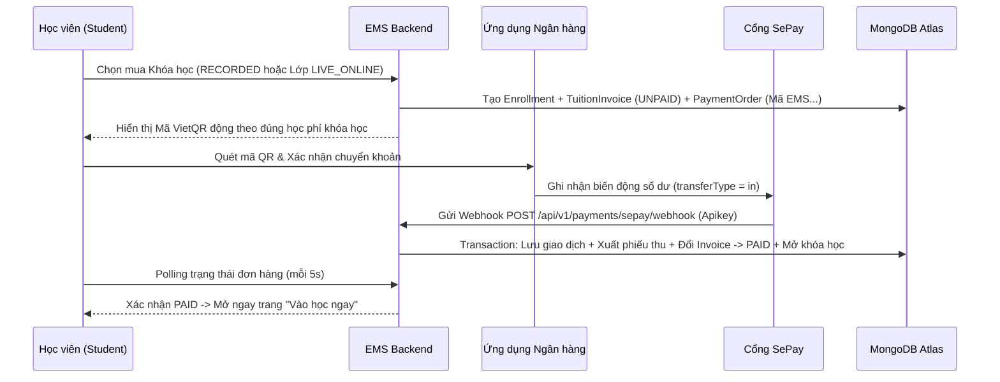
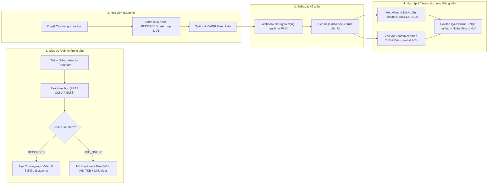
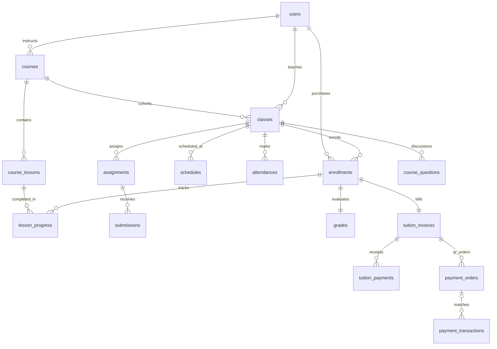

# TÀI LIỆU ĐẶC TẢ YÊU CẦU & THIẾT KẾ HỆ THỐNG
# HỆ THỐNG TRUNG TÂM QUẢN LÝ & KINH DOANH KHÓA HỌC (EDUCATION MANAGEMENT SYSTEM - EMS)
### *(Mô hình Trung tâm Đào tạo In-house: Ôn luyện Môn chuyên ngành FPT & Luyện thi Chứng chỉ Quốc tế CCNA, IELTS, TOEIC, AWS)*

> **Định hướng mô hình (Business Model — Hướng 1: In-house Training Center):**  
> Hệ thống quản lý vận hành và kinh doanh khóa học trực tuyến dành cho **Trung tâm Đào tạo có sẵn đội ngũ Giảng viên cơ hữu & thỉnh giảng**. Trung tâm làm chủ toàn bộ danh mục khóa học, chất lượng giảng dạy, lịch mở lớp và dòng tiền học phí.  
> **Hai hình thức khóa học cốt lõi (Dual Delivery Modes):**  
> 1. **`RECORDED` (Khóa học Video quay sẵn — Self-paced VOD):** Học viên mua khóa học, kích hoạt tức thì sau khi thanh toán VietQR/SePay, học qua hệ thống video bài giảng theo chương mục, tải tài liệu, làm bài tập và theo dõi thanh tiến độ hoàn thành (`0% → 100%`).  
> 2. **`LIVE_ONLINE` (Khóa học có Giảng viên dạy trực tuyến — Live Interactive Cohort):** Học theo lớp/đợt mở lớp (`Class`) với Giảng viên phụ trách theo Thời khóa biểu định kỳ (qua Zoom / Google Meet), có điểm danh buổi học, giao & chấm bài tập, và **Kênh Hỏi đáp / Trao đổi trực tuyến (`Q&A / Discussion`)** trực tiếp với Giảng viên.  
> **Hai nhóm danh mục đào tạo trọng tâm (`Course Categories`):**  
> - **`FPT_SUBJECT` (Các môn chuyên ngành Đại học FPT):** `PRF192` (Lập trình C), `PRO192` (Java OOP), `CSD201` (Cấu trúc dữ liệu & Giải thuật), `DBI202` (Cơ sở dữ liệu SQL), `PRJ301` (Java Web), `SWP391` (Dự án phần mềm), `PRN231` (.NET API)...  
> - **`CERTIFICATE` (Luyện thi Chứng chỉ Quốc tế & Ngoại ngữ):** `CCNA (200-301)`, `IELTS Academic 6.5+`, `TOEIC 4 Kỹ năng 750+`, `AWS Certified Cloud Practitioner`, `JLPT N3/N2`...  
> **Quy mô nhóm phát triển:** 5 thành viên (Mỗi thành viên phụ trách 1 Actor chính từ A → Z)  
> **Công nghệ sử dụng (Tech Stack):**  
> - **Backend:** Express.js + Mongoose ODM (Node.js)  
> - **Frontend:** React + Vite + Ant Design (v5)  
> - **Database:** MongoDB Atlas (Replica Set — hỗ trợ Multi-document Transaction)  
> - **Cổng thanh toán:** VietQR động + SePay Webhook tự động gạch nợ & đối soát  
> - **DevOps / Môi trường:** Docker & Docker Compose  

---

## MỤC LỤC
1. [Phần 1: Tổng quan Mô hình Nghiệp vụ Trung tâm Khóa học (In-house Center)](#phần-1-tổng-quan-mô-hình-nghiệp-vụ-trung-tâm-khóa-học-in-house-center)
2. [Phần 2: Kiến trúc Phân quyền Hệ thống (5 Actors & Roles)](#phần-2-kiến-trúc-phân-quyền-hệ-thống-5-actors--roles)
3. [Phần 3: Đặc tả Yêu cầu Chức năng Chi tiết (12 Modules theo 5 Actor)](#phần-3-đặc-tả-yêu-cầu-chức-năng-chi-tiết-12-modules-theo-5-actor)
4. [Phần 4: Luồng Nghiệp vụ Trọng tâm (Core Business Workflows)](#phần-4-luồng-nghiệp-vụ-trọng-tâm-core-business-workflows)
5. [Phần 5: Yêu cầu Phi Chức năng (Non-Functional Requirements)](#phần-5-yêu-cầu-phi-chức-năng-non-functional-requirements)
6. [Phần 6: Thiết kế Cơ sở Dữ liệu MongoDB Atlas (Database Schema - 20 Collections)](#phần-6-thiết-kế-cơ-sở-dữ-liệu-mongodb-atlas-database-schema---20-collections)
7. [Phần 7: Danh sách RESTful API Endpoints Chuẩn hóa (Theo 5 Actor)](#phần-7-danh-sách-restful-api-endpoints-chuẩn-hóa-theo-5-actor)
8. [Phần 8: Kiến trúc Thư mục Monorepo & Cấu hình Docker](#phần-8-kiến-trúc-thư-mục-monorepo--cấu-hình-docker)
9. [Phần 9: Phân công Nhiệm vụ & Kế hoạch Triển khai (5 Thành viên theo 5 Actor)](#phần-9-phân-công-nhiệm-vụ--kế-hoạch-triển-khai-5-thành-viên-theo-5-actor)

---

## PHẦN 1: TỔNG QUAN MÔ HÌNH NGHIỆP VỤ TRUNG TÂM KHÓA HỌC (IN-HOUSE CENTER)

### 1. Định vị Sản phẩm & Lý do lựa chọn Hướng 1 (In-house Training Center)
Thay vì xây dựng một hệ thống quản lý đại học 9 học kỳ nặng nề về quy chế học vụ (ràng buộc điều kiện tiên quyết chồng chéo, xét học kỳ, đơn từ hành chính đại học), hệ thống được tinh gọn (**Scale Down**) thành **Nền tảng Quản lý & Kinh doanh Khóa học cho Trung tâm Đào tạo**:

* **Trung tâm chủ động 100% nguồn lực:**
  * Đội ngũ Giảng viên (`TEACHER`) là nhân sự cơ hữu hoặc giảng viên thỉnh giảng đã được Trung tâm tuyển chọn và cấp tài khoản trực tiếp trên hệ thống.
  * Quản trị viên / Giáo vụ (`ADMIN` / `ACADEMIC STAFF`) trực tiếp thiết kế danh mục khóa học, biên soạn chương trình, định giá học phí, mở lớp và phân công giảng viên phụ trách.
  * Dòng tiền mua khóa học chảy trực tiếp về **tài khoản ngân hàng của Trung tâm** thông qua **VietQR động & SePay Webhook**, giúp Kế toán (`ACCOUNTANT`) đối soát minh bạch, tức thời mà không phát sinh bài toán chia doanh thu phức tạp như mô hình chợ cộng đồng (Marketplace).

### 2. So sánh 2 Hình thức Khóa học trên Hệ thống (`RECORDED` vs. `LIVE_ONLINE`)

| Tiêu chí | Dạng 1: Khóa học Quay sẵn (`RECORDED`) | Dạng 2: Khóa học Giảng viên dạy Online (`LIVE_ONLINE`) |
| :--- | :--- | :--- |
| **Cách thức tổ chức** | Học mọi lúc mọi nơi qua hệ thống bài giảng Video & Tài liệu đính kèm được biên soạn sẵn (`course_lessons`). | Học theo lớp (`classes`) có lịch học cố định hàng tuần (Thứ/Slot) cùng Giảng viên qua nền tảng trực tuyến (`meetUrl` - Zoom / Google Meet). |
| **Luồng Mua & Kích hoạt** | Học viên chọn khóa học → Tạo đơn & Hóa đơn → Quét VietQR (SePay) → **Kích hoạt quyền học ngay lập tức (`ACTIVE`)**. | Học viên chọn khóa học & chọn Lớp đang tuyển sinh (`UPCOMING` / `ONGOING`, còn chỗ `< maxStudents`) → Quét VietQR → Ghi danh vào lớp. |
| **Theo dõi Tiến độ (`Progress`)** | Dựa trên số bài giảng video đã hoàn thành (`completedLessons / totalLessons × 100%`) kết hợp điểm bài tập tự luyện. | Dựa trên số buổi tham gia học trực tuyến (`Attendance`) + bài tập được giảng viên chấm (`Submissions`) + điểm tổng kết khóa (`Grades`). |
| **Tương tác Giảng viên - Học viên** | Đặt câu hỏi dưới từng bài học (`course_questions`), giảng viên phụ trách khóa học vào phản hồi giải đáp. | Hỏi đáp trực tiếp trong buổi học Live qua đường link phòng học trực tuyến **và** trao đổi tại bảng Thảo luận & Hỏi đáp (`Q&A`) của lớp. |
| **Ví dụ Khóa học tiêu biểu** | - *Master PRF192 - Lập trình C nền tảng (20 Video)*<br>- *PRO192 Java OOP thực chiến (24 Video)*<br>- *IELTS Foundation 5.0 - Ngữ pháp & Từ vựng* | - *Luyện thi CCNA 200-301 Live Lab cùng Chuyên gia*<br>- *IELTS Intensive 6.5+ (Lớp tối 2-4-6 chấm Writing/Speaking 1-1)*<br>- *Kèm đồ án PRJ301 / SWP391 Live Mentoring* |

### 3. Hệ thống Nhận diện & Trải nghiệm Người dùng (Design System)
* **Bảng màu chủ đạo (Color Palette):**
  * `Primary Color`: Cam năng động `#F26F21` / `#FA742B` (đặc trưng khối đào tạo công nghệ & luyện thi FPT).
  * `Neutral Background`: Nền sáng `#F0F2F5` / `#FFFFFF` giúp hiển thị rõ ràng thẻ khóa học (Course Cards), trình phát bài giảng (Lesson Player) và bảng lịch dạy.
  * `Semantic Status Colors`:
    * Xanh lục (`#52C41A`): Đã thanh toán (`PAID`), Đã hoàn thành bài học (`COMPLETED`), Có mặt (`PRESENT`), Đạt chứng nhận (`PASSED`).
    * Xanh dương (`#1677FF`): Khóa học `LIVE_ONLINE`, Đang học (`ONGOING` / `STUDYING`).
    * Tím (`#722ED1`): Khóa học `RECORDED` (Video quay sẵn), Chứng chỉ quốc tế (`CERTIFICATE`).
    * Cam/Đỏ (`#FA8C16` / `#FF4D4F`): Hóa đơn chờ thanh toán (`UNPAID`), Nộp bài muộn (`LATE_SUBMITTED`), Vắng học (`ABSENT`).

---

## PHẦN 2: KIẾN TRÚC PHÂN QUYỀN HỆ THỐNG (5 ACTORS & ROLES)

Hệ thống áp dụng cơ chế phân quyền dựa trên vai trò (**RBAC - Role-Based Access Control**) với **5 Actor chính** để 5 thành viên phát triển độc lập, rõ ràng:

```mermaid
graph TD
    EMS[Hệ thống Trung tâm Khóa học EMS] --> A1[1. SYSTEM ADMIN - Người 1]
    EMS --> A2[2. ACADEMIC STAFF - Người 2]
    EMS --> A3[3. ACCOUNTANT - Người 3]
    EMS --> A4[4. TEACHER - Người 4]
    EMS --> A5[5. STUDENT - Người 5]

    A1 --> A1_1[Xác thực JWT, Đăng ký HV & Phân quyền 5 Roles]
    A1 --> A1_2[Quản lý Tài khoản: Khóa / Mở khóa & Cấp quyền]
    A1 --> A1_3[Phát Thông báo toàn Trung tâm / theo Khóa học]
    A1 --> A1_4[Dashboard Tổng quan: Doanh thu, Số HV, Khóa bán chạy]

    A2 --> A2_1[Quản lý Hồ sơ Học viên, Giảng viên Trung tâm & Excel]
    A2 --> A2_2[Quản lý Khóa học FPT / CCNA / IELTS: RECORDED & LIVE]
    A2 --> A2_3[Biên soạn Chương mục Video Bài giảng & Mở lớp Live]
    A2 --> A2_4[Xếp lịch dạy Online theo Slot & Chống trùng Giảng viên]

    A3 --> A3_1[Quản lý Đơn mua Khóa học & Công nợ Học phí]
    A3 --> A3_2[Thanh toán Tự động VietQR + SePay Webhook kích hoạt khóa học]
    A3 --> A3_3[Đối soát SePay API, Xử lý sai lệch & Hoàn tiền]
    A3 --> A3_4[Nhắc thanh toán đơn chờ & Báo cáo Doanh thu Khóa học]

    A4 --> A4_1[Teacher Dashboard & Xem Lịch dạy Online hàng tuần]
    A4_1 --> A4_2[Quản lý Bài giảng, Tài liệu, Link phòng học Meet/Zoom]
    A4 --> A4_3[Điểm danh lớp Live, Giao bài tập & Chấm điểm/Nhận xét]
    A4 --> A4_4[Giải đáp thắc mắc Học viên trên Kênh Hỏi đáp Q&A]

    A5 --> A5_1[Cửa hàng Khóa học: Tìm kiếm & Mua khóa FPT / CCNA / IELTS]
    A5 --> A5_2[Thanh toán VietQR tức thì & Quản lý Khóa học của tôi]
    A5 --> A5_3[Học Video quay sẵn, Xem lịch Live & Theo dõi Tiến độ %]
    A5 --> A5_4[Nộp bài tập, Xem điểm & Hỏi đáp trực tuyến với Giảng viên]
```



### 1. SYSTEM ADMIN (Quản trị hệ thống — Phụ trách: Người 1)
* Quản lý xác thực đăng nhập, đăng ký tài khoản học viên mới, cấp phát JWT token và kiểm tra phân quyền cho toàn bộ 5 Actor (`UC0.1`, `UC0.2`).
* Quản lý toàn bộ tài khoản người dùng (`users`): Khóa / Mở khóa tài khoản (`status: ACTIVE / INACTIVE / SUSPENDED`), phân quyền vai trò (`UC1.1`), chặn tự khóa tài khoản quản trị hiện hành (`ADM001`).
* Phát hành thông báo toàn trung tâm hoặc gửi riêng theo từng khóa học/lớp học (`SYSTEM` - `UC10.1`).
* Theo dõi **System Admin Dashboard (`UC12.1`)**: 4 thẻ KPI tổng (Tổng Học viên, Tổng Giảng viên, Tổng Khóa học & Lớp đang mở, Tổng Doanh thu) cùng thống kê tỷ lệ hoàn thành khóa học và top khóa học bán chạy (FPT vs. Chứng chỉ CCNA/IELTS).

### 2. ACADEMIC STAFF (Giáo vụ & Quản lý Đào tạo Trung tâm — Phụ trách: Người 2)
* Quản lý danh sách **Giảng viên của Trung tâm (`TEACHER`)**: Thêm mới giảng viên vào hệ thống, cập nhật học vị, chuyên môn (VD: *Giảng viên CCNA/Networking*, *Giảng viên IELTS 8.5*, *Giảng viên Java/SE FPT*), tiểu sử và danh sách khóa học phụ trách (`UC2.1`, `UC2.2`).
* Quản lý danh sách **Học viên (`STUDENT`)**: Tìm kiếm, thêm/sửa hồ sơ, Import/Export danh sách học viên qua Excel và xem hồ sơ học tập 360° (`UC1.2`..`UC1.5`).
* **Quản lý Danh mục Khóa học (`Courses` - `UC3.1`, `UC3.2`):**
  * Thêm/sửa/ẩn khóa học với đầy đủ thuộc tính: Mã khóa học (`PRF192`, `PRO192`, `CCNA-200`, `IELTS-65`...), Danh mục (`FPT_SUBJECT` hoặc `CERTIFICATE`), Hình thức học (`RECORDED` hoặc `LIVE_ONLINE`), Học phí (`baseTuitionFee`), Giảng viên phụ trách chính, Ảnh bìa (`thumbnailUrl`) và Đề cương (`syllabusUrl`).
  * Quản lý danh sách **Bài giảng (`Course Lessons` - `UC3.3`)** cho các khóa `RECORDED` và tài liệu học tập cho các khóa `LIVE_ONLINE` (Tiêu đề bài học, thứ tự chương/bài, link Video bài giảng, tài liệu đính kèm, thời lượng phút).
* **Quản lý Lớp học Live & Xếp lịch dạy (`Classes & Schedules` - `UC4.1`..`UC5.3`):**
  * Mở các đợt lớp học trực tuyến (`Class`) cho các khóa `LIVE_ONLINE`, gán Giảng viên giảng dạy, thiết lập sĩ số tối đa (`maxStudents`) và đường dẫn phòng học trực tuyến (`meetUrl`).
  * Xếp lịch học hàng tuần theo Thứ (Thứ 2 → Chủ nhật) và Ca học (`Slot 1..6`), tự động chạy **Thuật toán Kiểm tra Xung đột Lịch** (chặn trùng lịch dạy của Giảng viên hoặc trùng phòng học ảo/offline trong cùng đợt).

### 3. ACCOUNTANT (Kế toán tài chính — Phụ trách: Người 3)
* Quản lý **Đơn đăng ký / Hóa đơn mua khóa học (`tuition_invoices`)**: Tra cứu theo học viên, khóa học, loại khóa học (`RECORDED` / `LIVE_ONLINE`), trạng thái thanh toán (`UNPAID`, `PARTIAL`, `PAID`), quá hạn thanh toán (`UC9.1`).
* Vận hành luồng **Thanh toán tự động qua VietQR & SePay Webhook (`UC-PAY.1`, `UC-PAY.2`)**:
  * Khi học viên chọn mua khóa học (hoặc giáo vụ ghi danh), hệ thống khởi tạo `Enrollment` + `TuitionInvoice` (`UNPAID`).
  * Học viên bấm thanh toán → Sinh `PaymentOrder` kèm mã QR ngân hàng động (`EMS...`).
  * Khi tiền vào tài khoản ngân hàng của Trung tâm, SePay bắn Webhook → Backend xác thực chữ ký API Key, tự động chuyển hóa đơn sang `PAID`, xuất biên lai điện tử `SEPAY-<id>` và **tự động mở khóa quyền học (`Enrollment.status = 'ACTIVE'`)** cho học viên!
* Theo dõi lịch sử giao dịch ngân hàng chỉ đọc (`UC9.2`), đối soát độc lập với SePay User API theo giao dịch hoặc khoảng ngày (`UC9.3`), xử lý các giao dịch sai lệch/chuyển thừa/sai nội dung (`UC9.4`), phê duyệt & hoàn tất yêu cầu hoàn tiền (`UC9.5`), gửi thông báo nhắc thanh toán (`UC9.6`) và xem Báo cáo Doanh thu Trung tâm theo tháng/năm/khóa học (`UC9.7`).

### 4. TEACHER (Giảng viên Trung tâm — Phụ trách: Người 4)
* Xem **Teacher Dashboard (`UC12.2`)**: Thống kê số khóa học `RECORDED` và số lớp `LIVE_ONLINE` đang phụ trách, tổng số học viên đang theo học, số bài tập chờ chấm, số câu hỏi Q&A mới từ học viên và lịch dạy trong tuần.
* Xem **Thời khóa biểu giảng dạy hàng tuần (`UC5.3`)** kèm đường dẫn vào lớp học trực tuyến (`Zoom / Google Meet`).
* **Quản lý Nội dung Bài giảng & Lớp học phụ trách (`UC6.1`..`UC8.3`):**
  * Cập nhật tài liệu bài giảng, video record lại buổi học hoặc link phòng học trực tuyến cho lớp mình dạy.
  * Điểm danh học viên trong các buổi học `LIVE_ONLINE` (`UC6.1`) và theo dõi thống kê chuyên cần (`UC6.2`).
  * Giao bài tập thực hành / bài kiểm tra định kỳ (`Assignments` - `UC7.1`), xem danh sách bài nộp của học viên, chấm điểm và viết nhận xét chi tiết (`UC7.3`).
  * Nhập điểm đánh giá cuối khóa (`Grades` - `UC8.1`..`UC8.3`) để hệ thống xét hoàn thành khóa học (`isPassed`) cho học viên.
  * **Tương tác & Giải đáp Hỏi đáp Trực tuyến (`Q&A / Discussion` - `UC11.2`):** Trả lời các câu hỏi chuyên môn của học viên đặt ra trong từng bài giảng hoặc từng lớp học.

### 5. STUDENT (Học viên — Phụ trách: Người 5)
* **Khám phá & Mua Khóa học (`Course Marketplace / Catalog` - `UC3.4`, `UC4.3`):**
  * Duyệt danh sách khóa học theo 2 nhóm: **Môn chuyên ngành FPT (`PRF192`, `PRO192`, `CSD201`, `PRJ301`...)** và **Luyện thi Chứng chỉ (`CCNA`, `IELTS`, `TOEIC`, `AWS`...)**.
  * Lọc theo hình thức học: **Khóa học Quay sẵn (`RECORDED`)** hoặc **Khóa học Giảng viên dạy Online (`LIVE_ONLINE`)**.
  * Xem trang chi tiết khóa học: Thông tin giảng viên, đề cương các bài học, lịch học dự kiến (nếu là khóa Live) và mức học phí.
  * Bấm **"Mua khóa học / Đăng ký ngay"** → Quét mã **VietQR** thanh toán → Hệ thống tự động mở khóa học trong mục **"Khóa học của tôi"**.
* **Không gian Học tập & Theo dõi Tiến độ (`My Learning & Progress Tracking` - `UC6.3`..`UC8.4`):**
  * **Với khóa `RECORDED`:** Xem danh sách video bài giảng theo thứ tự, tải slide/source code, bấm **"Đánh dấu đã hoàn thành bài học"** → Hệ thống tự động cập nhật **Thanh tiến độ hoàn thành khóa học (`progressPercent: 0% → 100%`)**.
  * **Với khóa `LIVE_ONLINE`:** Xem Thời khóa biểu học trực tuyến hàng tuần, bấm nút **"Vào phòng học Online (Zoom/Meet)"**, xem lịch sử điểm danh chuyên cần của mình.
  * Làm và nộp bài tập trực tuyến (`Assignments & Submissions`), xem điểm số và lời nhận xét của Giảng viên.
* **Hỏi đáp & Trao đổi Online cùng Giảng viên (`Online Q&A / Discussion` - `UC11.1`):**
  * Đặt câu hỏi trực tiếp trong khóa học / lớp học (kèm đính kèm ảnh/file code nếu cần) và nhận phản hồi giải đáp từ Giảng viên phụ trách hoặc trao đổi cùng các học viên khác trong lớp.

---

## PHẦN 3: ĐẶC TẢ YÊU CẦU CHỨC NĂNG CHI TIẾT (12 MODULES THEO 5 ACTOR)

---

### PHÂN HỆ 1: QUẢN TRỊ HỆ THỐNG, TÀI KHOẢN & THÔNG BÁO TRUNG TÂM (Actor: SYSTEM ADMIN — Phụ trách: Người 1)

#### Module 1. Authentication & User Account Management (Xác thực & Quản lý Tài khoản)
* **UC0.1 - Đăng nhập & Phân quyền đa vai trò:** Mọi Actor đăng nhập bằng Email/Mã định danh và Mật khẩu. Hệ thống kiểm tra trạng thái `ACTIVE`, xác thực bằng `bcrypt` và trả về `JWT Token` kèm thông tin `role` (`ADMIN`, `ACCOUNTANT`, `TEACHER`, `STUDENT`).
* **UC0.2 - Đăng ký tài khoản Học viên mới:** Người dùng mới có thể tạo tài khoản Học viên (`STUDENT`) để mua các khóa học môn FPT hoặc chứng chỉ CCNA/IELTS trên hệ thống; hệ thống tự động sinh mã học viên (`HV2026xxxx`).
* **UC1.1 - Quản lý tài khoản người dùng (Khóa / Mở khóa & Phân quyền):** System Admin tra cứu danh sách tài khoản trên toàn hệ thống, thực hiện Khóa (`SUSPENDED`) hoặc Mở khóa (`ACTIVE`) tài khoản, cập nhật phân quyền.
  * *Ràng buộc nghiệp vụ:* Chặn thao tác tự khóa tài khoản quản trị đang đăng nhập (`ADM001`).

#### Module 2. System Broadcast & Executive Dashboard (Thông báo Hệ thống & Dashboard Tổng quan)
* **UC10.1 - Phát thông báo toàn Trung tâm / theo Lớp học:** System Admin tạo thông báo hệ thống (thông báo lịch nghỉ lễ, ra mắt khóa luyện thi IELTS/CCNA mới, bảo trì hệ thống...) gửi tới toàn bộ người dùng hoặc một lớp cụ thể.
* **UC12.1 - Xem Dashboard Tổng quan Trung tâm:**
  * **4 thẻ KPI tổng:** Tổng số Học viên, Tổng số Giảng viên, Tổng số Khóa học & Lớp đang vận hành, Tổng Doanh thu bán khóa học.
  * **Biểu đồ phân tích:** Tỷ lệ học viên theo nhóm khóa học (*Môn chuyên ngành FPT* vs. *Chứng chỉ Quốc tế CCNA/IELTS*) và tỷ lệ hoàn thành khóa học.

---

### PHÂN HỆ 2: QUẢN LÝ KHÓA HỌC (RECORDED & LIVE), GIẢNG VIÊN, MỞ LỚP & XẾP LỊCH (Actor: ACADEMIC STAFF — Phụ trách: Người 2)

#### Module 3. Student & In-house Teacher Management (Quản lý Học viên & Đội ngũ Giảng viên Trung tâm)
* **UC1.2 - Quản lý danh sách Học viên:** Tìm kiếm, lọc học viên theo khóa học đang tham gia hoặc trạng thái tài khoản; hỗ trợ phân trang server-side.
* **UC1.3 - Thêm / Sửa & Import/Export Excel Học viên:** Giáo vụ thêm mới học viên, nhập danh sách học viên từ file `.xlsx` (cho các đợt đăng ký theo nhóm/lớp) hoặc xuất danh sách học viên ra file Excel.
* **UC1.4 - Hồ sơ Học viên 360°:** Xem toàn bộ các khóa `RECORDED` và lớp `LIVE_ONLINE` học viên đã mua, tiến độ hoàn thành (`%`), lịch sử điểm danh, điểm số bài tập và lịch sử thanh toán học phí.
* **UC2.1 - Quản lý Đội ngũ Giảng viên Trung tâm:**
  * Vì hệ thống vận hành theo mô hình **Trung tâm Đào tạo (Hướng 1)**, Giáo vụ/Admin là người trực tiếp thêm mới và quản lý hồ sơ Giảng viên của trung tâm (`GV001`, `GV002`...).
  * Thông tin Giảng viên gồm: Mã GV, Họ tên, Email, SĐT, Học vị (`Thạc sĩ`, `Tiến sĩ`, `Kỹ sư`), Chuyên môn & Chứng chỉ sở hữu (VD: *CCNA/CCNP Cisco Instructor*, *IELTS 8.5 Overall*, *Senior Software Engineer - Giảng viên môn FPT*).
* **UC2.2 - Tra cứu Lịch dạy & Khóa học Giảng viên phụ trách:** Xem danh sách các khóa quay sẵn và các lớp Live mà từng giảng viên đang đảm nhận để phân bổ khối lượng giảng dạy hợp lý.

#### Module 4. Course Catalog & Lesson Curriculum Management (Quản lý Khóa học & Nội dung Bài giảng)
* **UC3.1 - Quản lý Danh mục Khóa học (`Courses`):**
  * Admin / Giáo vụ thêm mới, chỉnh sửa, kích hoạt hoặc tạm ẩn khóa học.
  * Mỗi khóa học được cấu hình rõ:
    1. **Mã & Tên khóa học:** VD: `PRF192` (*Lập trình C cơ bản cho sinh viên FPT*), `PRJ301` (*Java Web Servlet/JSP thực chiến*), `CCNA-200` (*Luyện thi chứng chỉ Cisco CCNA 200-301*), `IELTS-65` (*IELTS Intensive 4 Kỹ năng mục tiêu 6.5+*).
    2. **Danh mục (`category`):** `FPT_SUBJECT` (Môn học trường FPT) hoặc `CERTIFICATE` (Chứng chỉ Quốc tế & Ngoại ngữ).
    3. **Hình thức đào tạo (`deliveryMode`):**
       * `RECORDED`: Khóa học quay sẵn (học viên mua xong học ngay qua hệ thống bài giảng video).
       * `LIVE_ONLINE`: Khóa học có giảng viên dạy trực tuyến theo lịch cố định và hỏi đáp trực tiếp.
    4. **Thông tin định량:** Học phí niêm yết (`baseTuitionFee`), Tổng số buổi / bài học (`totalSessions`), Cấp độ (`BEGINNER`, `INTERMEDIATE`, `ADVANCED`), Giảng viên phụ trách chính (`instructorId`), Đề cương (`syllabusUrl`) và Mô tả chi tiết.
* **UC3.2 - Biên soạn Chương trình & Bài giảng (`Course Lessons`):**
  * Đối với mỗi khóa học (đặc biệt là khóa `RECORDED`), Admin / Giáo vụ (hoặc Giảng viên phụ trách) thêm danh sách các bài học (`course_lessons`) theo thứ tự `orderIndex`:
    * Tên chương (`sectionTitle`), Tiêu đề bài học (`title`), Đường dẫn Video bài giảng (`videoUrl` - YouTube/Vimeo/MP4), Tài liệu đính kèm (`materialUrl`), Thời lượng (`durationMinutes`) và cờ cho phép học thử miễn phí (`isPreview`).

#### Module 5. Live Class Cohort & Conflict-Free Schedule Management (Mở Lớp Online & Xếp Lịch Chống Trùng)
* **UC4.1 - Tổ chức Lớp học cho Khóa học:**
  * **Với khóa `RECORDED`:** Hệ thống tự động duy trì 1 lớp tự học mặc định (`Self-Paced Cohort`, không giới hạn sĩ số) để mọi học viên mua khóa `RECORDED` đều được ghi danh và đồng bộ hóa đơn học phí.
  * **Với khóa `LIVE_ONLINE`:** Giáo vụ mở các đợt lớp học trực tuyến cụ thể (VD: `CCNA-K12-LIVE`, `IELTS65-K08-LIVE`, `PRJ301-FA26-LIVE`), phân công 1 Giảng viên giảng dạy (`teacherId`), giới hạn sĩ số tối đa (`maxStudents`, VD: 25 học viên/lớp để đảm bảo chất lượng tương tác) và gắn đường dẫn phòng học trực tuyến (`meetUrl` - Google Meet / Zoom).
* **UC5.1 & UC5.2 - Xếp Lịch dạy Online & Thuật toán Kiểm tra Xung đột (`Conflict Detection`):**
  * Giáo vụ xếp lịch học định kỳ cho các lớp `LIVE_ONLINE` theo Thứ trong tuần (`Thứ 2` → `Chủ nhật`), Ca học (`Slot 1..6`) và Phòng học / Kênh phòng ảo (`room`).
  * Hệ thống tự động kiểm tra và chặn nếu phát hiện:
    1. **Trùng lịch Giảng viên:** Giảng viên đang có lịch dạy một lớp `LIVE_ONLINE` khác vào cùng Thứ và cùng Ca học trong cùng đợt mở lớp.
    2. **Trùng phòng học / Kênh phòng Zoom:** Cùng phòng/kênh đã được gán cho lớp khác cùng Thứ và Ca học.

---

### PHÂN HỆ 3: QUẢN LÝ HÓA ĐƠN MUA KHÓA HỌC, THANH TOÁN SEPAY/VIETQR & ĐỐI SOÁT (Actor: ACCOUNTANT — Phụ trách: Người 3)

#### Module 6. Course Purchase Billing & Automated SePay Reconciliation (Thanh toán Khóa học & Kế toán)
* **UC9.1 - Quản lý Hóa đơn Mua Khóa học & Công nợ (`Tuition Invoices`):**
  * Mọi lượt đăng ký mua khóa học (`RECORDED` hoặc `LIVE_ONLINE`) của học viên đều tự động sinh 1 hóa đơn trong `tuition_invoices` (`UNPAID` → `PARTIAL` → `PAID`).
  * Kế toán tra cứu theo mã/tên học viên, tên khóa học, hình thức khóa học, trạng thái thanh toán; xem chi tiết phiếu thu và giao dịch ngân hàng. Kế toán không chỉnh sửa tay số tiền đã thu (`paidAmount`).
* **UC-PAY.1 - Khởi tạo Lệnh Thanh toán Khóa học & Sinh mã VietQR động:**
  * Khi học viên bấm **"Mua khóa học / Thanh toán ngay"**, hệ thống tạo `PaymentOrder` với mã giao dịch duy nhất (`EMS` + 24 ký tự hex) và trả về ảnh mã QR ngân hàng động (`VietQR`) chứa đúng số tiền học phí của khóa học và nội dung chuyển khoản.
* **UC-PAY.2 - Xác nhận Thanh toán Tự động qua SePay Webhook & Mở khóa Khóa học:**
  * Khi học viên chuyển khoản thành công, SePay gửi Webhook (`POST /api/v1/payments/sepay/webhook`) kèm `Authorization: Apikey <SEPAY_WEBHOOK_API_KEY>`.
  * Trong 1 Multi-document Transaction của MongoDB Atlas:
    1. Kiểm tra chống trùng lặp (`providerId` unique) và lưu giao dịch gốc vào `payment_transactions`.
    2. Khớp mã lệnh `EMS...`, cập nhật hóa đơn `tuition_invoices` sang `PAID` (hoặc `PARTIAL` nếu chuyển thiếu).
    3. Sinh phiếu thu điện tử `SEPAY-<providerId>` trong `tuition_payments`.
    4. **Kích hoạt quyền vào học (`Enrollment.status = 'ACTIVE'`)** và gửi thông báo xác nhận mua khóa học thành công tới học viên.
* **UC9.2, UC9.3 & UC9.4 - Lịch sử Giao dịch, Đối soát SePay API & Xử lý Sai lệch:**
  * Kế toán xem toàn bộ lịch sử giao dịch ngân hàng, chạy đối soát độc lập với SePay User API theo từng giao dịch hoặc theo khoảng ngày (`≤ 31 ngày`), và xử lý các trường hợp chuyển sai nội dung / chuyển thừa (`payment_discrepancies`) kèm ghi vết kiểm toán (`payment_audit_logs`).
* **UC9.5, UC9.6 & UC9.7 - Hoàn tiền, Nhắc thanh toán & Báo cáo Doanh thu Trung tâm:**
  * Quản lý quy trình hoàn tiền (`PENDING → APPROVED/REJECTED → COMPLETED`) cho các khoản chuyển dư.
  * Gửi thông báo nhắc thanh toán (`TUITION`) cho các đơn đăng ký khóa học chưa hoàn tất học phí.
  * Xem Dashboard & Báo cáo Doanh thu Trung tâm theo tháng/năm, so sánh doanh thu giữa nhóm khóa học **Môn FPT (`FPT_SUBJECT`)** và **Chứng chỉ Quốc tế (`CERTIFICATE`)**, cũng như giữa khóa **Quay sẵn (`RECORDED`)** và **Dạy trực tiếp (`LIVE_ONLINE`)**.



---

### PHÂN HỆ 4: GIẢNG DẠY ONLINE, QUẢN LÝ BÀI GIẢNG, CHẤM BÀI & HỎI ĐÁP (Actor: TEACHER — Phụ trách: Người 4)

#### Module 7. Teacher Schedule, Live Classroom & Attendance (Lịch dạy Online & Điểm danh Lớp Live)
* **UC12.2 - Teacher Dashboard (Bảng điều khiển Giảng viên):**
  * Hiển thị tổng quan các khóa học `RECORDED` và các lớp `LIVE_ONLINE` mà giảng viên đang phụ trách, số học viên đang theo học, lịch dạy hôm nay, số bài tập học viên mới nộp và các câu hỏi Q&A chưa trả lời.
* **UC5.3 (Teacher) - Xem Lịch dạy Hàng tuần & Vào phòng dạy Online:**
  * Giảng viên xem Thời khóa biểu giảng dạy dạng lưới tuần (Thứ 2 → Chủ nhật, Slot 1 → 6), cập nhật link phòng học trực tuyến (`meetUrl` - Zoom / Google Meet) và bấm vào lớp dạy trực tiếp.
* **UC6.1 & UC6.2 - Điểm danh Học viên Lớp Live & Theo dõi Chuyên cần:**
  * Trong mỗi buổi dạy `LIVE_ONLINE`, giảng viên điểm danh học viên (`PRESENT`, `LATE`, `ABSENT_EXCUSED`, `ABSENT_UNEXCUSED`) và ghi chú tình hình tham gia buổi học.
  * Hệ thống thống kê tỷ lệ tham gia buổi học Live của từng học viên để giảng viên nắm bắt những học viên vắng nhiều cần hỗ trợ thêm.

#### Module 8. Assignments, Grading & Online Q&A Mentoring (Giao bài tập, Chấm điểm & Giải đáp Học viên)
* **UC3.3 (Teacher) - Cập nhật Bài giảng & Tài liệu Khóa học:**
  * Giảng viên phụ trách khóa học có thể bổ sung hoặc cập nhật link video bài giảng (bao gồm cả video record lại buổi dạy Live) và tài liệu thực hành (`course_lessons`) cho học viên.
* **UC7.1 & UC7.3 - Giao Bài tập Thực hành / Thi thử & Chấm điểm:**
  * Giảng viên tạo bài tập cho khóa học / lớp học (VD: *Bài Lab cấu hình định tuyến OSPF trên Packet Tracer cho khóa CCNA*, *Bài luận Writing Task 2 cho khóa IELTS*, *Bài tập lớn MVC cho môn PRJ301*) kèm file đề bài và hạn nộp (`dueDate`).
  * Xem danh sách bài nộp của học viên (`submissions`), chấm điểm thang 10 (hoặc band điểm quy đổi) và viết nhận xét chi tiết (`teacherFeedback`).
* **UC8.1 & UC8.2 - Đánh giá Tổng kết & Xét Hoàn thành Khóa học (`Grades`):**
  * Giảng viên nhập/cập nhật bảng điểm đánh giá quá trình & bài thi cuối khóa (`attendanceScore`, `midtermScore`, `finalScore`), hệ thống tự động tính `totalScore` và đánh dấu hoàn thành khóa học (`isPassed = true` khi `totalScore >= 5.0`).
* **UC11.2 - Giải đáp Thắc mắc Học viên trên Kênh Hỏi đáp (`Online Q&A / Discussion`):**
  * Giảng viên xem danh sách các câu hỏi do học viên gửi trong các khóa `RECORDED` và lớp `LIVE_ONLINE` mình dạy, nhập câu trả lời hướng dẫn chi tiết (`answer`) và đánh dấu câu hỏi đã được giải đáp (`RESOLVED`).

---

### PHÂN HỆ 5: CỔNG HỌC VIÊN — MUA KHÓA HỌC, HỌC VIDEO / LIVE, THEO DÕI TIẾN ĐỘ & HỎI ĐÁP (Actor: STUDENT — Phụ trách: Người 5)

#### Module 9. Course Storefront & Instant Enrollment (Cửa hàng Khóa học & Đăng ký Mua khóa học)
* **UC3.4 - Duyệt & Tìm kiếm Cửa hàng Khóa học (`Course Store / Catalog`):**
  * Học viên khám phá kho khóa học của Trung tâm với bộ lọc trực quan:
    * **Theo Danh mục:** *Ôn tập Môn chuyên ngành FPT (`PRF192`, `PRO192`, `CSD201`, `DBI202`, `PRJ301`, `SWP391`...)* hoặc *Luyện thi Chứng chỉ (`CCNA`, `IELTS`, `TOEIC`, `AWS`...)*.
    * **Theo Hình thức học:** *Khóa học Quay sẵn (`RECORDED`)* hoặc *Lớp học Giảng viên dạy Online (`LIVE_ONLINE`)*.
  * Xem chi tiết khóa học: Đề cương từng chương/bài học, thông tin Giảng viên phụ trách, các lớp Live đang mở đăng ký (kèm lịch học & sĩ số còn trống) và mức học phí.
* **UC4.3 - Mua Khóa học (`RECORDED` hoặc `LIVE_ONLINE`) & Thanh toán VietQR:**
  * **Nếu chọn khóa `RECORDED`:** Học viên bấm **"Mua khóa học Video"** → Hệ thống tạo đăng ký vào khóa học + Hóa đơn học phí → Hiển thị ngay cửa sổ mã **VietQR** để thanh toán và mở khóa toàn bộ bài giảng.
  * **Nếu chọn khóa `LIVE_ONLINE`:** Học viên chọn đợt lớp Live phù hợp lịch cá nhân (hệ thống tự động kiểm tra không trùng ca học với lớp Live khác mà học viên đang theo học) → Bấm **"Đăng ký lớp Live"** → Thanh toán qua **VietQR**.

#### Module 10. My Learning Portal, Video Lesson Player & Progress Tracking (Không gian Học tập & Tiến độ)
* **UC12.3 - Student Dashboard (Tổng quan Học tập Cá nhân):**
  * Hiển thị số khóa học đang theo học, tiến độ hoàn thành trung bình (`%`), lịch học Live sắp diễn ra trong tuần, danh sách bài tập sắp đến hạn và điểm trung bình các khóa học.
* **UC6.4 - Học Khóa Quay sẵn (`RECORDED`) & Theo dõi Tiến độ (`Lesson Progress`):**
  * Học viên mở trang **"Khóa học của tôi (`My Courses`)"**, vào trình phát bài giảng (`Course Player`):
    * Xem video bài giảng theo từng chương/bài (`course_lessons`) và tải tài liệu/source code đính kèm.
    * Bấm **"Hoàn thành bài học"** sau khi học xong mỗi bài → Hệ thống lưu vào `lesson_progress` và tự động cập nhật **Thanh tiến độ khóa học (`progressPercent`)**:
      $$\text{Tiến độ khóa học (\%)} = \frac{\text{Số bài học đã hoàn thành}}{\text{Tổng số bài học của khóa}} \times 100\%$$
* **UC5.3 & UC6.3 - Học Lớp Trực tuyến (`LIVE_ONLINE`), Xem Thời khóa biểu & Báo cáo Chuyên cần:**
  * Học viên xem **Thời khóa biểu các buổi học Live** hàng tuần, bấm nút **"Vào phòng học Online (Zoom / Google Meet)"** khi đến giờ học.
  * Xem báo cáo điểm danh từng buổi học của mình (các buổi đã diễn ra hiển thị `Có mặt` / `Đi muộn` / `Vắng`; các buổi chưa đến ngày hiển thị `Chưa học`).

#### Module 11. Online Assignments, Grades & Interactive Q&A (Làm Bài tập, Xem Điểm & Hỏi đáp Online)
* **UC7.2 & UC7.4 - Làm Bài tập Trực tuyến & Xem Nhận xét của Giảng viên:**
  * Học viên xem danh sách bài tập của tất cả các khóa học đang tham gia, nộp link bài làm (GitHub / Google Drive / File đính kèm) và theo dõi điểm số cùng lời phê chi tiết từ Giảng viên.
* **UC8.4 - Tra cứu Kết quả Học tập & Chứng nhận Hoàn thành:**
  * Xem bảng điểm tổng hợp các khóa học đã và đang học (`Chuyên cần`, `Bài tập/Giữa kỳ`, `Thi cuối khóa`, `Tổng kết`, trạng thái `Hoàn thành / Đạt`).
* **UC11.1 - Đặt câu hỏi & Trao đổi Trực tuyến với Giảng viên (`Course Q&A / Discussion`):**
  * Trong bất kỳ khóa học nào (cả `RECORDED` và `LIVE_ONLINE`), học viên có thể gửi câu hỏi thắc mắc về nội dung bài học/bài tập (`course_questions`) và nhận thông báo ngay khi Giảng viên phản hồi giải đáp.

---

## PHẦN 4: LUỒNG NGHIỆP VỤ TRỌNG TÂM (CORE BUSINESS WORKFLOWS)



---

## PHẦN 5: YÊU CẦU PHI CHỨC NĂNG (NON-FUNCTIONAL REQUIREMENTS)

1. **Bảo mật & Phân quyền (Security & RBAC):**
   * Mật khẩu băm bằng `bcryptjs` (`saltRounds >= 10`), không bao giờ trả `passwordHash` qua API.
   * Phân quyền chặt chẽ qua `authenticateJWT` và `authorizeRoles`:
     * Học viên chỉ xem/học được các khóa học mình đã đăng ký và chỉ thanh toán hóa đơn của chính mình.
     * Giảng viên chỉ điểm danh, giao bài, chấm điểm và trả lời Q&A trên các khóa học/lớp học được Trung tâm phân công.
     * Webhook thanh toán SePay xác thực chữ ký `Apikey` bằng thuật toán so sánh hằng thời gian (`timingSafeEqual`) và đảm bảo tính bất biến (`idempotency`).
2. **Toàn vẹn Dữ liệu Giao dịch (Transactional Integrity):**
   * Sử dụng **MongoDB Multi-document Transactions** kết hợp cơ chế khóa lạc quan (`lockVersion`) cho toàn bộ các thao tác nhạy cảm: Đăng ký mua khóa học, Xử lý Webhook thanh toán SePay, Xử lý sai lệch/hoàn tiền và Hủy đăng ký.
3. **Trải nghiệm Giao diện (UI/UX):**
   * Sử dụng thống nhất bộ thư viện **Ant Design v5** (Card, Tag, Progress, Tabs, Table, Modal, Badge) tối ưu cho cả màn hình Cửa hàng khóa học (Course Catalog), Trình phát bài giảng (Course Player) và Bảng quản trị.

---

## PHẦN 6: THIẾT KẾ CƠ SỞ DỮ LIỆU MONGODB ATLAS (DATABASE SCHEMA - 20 COLLECTIONS)

Hệ thống sử dụng **MongoDB Atlas + Mongoose ODM**. Mỗi document đều có trường định danh số tự tăng `id` (`Number`, `unique`) thông qua collection `counters` để giữ URL và API thân thiện, đồng nhất.



### Bảng Đặc tả Chi tiết các Collections trong MongoDB Atlas

| Mã kho | Collection | Khóa / Index Unique | Tham chiếu (Logic) | Các trường dữ liệu cốt lõi | Phụ trách chính |
| :---: | :--- | :--- | :--- | :--- | :--- |
| **D1** (+D2, D3) | **`users`** | `id`, `code`, `email` | — | `passwordHash`, `fullName`, `role` (`ADMIN`, `TEACHER`, `STUDENT`, `ACCOUNTANT`), `phone`, `avatar`, `status` (`ACTIVE`, `INACTIVE`, `SUSPENDED`), `studentProfile` {`dob`, `gender`, `address`, `enrollmentYear`, `targetGoal`}, `teacherProfile` {`degree`, `specialty`, `certificates` (CCNA, IELTS 8.5...), `bio`} | **Người 1** *(Người 2 quản lý HV/GV)* |
| **D4** | **`courses`** | `id`, `courseCode` | `instructorId` → `users` | `name`, `category` (`FPT_SUBJECT`, `CERTIFICATE`), `deliveryMode` (`RECORDED`, `LIVE_ONLINE`), `level` (`BEGINNER`, `INTERMEDIATE`, `ADVANCED`), `credits`, `totalSessions`, `baseTuitionFee` (VND), `thumbnailUrl`, `syllabusUrl`, `description`, `status` (`ACTIVE`, `INACTIVE`) | **Người 2** |
| **D4b** | **`course_lessons`** | `id`, (`courseId`, `orderIndex`) | `courseId` → `courses` | `sectionTitle` (Tên chương), `orderIndex` (Thứ tự bài), `title` (Tên bài giảng), `videoUrl` (Link video bài giảng), `materialUrl` (Slide/Code), `durationMinutes`, `isPreview` (`Boolean`) | **Người 2** & **Người 4** |
| **D5** | **`classes`** | `id`, `classCode` | `courseId` → `courses`, `teacherId` → `users` | `semester` / đợt mở lớp (`SP26`, `SU26`, `FA26`), `maxStudents`, `meetUrl` (Link Zoom / Google Meet cho lớp `LIVE_ONLINE`), `status` (`UPCOMING`, `ONGOING`, `COMPLETED`) | **Người 2** |
| **D6** | **`enrollments`** | `id`, (`classId`, `studentId`) | `classId` → `classes`, `studentId` → `users` | `enrolledAt`, `progressPercent` (`0..100`), `completedLessonsCount`, `status` (`ACTIVE`, `DROPPED`) | **Người 2** & **Người 5** (Mua khóa học) |
| **D6b** | **`lesson_progress`** | `id`, (`enrollmentId`, `lessonId`) | `enrollmentId` → `enrollments`, `lessonId` → `course_lessons` | `studentId`, `courseId`, `isCompleted` (`Boolean`), `completedAt`, `lastWatchedSecond` | **Người 5** |
| **D7** | **`schedules`** | `id` | `classId` → `classes` | `dayOfWeek` (`2..8`), `shift` (`Slot 1..6`), `startTime` (`HH:mm`), `endTime` (`HH:mm`), `room` (Phòng học / Kênh Online) | **Người 2** |
| **D8** | **`attendances`** | `id`, (`classId`, `studentId`, `sessionDate`) | `classId` → `classes`, `studentId` → `users` | `sessionDate`, `status` (`PRESENT`, `ABSENT_EXCUSED`, `ABSENT_UNEXCUSED`, `LATE`), `note` | **Người 4** *(Người 5 xem)* |
| **D9** | **`assignments`** | `id` | `classId` → `classes` | `title`, `description`, `fileUrl`, `dueDate`, `createdAt` | **Người 4** *(Người 5 xem)* |
| **D10** | **`submissions`** | `id`, (`assignmentId`, `studentId`) | `assignmentId` → `assignments`, `studentId` → `users` | `fileUrl`, `content`, `submittedAt`, `status` (`SUBMITTED`, `LATE_SUBMITTED`), `score` (`0..10`), `teacherFeedback` | **Người 5** nộp & **Người 4** chấm |
| **D11** | **`grades`** | `id`, `enrollmentId` | `enrollmentId` → `enrollments` | `attendanceScore`, `midtermScore`, `finalScore`, `totalScore`, `isPassed`, `isBanned` | **Người 4** nhập & **Người 5** xem |
| **D12** | **`tuition_invoices`** | `id`, `enrollmentId` | `studentId` → `users`, `enrollmentId` → `enrollments` | `amount`, `paidAmount`, `dueDate`, `status` (`UNPAID`, `PARTIAL`, `PAID`), `paidAt`, `createdAt` | **Người 3** *(Người 5 thanh toán)* |
| **D12b** | **`tuition_payments`** | `id`, `receiptNo` | `invoiceId` → `tuition_invoices`, `transactionId` → `payment_transactions` | `amount`, `method` (`CASH`, `BANK_TRANSFER`, `VIETQR`), `note`, `collectedById`, `paidAt` | **Người 3** |
| **D13** | **`notifications`** | `id` | `userId` → `users` (`null` = toàn hệ thống) | `title`, `message`, `type` (`ASSIGNMENT`, `GRADE`, `TUITION`, `QA`, `SYSTEM`), `isRead`, `createdAt` | **Người 1, 3, 4, 5** |
| **D14** | **`course_questions`** *(hoặc `student_requests`)* | `id` | `studentId` → `users`, `classId` → `classes`, `lessonId` → `course_lessons` | `questionTitle`, `questionContent`, `attachmentUrl`, `status` (`PENDING`, `ANSWERED`, `RESOLVED`), `teacherAnswer`, `answeredById`, `answeredAt`, `createdAt` | **Người 5** hỏi & **Người 4 / Người 2** trả lời |
| **D15** | **`payment_orders`** | `id`, `code` | `invoiceId` → `tuition_invoices` | `amount`, `createdById`, `createdAt` | **Người 3** & **Người 5** |
| **D16** | **`payment_transactions`** | `id`, `providerId` | `orderId` → `payment_orders`, `invoiceId` → `tuition_invoices` | `reference`, `amount`, `appliedAmount`, `status` (`MATCHED`, `UNMATCHED`, `DISCREPANCY`), `payload`, `occurredAt` | **Người 3** (SePay Webhook) |
| **D17** | **`payment_discrepancies`** | `id`, `transactionId` | `transactionId` → `payment_transactions` | `reason` (`UNDERPAYMENT`, `OVERPAYMENT_OR_DUPLICATE`, `UNKNOWN_PAYMENT_CODE`), `status` (`OPEN`, `RESOLVED`), `note` | **Người 3** |
| **D18** | **`refund_requests`** | `id`, `reference` | `transactionId` → `payment_transactions` | `amount`, `reason`, `status` (`PENDING`, `APPROVED`, `REJECTED`, `COMPLETED`), `requestedById`, `completedAt` | **Người 3** |
| **D19** | **`payment_audit_logs`** | `id` | `actorId` → `users` | `action`, `entityId`, `details`, `createdAt` (Append-only) | **Người 3** |

---

## PHẦN 7: DANH SÁCH RESTFUL API ENDPOINTS CHUẨN HÓA (THEO 5 ACTOR)

Mọi API tuân thủ tiền tố `/api/v1` và trả về cấu trúc JSON đồng nhất:
```json
{
  "success": true,
  "message": "Thao tác thực hiện thành công",
  "data": {}
}
```

### 1. Cụm API của SYSTEM ADMIN (Phụ trách: Người 1)
* `POST /api/v1/auth/login` — Đăng nhập cho mọi Actor, trả về JWT Token và Role.
* `POST /api/v1/auth/register` — Đăng ký tài khoản Học viên (`STUDENT`) mới trên hệ thống.
* `GET /api/v1/auth/me` — Lấy thông tin cá nhân và phân quyền của phiên đăng nhập hiện tại.
* `GET /api/v1/users` — Danh sách toàn bộ tài khoản người dùng trên hệ thống (`ADMIN`).
* `PATCH /api/v1/users/:id/status` — Khóa / Mở khóa tài khoản và cập nhật Role, chặn tự khóa `ADM001` (`ADMIN`).
* `POST /api/v1/notifications` — Phát thông báo toàn trung tâm hoặc gửi tới học viên theo khóa/lớp (`ADMIN`).
* `GET /api/v1/analytics/admin-overview` — Thống kê KPI tổng quan trung tâm (Tổng HV, Tổng GV, Số khóa/lớp đang mở, Tổng doanh thu, Tỷ lệ hoàn thành khóa học).

### 2. Cụm API của ACADEMIC STAFF / Quản lý Đào tạo Trung tâm (Phụ trách: Người 2)
* `GET /api/v1/teachers` / `POST /api/v1/teachers` / `PUT /api/v1/teachers/:id` — Quản lý đội ngũ Giảng viên của Trung tâm (thêm giảng viên, cập nhật chuyên môn FPT / CCNA / IELTS).
* `GET /api/v1/students` / `POST /api/v1/students` / `PUT /api/v1/students/:id` — Quản lý danh sách Học viên.
* `POST /api/v1/students/import` / `GET /api/v1/students/export-excel` — Import/Export danh sách học viên bằng file Excel.
* `GET /api/v1/students/:id/profile-360` — Xem hồ sơ 360° của học viên (các khóa đã mua, tiến độ, điểm số, công nợ).
* `GET /api/v1/courses` / `POST /api/v1/courses` / `PUT /api/v1/courses/:id` / `DELETE /api/v1/courses/:id` — Quản lý danh mục Khóa học (`category: FPT_SUBJECT | CERTIFICATE`, `deliveryMode: RECORDED | LIVE_ONLINE`, `baseTuitionFee`...).
* `GET /api/v1/courses/:id/lessons` / `POST /api/v1/courses/:id/lessons` / `PUT /api/v1/lessons/:lessonId` / `DELETE /api/v1/lessons/:lessonId` — Quản lý chương trình bài giảng video & tài liệu của khóa học (`course_lessons`).
* `GET /api/v1/classes` / `POST /api/v1/classes` / `PUT /api/v1/classes/:id` — Mở lớp học trực tuyến (`LIVE_ONLINE`) hoặc lớp tự học (`RECORDED`), gán Giảng viên và link phòng học `meetUrl`.
* `POST /api/v1/classes/:id/enrollments` — Ghi danh học viên vào lớp (kiểm tra sĩ số & trùng lịch, tự sinh `Grade` và `TuitionInvoice`).
* `POST /api/v1/classes/:id/schedules` — Xếp lịch dạy định kỳ theo Thứ/Slot kèm thuật toán kiểm tra chống trùng lịch Giảng viên & phòng học.

### 3. Cụm API của ACCOUNTANT / Kế toán Trung tâm (Phụ trách: Người 3)
* `GET /api/v1/tuition-invoices` — Tra cứu hóa đơn mua khóa học & công nợ theo học viên, khóa học, trạng thái `UNPAID / PARTIAL / PAID`.
* `GET /api/v1/tuition-invoices/:id` — Xem chi tiết hóa đơn kèm danh sách phiếu thu, lệnh thanh toán VietQR và giao dịch SePay.
* `POST /api/v1/payment-orders` & `GET /api/v1/payment-orders/:id` — Tạo lệnh thanh toán khóa học kèm mã VietQR động và kiểm tra trạng thái gạch nợ tự động.
* `POST /api/v1/payments/sepay/webhook` — Nhận Webhook tự động từ SePay (`Authorization: Apikey <key>`), gạch nợ hóa đơn, xuất phiếu thu và kích hoạt khóa học.
* `GET /api/v1/accountant/transactions` & `GET /api/v1/accountant/transactions/:id` — Lịch sử giao dịch ngân hàng chỉ đọc.
* `POST /api/v1/accountant/reconcile` & `POST /api/v1/accountant/reconcile-range` — Đối soát độc lập với SePay User API.
* `POST /api/v1/accountant/recover-payment` — Khôi phục giao dịch bị nhỡ webhook từ SePay API.
* `GET /api/v1/accountant/discrepancies` & `PATCH /api/v1/accountant/discrepancies/:id` — Quản lý và xử lý giao dịch sai lệch.
* `GET /api/v1/accountant/refunds` / `POST /api/v1/accountant/refunds` / `PATCH /api/v1/accountant/refunds/:id` — Quy trình hoàn tiền cho học viên chuyển thừa.
* `POST /api/v1/tuition-invoices/reminders` — Gửi thông báo nhắc hoàn tất học phí khóa học.
* `GET /api/v1/analytics/tuition-revenue` & `GET /api/v1/accountant/summary` — Báo cáo doanh thu bán khóa học theo tháng/năm và theo từng khóa học.

### 4. Cụm API của TEACHER / Giảng viên Trung tâm (Phụ trách: Người 4)
* `GET /api/v1/teacher/dashboard` — Dashboard Giảng viên: Danh sách khóa/lớp đang dạy, lịch dạy, số bài nộp mới và câu hỏi học viên.
* `GET /api/v1/schedules/my-schedule` — Xem Thời khóa biểu giảng dạy hàng tuần của Giảng viên.
* `GET /api/v1/classes/:id/attendances?date=YYYY-MM-DD` & `POST /api/v1/classes/:id/attendances` — Điểm danh học viên trong các buổi học `LIVE_ONLINE`.
* `GET /api/v1/classes/:id/attendance-summary` — Xem thống kê chuyên cần của lớp phụ trách.
* `POST /api/v1/classes/:id/assignments` — Giao bài tập thực hành / đề thi thử mới cho lớp.
* `GET /api/v1/assignments/:id/submissions` & `PATCH /api/v1/submissions/:id/grade` — Xem bài nộp của học viên, chấm điểm và gửi nhận xét `teacherFeedback`.
* `GET /api/v1/classes/:id/grades` & `PUT /api/v1/classes/:id/grades` — Xem và cập nhật điểm tổng kết khóa học cho học viên.
* `GET /api/v1/questions` & `PATCH /api/v1/questions/:id/answer` *(hoặc `/requests`)* — Xem câu hỏi thắc mắc của học viên trong lớp/khóa học và gửi câu trả lời giải đáp.

### 5. Cụm API của STUDENT / Học viên (Phụ trách: Người 5)
* `GET /api/v1/courses/catalog` *(hoặc `GET /api/v1/courses`)* — Xem Cửa hàng Khóa học (lọc theo `category: FPT_SUBJECT | CERTIFICATE` và `deliveryMode: RECORDED | LIVE_ONLINE`).
* `POST /api/v1/courses/:id/purchase` *(hoặc đăng ký vào lớp qua Enrollment + PaymentOrder)* — Đăng ký mua khóa học `RECORDED` hoặc chọn lớp `LIVE_ONLINE` và nhận hóa đơn thanh toán VietQR.
* `GET /api/v1/analytics/student-overview` — Student Dashboard: Số khóa đang học, tiến độ trung bình, deadline bài tập sắp tới, điểm trung bình.
* `GET /api/v1/my-courses` *(hoặc `GET /api/v1/classes?status=ONGOING`)* — Danh sách các khóa học `RECORDED` và lớp `LIVE_ONLINE` của học viên kèm tiến độ hoàn thành (`progressPercent`).
* `POST /api/v1/lessons/:lessonId/complete` — Đánh dấu hoàn thành 1 bài giảng video và tự động tính lại `% tiến độ` khóa học.
* `GET /api/v1/schedules/my-schedule` — Xem Thời khóa biểu học trực tuyến hàng tuần kèm link phòng học (`meetUrl`) và trạng thái điểm danh từng buổi.
* `GET /api/v1/attendances/my-report` — Xem báo cáo chuyên cần chi tiết của các lớp `LIVE_ONLINE`.
* `GET /api/v1/classes/:id/assignments` & `POST /api/v1/assignments/:id/submit` — Xem danh sách bài tập, nộp bài trực tuyến và xem điểm/nhận xét của Giảng viên.
* `GET /api/v1/students/my-grades` — Xem bảng điểm và kết quả hoàn thành các khóa học.
* `GET /api/v1/questions` & `POST /api/v1/questions` *(hoặc `/requests`)* — Đặt câu hỏi trao đổi trực tuyến với Giảng viên và xem câu trả lời.
* `GET /api/v1/notifications` & `PATCH /api/v1/notifications/:id/read` — Xem và đánh dấu đã đọc thông báo.

---

## PHẦN 8: KIẾN TRÚC THƯ MỤC MONOREPO & CẤU HÌNH DOCKER

```text
Education-Management-System/
├── docker-compose.yml              # MongoDB 7 replica set cục bộ (dự phòng khi chạy offline)
├── Education Management System.md  # Tài liệu đặc tả & thiết kế hệ thống chi tiết
├── backend/                        # Ứng dụng Backend Express.js + Mongoose
│   ├── package.json
│   ├── .env                        # MONGODB_URI (MongoDB Atlas), JWT_SECRET, Cấu hình VietQR/SePay
│   ├── scripts/
│   │   └── seed.js                 # Khởi tạo dữ liệu mẫu Trung tâm Khóa học trên MongoDB Atlas
│   ├── test/                       # Bộ kiểm thử tự động (node:test + mongodb-memory-server)
│   └── src/
│       ├── config/                 # db.js (Kết nối MongoDB Atlas, withTransaction, lockDoc), upload.js
│       ├── models/                 # Mongoose Models (Users, Courses, CourseLessons, Classes, Enrollments...)
│       ├── middlewares/            # auth.middleware.js, role.middleware.js
│       ├── utils/                  # formatResponse.js, gradeHelper.js, vietqrGenerator.js, query.js
│       ├── modules/
│       │   ├── users-courses/          # Người 1 & Người 2: Auth, Users, Students, Teachers, Courses & Lessons
│       │   ├── classes-schedules/      # Người 2 & Người 5: Classes, Enrollments, Mua khóa học, Schedules
│       │   ├── accountant/             # Người 3: Payment Orders, SePay Webhook, Reconcile, Refunds
│       │   ├── grades-tuition/         # Người 3 & Người 4: Tuition Invoices, Grades & Kết quả khóa học
│       │   ├── attendance-assignments/ # Người 4 & Người 5: Attendances, Assignments, Submissions, Progress
│       │   └── notifications-analytics/# Người 1, 4 & 5: Dashboards, Notifications, Hỏi đáp Q&A
│       └── app.js
└── frontend/                       # Ứng dụng Frontend React + Vite + Ant Design v5
    ├── package.json
    ├── vite.config.js
    └── src/
        ├── api/                    # Axios client gắn JWT Token
        ├── context/                # AuthContext quản lý trạng thái đăng nhập
        ├── components/             # Sidebar (theo Role), Header, TuitionModals (VietQR)
        ├── layouts/                # MainLayout
        └── pages/
            ├── auth/               # LoginPage
            ├── dashboard/          # DashboardPage (Admin, Accountant, Teacher, Student)
            ├── users-courses/      # StudentsPage, TeachersPage, CoursesPage (Quản lý & Cửa hàng Khóa học)
            ├── classes-schedules/  # ClassesPage, SchedulePage (Lịch học Live & Link Meet/Zoom)
            ├── attendance-assignments/ # AttendancePage, AssignmentsPage
            ├── grades-tuition/     # GradesPage, TuitionPage, PaymentOperationsPage
            └── notifications-analytics/ # RequestsPage (Hỏi đáp Q&A & Hỗ trợ), NotificationsPage
```

---

## PHẦN 9: PHÂN CÔNG NHIỆM VỤ & KẾ HOẠCH TRIỂN KHAI (5 THÀNH VIÊN THEO 5 ACTOR)

| Thành viên | Actor Phụ trách | Các Collection Làm việc Chính | Đầu việc Trọng tâm (Core Tasks) |
| :--- | :--- | :--- | :--- |
| **Người 1 (Team Leader)** | **SYSTEM ADMIN** | `users`, `notifications`, `counters` | - Quản trị hạ tầng Monorepo, kết nối MongoDB Atlas (`db.js`), JWT Auth & Middleware phân quyền.<br>- Đăng nhập, đăng ký tài khoản Học viên mới, Khóa/Mở khóa tài khoản người dùng.<br>- Phát thông báo toàn Trung tâm (`SYSTEM`) & Xây dựng **System Admin Dashboard** (4 KPI tổng, thống kê khóa học FPT vs. Chứng chỉ CCNA/IELTS). |
| **Người 2** | **ACADEMIC STAFF (Quản lý Đào tạo Trung tâm)** | `users` (HV/GV), `courses`, `course_lessons`, `classes`, `schedules` | - Quản lý đội ngũ Giảng viên của Trung tâm (chuyên môn FPT, CCNA, IELTS) & danh sách Học viên (Import/Export Excel, Hồ sơ 360°).<br>- **Quản lý Khóa học (`RECORDED` & `LIVE_ONLINE`)** và biên soạn chương mục Bài giảng Video (`course_lessons`).<br>- Mở các lớp `LIVE_ONLINE` (gắn Giảng viên, `meetUrl`, sĩ số) và **Xếp lịch dạy kèm thuật toán chống trùng lịch Giảng viên/Phòng học**. |
| **Người 3** | **ACCOUNTANT (Kế toán Tài chính)** | `tuition_invoices`, `tuition_payments`, `payment_orders`, `payment_transactions`, `payment_discrepancies`, `refund_requests`, `payment_audit_logs` | - Quản lý Hóa đơn mua khóa học (`UNPAID` / `PARTIAL` / `PAID`) và gửi nhắc thanh toán.<br>- **Tích hợp thanh toán tự động VietQR + SePay Webhook** (xác thực Apikey, gạch nợ tự động trong Transaction, xuất biên lai điện tử, kích hoạt khóa học).<br>- Đối soát giao dịch qua SePay User API, xử lý giao dịch sai lệch, duyệt hoàn tiền và Báo cáo Doanh thu Trung tâm. |
| **Người 4** | **TEACHER (Giảng viên Trung tâm)** | `attendances`, `assignments`, `submissions`, `grades`, `course_questions` | - Xây dựng **Teacher Dashboard** và xem **Lịch dạy trực tuyến hàng tuần** (kèm link phòng học Zoom/Meet).<br>- Điểm danh học viên trong các buổi dạy `LIVE_ONLINE` và theo dõi thống kê chuyên cần.<br>- Giao bài tập thực hành / bài thi thử (FPT Lab, CCNA Lab, IELTS Writing), chấm điểm & nhận xét bài nộp của học viên.<br>- Nhập điểm đánh giá cuối khóa và **Trả lời câu hỏi của học viên trên kênh Hỏi đáp Trực tuyến (`Q&A`)**. |
| **Người 5** | **STUDENT (Học viên)** | Truy vấn & tương tác trên `courses`, `course_lessons`, `enrollments`, `lesson_progress`, `schedules`, `submissions`, `course_questions` | - Xây dựng **Cửa hàng Khóa học (`Course Catalog`)**: Lọc khóa học Môn FPT / Chứng chỉ CCNA-IELTS, chọn mua khóa `RECORDED` hoặc lớp `LIVE_ONLINE` và quét mã **VietQR**. <br>- Xây dựng **Không gian Học tập (`My Learning`)**: Xem Video bài giảng, đánh dấu hoàn thành bài học để cập nhật **Thanh tiến độ (`0% - 100%`)**, xem Lịch học Live & vào phòng Zoom/Meet.<br>- Nộp bài tập trực tuyến, xem điểm/nhận xét của Giảng viên và **Đặt câu hỏi trao đổi trực tuyến (`Q&A`) với Giảng viên**. |
