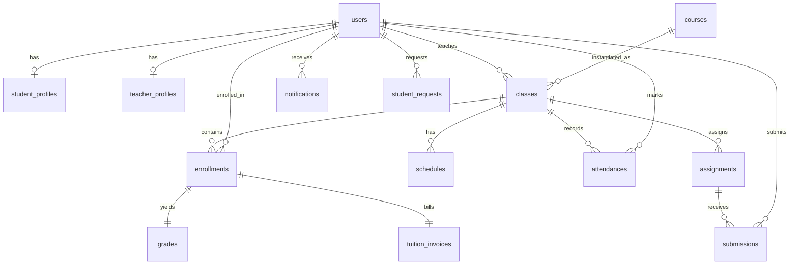

# TÀI LIỆU ĐẶC TẢ YÊU CẦU & THIẾT KẾ HỆ THỐNG
# HỆ THỐNG QUẢN LÝ GIÁO DỤC (EDUCATION MANAGEMENT SYSTEM - EMS)

> **Mô hình học hỏi & cải tiến:** Kế thừa các chuẩn nghiệp vụ thực tế từ Cổng thông tin đào tạo Đại học FPT (**FAP - FPT Academic Portal** - `https://fap.fpt.edu.vn/`).  
> **Quy mô nhóm phát triển:** 5 thành viên (Mỗi thành viên phụ trách 1 Actor chính từ A → Z)  
> **Công nghệ sử dụng (Tech Stack):** 
> - **Backend:** Express.js + Prisma ORM (Node.js)
> - **Frontend:** React + Vite + Ant Design (v5)
> - **Database:** MySQL 8.0
> - **DevOps / Môi trường:** Docker & Docker Compose  
> **Định hướng phạm vi (Scope):** MVP hoàn chỉnh gồm 12 module chính, tập trung vào luồng nghiệp vụ cốt lõi (Core Business Flow), tích hợp giải pháp chống xung đột lịch học, cảnh báo chuyên cần tự động, quản lý đơn từ học vụ trực tuyến, phân tách theo **5 Actor chuẩn hóa** (`SYSTEM ADMIN`, `ACADEMIC STAFF`, `ACCOUNTANT`, `TEACHER`, `STUDENT`) để 5 thành viên phát triển song song không xung đột.

---

## MỤC LỤC
1. [Phần 1: Khảo sát & Học hỏi từ Hệ thống Mẫu (FAP FPT)](#phần-1-khảo-sát--học-hỏi-từ-hệ-thống-mẫu-fap-fpt)
2. [Phần 2: Tổng quan & Phân quyền Hệ thống (5 Actors & Roles)](#phần-2-tổng-quan--phân-quyền-hệ-thống-5-actors--roles)
3. [Phần 3: Đặc tả Yêu cầu Chức năng Chi tiết (12 Modules theo 5 Actor)](#phần-3-đặc-tả-yêu-cầu-chức-năng-chi-tiết-12-modules-theo-5-actor)
4. [Phần 4: Yêu cầu Phi Chức năng (Non-Functional Requirements)](#phần-4-yêu-cầu-phi-chức-năng-non-functional-requirements)
5. [Phần 5: Thiết kế Cơ sở Dữ liệu MySQL (Database Schema - 14 Bảng)](#phần-5-thiết-kế-cơ-sở-dữ-liệu-mysql-database-schema---14-bảng)
6. [Phần 6: Danh sách RESTful API Endpoints Chuẩn hóa (Theo 5 Actor)](#phần-6-danh-sách-restful-api-endpoints-chuẩn-hóa-theo-5-actor)
7. [Phần 7: Kiến trúc Thư mục Monorepo & Cấu hình Docker](#phần-7-kiến-trúc-thư-mục-monorepo--cấu-hình-docker)
8. [Phần 8: Phân công Nhiệm vụ & Kế hoạch Triển khai (5 Thành viên theo 5 Actor)](#phần-8-phân-công-nhiệm-vụ--kế-hoạch-triển-khai-5-thành-viên-theo-5-actor)

---

## PHẦN 1: KHẢO SÁT & HỌC HỎI TỪ HỆ THỐNG MẪU (FAP FPT)

Dựa trên phân tích thực tế và khảo sát kiến trúc cổng học vụ FAP (`fap.fpt.edu.vn`), hệ thống EMS kế thừa và cải tiến các điểm then chốt sau:

### 1. Hệ thống Nhận diện & Trải nghiệm Người dùng (Design System)
* **Bảng màu chủ đạo (Color Palette):**
  * `Primary Color`: Màu cam FPT `#F26F21` kết hợp sắc độ nhấn `#FA742B` thể hiện sự năng động, gắn liền với khối giáo dục công nghệ.
  * `Neutral Background`: Nền sáng `#F0F2F5` / `#FFFFFF` cho khả năng đọc tốt khi hiển thị danh sách và bảng điểm dày đặc.
  * `Semantic Status Colors`:
    * Xanh lục (`#52C41A`): Điểm danh *PRESENT* (Có mặt), Môn học *PASSED* (Đạt), Học phí *PAID*.
    * Đỏ (`#FF4D4F`): Điểm danh *ABSENT* (Vắng), Môn học *NOT PASSED*, Cảnh báo cấm thi (>20% vắng).
    * Cam/Vàng (`#FA8C16` / `#FAAD14`): Trạng thái *LATE* (Đi muộn), Đơn từ *PENDING* (Chờ duyệt), Học phí *PARTIAL*.
* **Bố cục (Layout Paradigm):**
  * **Table-Centric Interface:** Kế thừa cách tổ chức thông tin dạng lưới chuẩn hóa của FAP cho Thời khóa biểu, Điểm danh, Bảng điểm.
  * **Breadcrumbs Navigation:** Đặt ngay dưới Header để người dùng dễ dàng định vị cấp bậc danh mục (`Trang chủ > Lớp học phần > Bảng điểm`).
  * **Cải tiến Responsive:** Khắc phục nhược điểm của FAP cũ (chủ yếu là giao diện cố định cho Desktop) bằng cách ứng dụng hệ thống Ant Design Grid (Row/Col) và cuộn ngang thông minh trên Mobile.

### 2. Chuẩn hóa Nghiệp vụ Học vụ Kế thừa từ FAP
* **Tách bạch 5 Vai trò Vận hành:** Thay vì gộp chung một Admin duy nhất, hệ thống tách rõ **System Admin** (Quản trị tài khoản & hệ thống), **Academic Staff** (Giáo vụ đào tạo, xếp lịch & duyệt đơn học vụ), **Accountant** (Kế toán công nợ & VietQR), **Teacher** (Giảng viên) và **Student** (Học viên).
* **Chuẩn ca học theo Slot:** Phân chia ngày học thành 6 ca cố định (hoặc theo ca Sáng/Chiều chuẩn hóa) giúp tối ưu hóa thuật toán phát hiện trùng phòng (`P101`, `P102`) và trùng giảng viên (`TEA001`).
* **Quy chế Chuyên cần 20%:** Tự động tính tỷ lệ vắng và phát cảnh báo / khóa điều kiện thi kết thúc môn nếu học viên vắng vượt ngưỡng 20% tổng số buổi.
* **Cơ chế Đơn từ Học vụ Trực tuyến (Online Applications):** Cho phép học viên gửi yêu cầu trực tiếp trên hệ thống (Xin nghỉ phép, phúc khảo điểm, xác nhận sinh viên) và đồng bộ tự động sang bảng điểm danh khi Giáo vụ phê duyệt.

---

## PHẦN 2: TỔNG QUAN & PHÂN QUYỀN HỆ THỐNG (5 ACTORS & ROLES)

Hệ thống áp dụng cơ chế phân quyền dựa trên vai trò (**RBAC - Role-Based Access Control**) với **5 nhóm Actor chính** (cùng các Actor hệ thống phụ trợ: *Payment System - VietQR* và *File Storage - X1*):

```mermaid
graph TD
    EMS[Hệ thống EMS] --> A1[1. SYSTEM ADMIN - Người 1]
    EMS --> A2[2. ACADEMIC STAFF - Người 2]
    EMS --> A3[3. ACCOUNTANT - Người 3]
    EMS --> A4[4. TEACHER - Người 4]
    EMS --> A5[5. STUDENT - Người 5]
    
    A1 --> A1_1[Xác thực JWT & Phân quyền 5 Roles]
    A1 --> A1_2[Khóa / Mở khóa Tài khoản người dùng]
    A1 --> A1_3[Phát Thông báo toàn hệ thống SYSTEM]
    A1 --> A1_4[Dashboard Tổng quan 4 KPI & Tỷ lệ qua môn]

    A2 --> A2_1[Quản lý Hồ sơ HV, GV & Import/Export Excel]
    A2 --> A2_2[Quản lý Môn học, Mở lớp & Ghi danh Enrollment]
    A2 --> A2_3[Xếp TKB theo Slot & Kiểm tra trùng Phòng/GV]
    A2 --> A2_4[Duyệt Đơn từ Học vụ & Xem Bảng điểm lớp]

    A3 --> A3_1[Quản lý & Tra cứu Công nợ Học phí tự động]
    A3 --> A3_2[Ghi nhận Thanh toán từng đợt UNPAID -> PARTIAL -> PAID]
    A3 --> A3_3[Tích hợp Mã VietQR tĩnh & In Phiếu thu/Biên lai]
    A3 --> A3_4[Nhắc nợ TUITION & Thống kê Doanh thu tháng]

    A4 --> A4_1[Xem Lịch dạy tuần & Teacher Dashboard]
    A4 --> A4_2[Điểm danh buổi học & Cảnh báo vắng > 20%]
    A4 --> A4_3[Giao Bài tập BT01 & Chấm điểm/Nhận xét]
    A4 --> A4_4[Nhập Bảng điểm lưới 3 cột, Tính điểm & Công bố]

    A5 --> A5_1[Xem Student Dashboard & TKB Lưới tuần]
    A5 --> A5_2[Theo dõi Điểm danh cá nhân & Tỷ lệ chuyên cần]
    A5 --> A5_3[Nộp Bài tập trực tuyến & Xem điểm/Nhận xét GV]
    A5 --> A5_4[Tra cứu Điểm/GPA, Công nợ VietQR & Nộp đơn Online]
```



### 1. SYSTEM ADMIN (Quản trị hệ thống — Phụ trách: Người 1)
* Quản lý xác thực đăng nhập (`DF01`), cấp phát JWT token và kiểm tra phân quyền Role cho toàn bộ 5 Actor (`UC0.1`, `DF02`).
* Quản lý tài khoản người dùng trong hệ thống: Khóa / Mở khóa tài khoản (`is_active`), thay đổi phân quyền vai trò (`UC1.2a*`, `DF03a`), chặn tự khóa tài khoản quản trị hiện hành (`ADM001`).
* Tạo và phát hành thông báo toàn hệ thống hoặc theo lớp học cụ thể (loại `SYSTEM` - `UC10.1`, `DF08a`).
* Theo dõi Dashboard tổng quan hệ thống: 4 thẻ KPI tổng (Tổng HV, Tổng GV, Số lớp đang mở, Tổng doanh thu) và Biểu đồ tròn tỷ lệ qua môn / trượt môn (`UC11.1a`, `DF12a`).

### 2. ACADEMIC STAFF (Giáo vụ đào tạo — Phụ trách: Người 2)
* Quản lý danh mục Hồ sơ Học viên (`STU2026001`..`004`): Tìm kiếm (`UC1.1`), Thêm/Sửa kèm tự sinh mã (`UC1.2b`, `DF03b`), Import/Export Excel (`UC1.3`, `DF04`, `DF10`) và Xem hồ sơ 360° (`UC1.4`, `DF09`).
* Quản lý Hồ sơ Giảng viên (`TEA001`, `TEA002` - `UC2.1`) và tra cứu lịch dạy / lớp phụ trách (`UC2.2`).
* Quản lý danh mục Môn học gốc (`WEB101`, `JS201`, số buổi, học phí cơ bản, file syllabus - `UC3.1`, `DF05`).
* Mở lớp học phần (`WEB101-2026A-01`), gán giảng viên, thiết lập sĩ số tối đa (`UC4.1`, `DF06`) và quản lý ghi danh học viên (`Enrollment` - `UC4.2`, `DF07`, `DF11`) — tự động khởi tạo bản ghi điểm trống và hóa đơn học phí.
* Xếp lịch học theo Slot/Ca (`UC5.1`, `DF13`), kiểm tra xung đột trùng phòng học (`P101`, `P102`) và trùng giảng viên (`UC5.2`, `DF14`), xuất thời khóa biểu lưới tuần (`UC5.3`, `DF15`).
* Xem bảng điểm lớp ở chế độ chỉ đọc (`UC8.5*`, `DF09`) và phê duyệt các đơn từ học vụ trực tuyến của học viên (`UC11.2`).

### 3. ACCOUNTANT (Kế toán tài chính — Phụ trách: Người 3)
* Quản lý và tra cứu danh sách công nợ học phí được hệ thống tự động sinh ra khi Giáo vụ ghi danh học viên vào lớp (`UC9.1`).
* Đối soát và ghi nhận thanh toán học phí theo từng đợt (VD: Đợt 1 thu 1.000.000 đ, Đợt 2 thu 2.000.000 đ), cộng dồn `paid_amount` và tự động chuyển trạng thái hóa đơn `UNPAID → PARTIAL → PAID` (`UC9.2`, `DF34`, `DF35`).
* Kết nối Payment System để tạo mã VietQR tĩnh theo đúng số tiền còn nợ kèm nội dung chuyển khoản (`"STU2026001 WEB101"`) và in phiếu thu / biên lai trên trình duyệt (`UC9.3`, `DF32`, `DF33`, `DF35`).
* Phát thông báo nhắc đóng học phí tự động (loại `TUITION` - `UC10.2` Trigger 3, `DF08b`).
* Xem báo cáo thống kê doanh thu học phí: Biểu đồ cột so sánh Đã thu vs. Còn nợ theo tháng và danh sách công nợ (`UC11.1b*`, `DF12b`).

### 4. TEACHER (Giảng viên — Phụ trách: Người 4)
* Tra cứu lịch giảng dạy, danh sách lớp phụ trách (`UC2.2`, `DF20`), xem Thời khóa biểu dạng lưới tuần (`UC5.3`, `DF15`) và Teacher Dashboard (`UC11.2`, `DF31`).
* Thực hiện điểm danh học viên theo từng buổi học (`UC6.1`, `DF16`) và theo dõi thống kê chuyên cần, nhận cảnh báo khi học viên vắng vượt ngưỡng > 20% (`UC6.2`, `DF22`).
* Giao bài tập mới (`BT01`), tải file đề bài lên File Storage (`UC7.1`, `DF17`, `DF36` — kích hoạt Trigger 1 thông báo `ASSIGNMENT`), xem danh sách bài nộp kèm cờ nộp muộn (`DF21`), chấm điểm và nhận xét (`UC7.3`, `DF18`).
* Nhập bảng điểm thi kết thúc học phần dạng lưới 3 cột (Chuyên cần 10%, Giữa kỳ 30%, Cuối kỳ 60% - `UC8.1`, `DF19`), kích hoạt tự tính điểm tổng kết & xét qua môn (`UC8.2`), Import/Export bảng điểm Excel (`UC8.3`, `DF23`) và Công bố điểm (kích hoạt Trigger 2 thông báo `GRADE`).
* Xem và đánh dấu đã đọc thông báo (`UC10.3`).

### 5. STUDENT (Học viên — Phụ trách: Người 5)
* Xem Student Dashboard (`UC11.2`, `DF31`) và Thời khóa biểu cá nhân dạng lưới tuần (`UC5.3`, `DF15`).
* Xem lịch sử điểm danh cá nhân (`UC6.3*`, `DF26`) và theo dõi tỷ lệ % chuyên cần cùng cảnh báo vắng học (`UC6.2`).
* Tải đề bài tập (`BT01`), nộp file bài làm trực tuyến lên File Storage kèm kiểm tra hạn nộp (`UC7.2`, `DF24`), xem điểm bài tập và nhận xét từ giảng viên (`UC7.4*`, `DF27`).
* Tra cứu kết quả học tập từng môn và điểm trung bình tích lũy GPA (`UC8.4`, `DF28`).
* Kiểm tra công nợ học phí cá nhân (`UC9.4*`, `DF30`) và mở mã VietQR tĩnh theo số tiền còn nợ để thanh toán (`UC9.3`, `DF33`).
* Nhận thông báo trên quả chuông (`DF29`), đánh dấu đã đọc (`UC10.3`, `DF25`) và gửi các mẫu đơn học vụ trực tuyến (Xin nghỉ phép, phúc khảo điểm, xác nhận sinh viên - `UC11.1`).

---

## PHẦN 3: ĐẶC TẢ YÊU CẦU CHỨC NĂNG CHI TIẾT (12 MODULES THEO 5 ACTOR)

---

### PHÂN HỆ 1: QUẢN TRỊ HỆ THỐNG, TÀI KHOẢN & THÔNG BÁO TOÀN TRƯỜNG (Actor: SYSTEM ADMIN — Phụ trách: Người 1)

#### 1. Authentication & User Account Management (Xác thực & Quản lý Tài khoản)
* **UC0.1 - Đăng nhập / Xem thông tin cá nhân & Phân quyền:** Mọi Actor (`A1..A5`) đăng nhập bằng mã/email và mật khẩu (`DF01`). Hệ thống xác thực JWT và trả về thông tin tài khoản kèm `role` (`SYSTEM_ADMIN`, `ACADEMIC_STAFF`, `ACCOUNTANT`, `TEACHER`, `STUDENT`) (`DF02`).
* **UC1.2a\* - Quản lý tài khoản người dùng (Khóa / Mở khóa & Phân quyền):** System Admin (tài khoản `ADM001`) tìm kiếm tài khoản trong bảng `users` (`D1`) (VD: `STU2026003` hoặc `TEA002`), chọn thao tác Khóa hoặc Mở khóa (`is_active` / `status`) và cập nhật quyền (`DF03a`).
  * *Ràng buộc nghiệp vụ:* Nếu System Admin tự khóa chính tài khoản `ADM001` đang đăng nhập → Hệ thống chặn và báo lỗi không được tự khóa tài khoản quản trị hiện hành. Nếu khóa tài khoản khác thành công, thu hồi phiên đăng nhập của tài khoản đó.

#### 2. System Notification & System Overview Dashboard (Thông báo Hệ thống & Dashboard Tổng quan)
* **UC10.1 - Tạo thông báo toàn hệ thống / theo lớp (Loại `SYSTEM`):** System Admin chọn phạm vi nhận (Toàn hệ thống hoặc một lớp cụ thể như `WEB101-2026A-01`), nhập tiêu đề và nội dung thông báo (`DF08a`). Hệ thống tạo bản ghi loại `SYSTEM` vào bảng `notifications` (`D13`) và cập nhật số thông báo chưa đọc trên quả chuông của Teacher và Student (`DF29`).
* **UC11.1a - Xem Dashboard tổng quan hệ thống (`DF12a`):**
  * **4 thẻ thống kê KPI tổng:** Tổng số Học viên, Tổng số Giảng viên, Tổng số lớp đang mở, Tổng doanh thu học phí.
  * **Biểu đồ Học lực (Pie Chart):** Tỷ lệ học viên Qua môn vs. Trượt môn trên toàn hệ thống (tổng hợp từ `D1`, `D5`, `D11`, `D12`).

---

### PHÂN HỆ 2: QUẢN LÝ ĐÀO TẠO, MỞ LỚP, THỜI KHÓA BIỂU & DUYỆT ĐƠN (Actor: ACADEMIC STAFF — Phụ trách: Người 2)

#### 3. Student & Teacher Profile Management (Quản lý Hồ sơ Học viên & Giảng viên)
* **UC1.1 - Danh sách & Tìm kiếm học viên:** Xem danh sách học viên có phân trang server-side, bộ lọc trạng thái (Đang học, Bảo lưu, Đã tốt nghiệp), tìm kiếm theo Mã SV, Họ tên, Email, SĐT.
* **UC1.2b - Thêm / Sửa hồ sơ học viên:** Giáo vụ thêm mới hoặc cập nhật hồ sơ cá nhân (Ngày sinh, Giới tính, Địa chỉ, Năm nhập học) (`DF03b`). Hệ thống kiểm tra trùng Email/SĐT và tự động sinh mã học viên chuẩn (VD: `STU2026001`..`004`), lưu vào `D1 (users)` và `D2 (student_profiles)`.
* **UC1.3 - Import / Export Excel danh sách học viên:** Nhập hàng loạt học viên từ file `.xlsx` (`DF04`) và xuất danh sách học viên ra file Excel (`DF10`).
* **UC1.4 - Xem hồ sơ chi tiết 360° học viên:** Xem toàn diện thông tin một học viên trên 1 màn hình: Hồ sơ cá nhân, các lớp đã tham gia, điểm số và tình trạng học phí (`DF09`).
* **UC2.1 - Quản lý hồ sơ giảng viên:** Thêm mới, cập nhật thông tin giảng viên (`TEA001`, `TEA002`), lưu học vị (Cử nhân, Thạc sĩ, Tiến sĩ), chuyên ngành và tiểu sử vào `D3 (teacher_profiles)` (`DF03b`, `DF09`).
* **UC2.2 - Tra cứu lịch dạy & Lớp phụ trách:** Giáo vụ (và Giảng viên) tra cứu danh sách các lớp học phần và lịch giảng dạy của giảng viên.

#### 4. Course & Class Management (Quản lý Môn học & Lớp học phần)
* **UC3.1 - Quản lý danh mục môn học:** CRUD môn học gồm Mã môn (VD: `WEB101`, `JS201`), Tên môn, Số tín chỉ, Tổng số buổi học (VD: 30 buổi), Mức học phí cơ bản (`base_tuition_fee`, VD: `3.000.000 đ`), Mô tả và tải file Đề cương (`syllabus_url`) lên File Storage (`X1`) (`DF05`, `DF36`).
  * *Ràng buộc nghiệp vụ:* Chặn xóa cứng môn học nếu môn học đó đã có Lớp học phần (`D5`) được mở.
* **UC4.1 - Mở lớp học phần:** Tạo lớp mới từ môn học có sẵn (VD: `WEB101-2026A-01`, kỳ `2026A`), gán 1 Giảng viên phụ trách (`TEA001`), thiết lập sĩ số tối đa (`max_students = 3` để dễ test hoặc mặc định 30) và trạng thái lớp (`UPCOMING`, `ONGOING`, `COMPLETED`) (`DF06`).
* **UC4.2 - Quản lý Enrollment (Thêm/Xóa học viên vào lớp):** Giáo vụ thêm/xóa học viên (`STU2026001`..`004`) vào lớp (`DF07`).
  * *Ràng buộc nghiệp vụ & 3 bước tự động bắt buộc:*
    1. **Kiểm tra sĩ số & Trùng lịch:** Kiểm tra sĩ số hiện tại `< max_students`. Nếu lớp đã đủ 3/3 mà thêm tiếp `STU2026004` → Báo lỗi `"Vượt sĩ số 3/3"` (`DF11`), không tạo bản ghi nào. Đồng thời kiểm tra học viên không bị trùng ca học với lớp khác trong cùng kỳ.
    2. **Tự tạo bảng điểm trống:** Khi ghi danh hợp lệ vào `D6 (enrollments)` với trạng thái `ACTIVE`, tự động tạo 1 bản ghi điểm trống trong `D11 (grades)`.
    3. **Tự tạo hóa đơn học phí:** Tự động tạo 1 hóa đơn học phí trạng thái `UNPAID` với `amount = base_tuition_fee` (`3.000.000 đ`) trong `D12 (tuition_invoices)` (chuyển giao sang Người 3 - Kế toán).
* **UC8.5\* - Xem bảng điểm lớp (Chỉ đọc):** Giáo vụ xem bảng điểm tổng hợp của các lớp học phần ở chế độ Read-only (`DF09`).

#### 5. Schedule Management (Quản lý Thời khóa biểu & Kiểm tra Xung đột)
* **UC5.1 - Xếp lịch học cho lớp (Chuẩn Slot/Ca):** Giáo vụ gán lịch học định kỳ theo Thứ trong tuần (Thứ 2 -> Chủ nhật), Ca học / Slot (VD: Sáng `07:30–09:30`, Chiều `13:30–15:30` hoặc Slot 1–6) và Phòng học (`P101`, `P102`) (`DF13`).
* **UC5.2 - Kiểm tra xung đột lịch (Conflict Detection):** Khi Giáo vụ lưu lịch học vào `D7 (schedules)`, hệ thống tự động quét và chặn lưu nếu phát hiện (`DF14`):
  * **Lỗi trùng phòng học:** Xếp lớp `JS201-2026A-01` vào Thứ 2 Sáng `07:30–09:30` tại `P101` (đã có lớp `WEB101` học) → Báo `"Lỗi trùng phòng P101"`.
  * **Lỗi trùng giảng viên:** Xếp lớp `JS201-2026A-02` (do `TEA001` dạy) vào Thứ 2 Sáng `07:30–09:30` tại `P102` → Báo `"Lỗi trùng giảng viên TEA001"`.
* **UC5.3 - Xem thời khóa biểu dạng lưới tuần (Calendar View):** Hiển thị thời khóa biểu trực quan dạng lưới tuần (`DF15`) cho Academic Staff, Teacher và Student.

---

### PHÂN HỆ 3: QUẢN LÝ CÔNG NỢ HỌC PHÍ, VIETQR & THỐNG KÊ DOANH THU (Actor: ACCOUNTANT — Phụ trách: Người 3)

#### 6. Tuition & Financial Analytics (Quản lý Học phí, VietQR & Doanh thu)
* **UC9.1 - Ghi nhận và tra cứu công nợ học phí tự động:** Hệ thống tự động sinh hóa đơn `UNPAID` theo `base_tuition_fee` (`3.000.000 đ`) trong `D12 (tuition_invoices)` ngay khi Giáo vụ thêm học viên vào lớp ở `UC4.2`. Kế toán tra cứu và quản lý danh sách công nợ này.
* **UC9.2 - Cập nhật trạng thái thanh toán học phí (`UNPAID → PARTIAL → PAID`):** Kế toán đối soát tiền vào và nhập số tiền thực thu theo từng đợt (`DF34`):
  * **Đợt 1:** Kế toán nhập số tiền thu `1.000.000 đ` cho `STU2026001` → Hệ thống kiểm tra hợp lệ (`0 < thu <= nợ`), cộng vào `paid_amount = 1.000.000 đ`. Do `paid_amount < amount`, cập nhật trạng thái thành `PARTIAL` (còn nợ `2.000.000 đ`).
  * **Đợt 2:** Kế toán nhập tiếp `2.000.000 đ` → `paid_amount = 3.000.000 đ == amount` → Cập nhật trạng thái thành `PAID`, ghi nhận `paid_at` và khóa hóa đơn không cho thu thêm.
* **UC9.3 - Xuất mã VietQR và in phiếu thu/biên lai học phí:**
  * Hệ thống tính số tiền còn nợ (`amount - paid_amount = 2.000.000 đ`), gửi yêu cầu kèm nội dung chuyển khoản `"STU2026001 WEB101"` tới **Payment System (VietQR)** (`DF32`) và nhận về mã VietQR tĩnh (`DF33`) để hiển thị cho Student và Accountant.
  * Hỗ trợ Kế toán xuất và in phiếu thu / biên lai điện tử trực tiếp trên trình duyệt (`DF35`).
* **UC10.2 (Trigger 3) - Thông báo nhắc nợ học phí (`TUITION`):** Kế toán kiểm tra danh sách công nợ và bấm gửi thông báo nhắc đóng học phí cho các học viên chưa `PAID` (`DF08b` → ghi vào `D13`).
* **UC11.1b\* - Xem thống kê doanh thu học phí theo tháng (`DF12b`):** Kế toán xem báo cáo doanh thu và Biểu đồ cột (Bar Chart) so sánh tổng học phí Đã thu vs. Tổng còn nợ theo từng tháng.

---

### PHÂN HỆ 4: VẬN HÀNH LỚP HỌC, ĐIỂM DANH, BÀI TẬP & KHẢO THÍ (Actor: TEACHER — Phụ trách: Người 4)

#### 7. Attendance Management (Quản lý Điểm danh & Cảnh báo Chuyên cần > 20%)
* **UC6.1 - Điểm danh theo buổi học:** Giảng viên chọn lớp phụ trách (VD: `WEB101-2026A-01`) và ngày học (`DF20`), hệ thống hiển thị danh sách học viên của lớp từ `D6`, `D8` (mặc định trạng thái `PRESENT` - Có mặt). Giảng viên tích chọn các trường hợp `ABSENT_EXCUSED` (Vắng có phép), `ABSENT_UNEXCUSED` (Vắng không phép), `LATE` (Đi muộn), nhập ghi chú và lưu vào `D8 (attendances)` (`DF16`).
* **UC6.2 - Thống kê chuyên cần và cảnh báo vắng (> 20%):**
  * Công thức tính tỷ lệ vắng:
    $$\text{Tỷ lệ vắng (\%)} = \frac{\text{Số buổi vắng không phép}}{\text{Tổng số buổi học của môn}} \times 100\%$$
  * Khi học viên vắng vượt ngưỡng 20% (VD: `STU2026003` vắng 3/10 buổi = 30% > 20%), hệ thống phát cảnh báo chuyên cần màu đỏ (`DF22`) cho Giảng viên và Học viên, đồng thời hỗ trợ gắn cờ cấm thi (`is_banned = true`).

#### 8. Assignment Management (Giao Bài tập & Chấm điểm - Phía Giảng viên)
* **UC7.1 - Giao bài tập mới (`BT01`):** Giảng viên tạo bài tập mới gồm Tiêu đề, Hướng dẫn, Hạn nộp (VD: `02/11/2026 23:59`) và tải file đề đính kèm lên **File Storage (X1)** (`DF17`, `DF36`, lưu vào `D9`).
  * Tự động kích hoạt **UC10.2 (Trigger 1)**: Ghi thông báo loại `ASSIGNMENT` vào `D13` gửi tới toàn bộ học viên trong lớp.
* **UC7.3 - Chấm điểm và nhận xét bài tập:** Giảng viên xem danh sách bài nộp của học viên từ `D10` kèm thời gian nộp và cờ nộp muộn (`DF21`), tải file bài làm từ `X1`, chấm điểm (thang 10) và nhập lời phê `teacher_feedback` (`DF18`).

#### 9. Exam & Grade Management (Nhập Điểm thi & Công bố Điểm - Phía Giảng viên)
* **UC8.1 - Nhập bảng điểm thi kết thúc học phần dạng lưới (Editable Grid):** Giảng viên mở bảng điểm lớp (`DF23`) và nhập 3 cột điểm thành phần (thang 0..10): Chuyên cần (`attendance_score` - 10%), Giữa kỳ (`midterm_score` - 30%), Cuối kỳ (`final_score` - 60%) (`DF19`) (VD: `STU2026001`: 9/7/8; `STU2026002`: 10/3/4; `STU2026003`: 8/2/3).
* **UC8.2 - Tự tính điểm tổng kết và xét qua môn:**
  * Công thức điểm tổng kết (làm tròn 1 chữ số thập phân):
    $$\text{total\_score} = 0.1 \times \text{CC} + 0.3 \times \text{GK} + 0.6 \times \text{CK}$$
  * Tự động xét trạng thái Qua môn: `is_passed = true` nếu `total_score >= 4.0` (và không bị cấm thi) (VD: `7.8`, `4.3` → Qua môn; `3.2` → Học lại), lưu vào `D11 (grades)`.
* **UC8.3 - Import / Export bảng điểm Excel:** Hỗ trợ tải file mẫu Excel để nhập điểm nhanh và xuất bảng điểm lớp ra file Excel (`X2`) (`DF23`).
* **Công bố điểm & UC10.2 (Trigger 2):** Khi Giảng viên bấm nút **Công bố điểm** (`DF19`), hệ thống tự động chạy Trigger 2 tạo thông báo loại `GRADE` vào `D13` gửi tới học viên.
* **UC10.3 & UC11.2 (Teacher):** Giảng viên xem Teacher Dashboard (`DF31`) và xem/đánh dấu đã đọc thông báo.

---

### PHÂN HỆ 5: CỔNG THÔNG TIN HỌC VIÊN, NỘP BÀI, TRA CỨU & ĐƠN TỪ ONLINE (Actor: STUDENT — Phụ trách: Người 5)

#### 10. Student Learning & Submission Portal (Chuyên cần & Nộp Bài tập - Phía Học viên)
* **UC11.2 & UC5.3 (Student):** Học viên (`STU2026001`, `STU2026002`) xem Student Dashboard (lịch học hôm nay, deadline `BT01` sắp hết hạn, biểu đồ GPA - `DF31`) và Thời khóa biểu tuần dạng lưới (`DF15`).
* **UC6.3\* & UC6.2 - Xem lịch sử điểm danh cá nhân & Tỷ lệ chuyên cần:** Học viên xem chi tiết lịch sử điểm danh từng buổi và tỷ lệ % chuyên cần cá nhân (`DF26` đọc từ `D7`, `D8`).
* **UC7.2 - Nộp bài tập trực tuyến (`BT01`):** Học viên mở bài tập `BT01`, tải file đề từ `X1` (`DF27`) và tải file bài làm lên nộp trực tuyến (`DF24`). Hệ thống đối chiếu thời gian nộp với hạn `02/11/2026 23:59`:
  * `STU2026001` nộp trước hạn → Lưu file vào `X1`, ghi `D10 (submissions)` trạng thái `SUBMITTED` (Đúng hạn).
  * `STU2026002` nộp lúc `03/11/2026 08:00` (sau hạn) → Lưu file vào `X1`, ghi `D10` kèm cờ Nộp muộn `LATE_SUBMITTED` (hoặc từ chối nộp nếu cấu hình chặn).
* **UC7.4\* - Xem nhận xét và điểm bài tập:** Học viên xem điểm bài tập và nhận xét `teacher_feedback` của giảng viên (`DF27` từ `D10`).

#### 11. Student Grade, Tuition & Notification Lookup (Tra cứu Điểm, GPA, Học phí & Thông báo)
* **UC8.4 - Tra cứu kết quả học tập và GPA:** Học viên nhận thông báo `GRADE`, tra cứu bảng điểm từng môn (VD: `WEB101`: `7.8` - Qua môn) và điểm trung bình tích lũy GPA (`DF28` từ `D11`).
* **UC9.4\* & UC9.3 - Kiểm tra công nợ học phí cá nhân & Quét mã VietQR:** Học viên kiểm tra công nợ cá nhân (`DF30` từ `D12`: tổng phải thu `3.000.000 đ`, đã đóng `1.000.000 đ`, còn nợ `2.000.000 đ`, trạng thái `PARTIAL`) và bấm hiển thị mã VietQR tĩnh theo đúng số tiền còn nợ (`2.000.000 đ`) để chuyển khoản ngân hàng.
* **UC10.3 - Xem và đánh dấu thông báo đã đọc:** Học viên nhận thông báo trên quả chuông (`DF29` từ `D13`) và bấm đánh dấu đã đọc (`DF25` → cập nhật `is_read = true`).

#### 12. Online Academic Requests (Đơn từ Học vụ Trực tuyến - Kế thừa FAP)
* **UC11.1 (Request) - Học viên gửi đơn học vụ trực tuyến:** Học viên tạo yêu cầu trực tuyến (Xin nghỉ học có phép đính kèm minh chứng cho buổi học `session_date`, Đơn phúc khảo điểm, Đơn xin xác nhận sinh viên) lưu vào `D14 (student_requests)`.
* **UC11.2 (Request) - Giáo vụ (`ACADEMIC STAFF`) phê duyệt đơn:** Giáo vụ xem danh sách đơn, chọn `APPROVED` hoặc `REJECTED`. Khi duyệt `APPROVED` đơn xin nghỉ phép, hệ thống tự động cập nhật buổi học tương ứng trong `D8 (attendances)` thành `ABSENT_EXCUSED` và tính lại tỷ lệ chuyên cần cho học viên.

---

## PHẦN 4: YÊU CẦU PHI CHỨC NĂNG (NON-FUNCTIONAL REQUIREMENTS)

### 1. Bảo mật & Phân quyền 5 Actor (Security)
* **Mã hóa mật khẩu:** Mật khẩu người dùng lưu trong MySQL phải được băm bằng `bcryptjs` với `salt rounds >= 10`.
* **Xác thực & Phân quyền 5 Role:** Sử dụng `JSON Web Token (JWT)`. Tất cả các API đều bắt buộc đi qua `role.middleware.js` kiểm tra chính xác quyền của 5 Actor: `SYSTEM_ADMIN`, `ACADEMIC_STAFF`, `ACCOUNTANT`, `TEACHER`, `STUDENT`.
* **Input Validation:** Kiểm tra tính hợp lệ dữ liệu đầu vào (miền điểm `0..10`, số tiền thu `0 < thu <= nợ`, kiểm tra không tự khóa `ADM001`).

### 2. Hiệu năng & Trải nghiệm Người dùng (UX/UI Standards)
* **Bộ thư viện UI thống nhất:** Toàn bộ 5 thành viên sử dụng **Ant Design (v5)** trên nền React để đảm bảo giao diện đồng nhất.
* **Phân trang Bắt buộc (Server-side Pagination):** Các danh sách lớn (Users, Students, Courses, Classes, Tuition Invoices) bắt buộc hỗ trợ phân trang từ phía Backend.

### 3. Tính Đóng gói & Triển khai Nhất quán (Portability)
* Toàn bộ Database MySQL 8.0 và công cụ quản trị (phpMyAdmin) được cấu hình trong `docker-compose.yml` để cả 5 thành viên khởi chạy môi trường giống hệt nhau bằng 1 lệnh duy nhất `docker-compose up -d`.

---

## PHẦN 5: THIẾT KẾ CƠ SỞ DỮ LIỆU MYSQL (DATABASE SCHEMA - 14 BẢNG)



Dưới đây là đặc tả chi tiết 14 bảng quan hệ (`D1` → `D14`) chuẩn hóa cho MySQL 8.0 và phân bổ theo 5 Actor / Thành viên:

| Mã kho | Tên bảng | Khóa chính (PK) | Khóa ngoại (FK) & Ràng buộc chính | Các cột dữ liệu cốt lõi | Phụ trách chính |
| :---: | :--- | :--- | :--- | :--- | :--- |
| **D1** | **users** | `id` (INT, AI) | `code` (UNIQUE), `email` (UNIQUE) | `password_hash`, `full_name`, `role` (`SYSTEM_ADMIN`, `ACADEMIC_STAFF`, `ACCOUNTANT`, `TEACHER`, `STUDENT`), `phone`, `avatar`, `status` (`ACTIVE`, `LOCKED`), `created_at` | **Người 1 (System Admin)** *(Người 2 tạo SV/GV)* |
| **D2** | **student_profiles** | `user_id` (INT) | FK -> `users(id)` ON DELETE CASCADE | `dob` (DATE), `gender` (`MALE`, `FEMALE`, `OTHER`), `address`, `enrollment_year` | **Người 2 (Academic Staff)** |
| **D3** | **teacher_profiles** | `user_id` (INT) | FK -> `users(id)` ON DELETE CASCADE | `degree` (Cử nhân, ThS, TS), `specialty`, `bio` | **Người 2 (Academic Staff)** |
| **D4** | **courses** | `id` (INT, AI) | `course_code` (UNIQUE) | `name`, `credits`, `total_sessions`, `base_tuition_fee` (DECIMAL 12,2), `description`, `syllabus_url`, `status` (`ACTIVE`, `INACTIVE`), `created_at` | **Người 2 (Academic Staff)** |
| **D5** | **classes** | `id` (INT, AI) | `class_code` (UNIQUE), `course_id` -> `courses(id)`, `teacher_id` -> `users(id)` | `semester` (VD: `2026A`), `max_students`, `status` (`UPCOMING`, `ONGOING`, `COMPLETED`), `created_at` | **Người 2 (Academic Staff)** |
| **D6** | **enrollments** | `id` (INT, AI) | `class_id` -> `classes(id)`, `student_id` -> `users(id)`, UNIQUE(`class_id`, `student_id`) | `enrolled_at`, `status` (`ACTIVE`, `DROPPED`) | **Người 2 (Academic Staff)** |
| **D7** | **schedules** | `id` (INT, AI) | `class_id` -> `classes(id)` ON DELETE CASCADE | `day_of_week` (TINYINT 2-8), `shift` (Slot 1-6 / Ca), `start_time` (TIME), `end_time` (TIME), `room` (`P101`, `P102`) | **Người 2 (Academic Staff)** |
| **D8** | **attendances** | `id` (INT, AI) | `class_id` -> `classes(id)`, `student_id` -> `users(id)`, UNIQUE(`class_id`, `student_id`, `session_date`) | `session_date` (DATE), `status` (`PRESENT`, `ABSENT_EXCUSED`, `ABSENT_UNEXCUSED`, `LATE`), `note` | **Người 4 (Teacher)** *(Người 5 xem)* |
| **D9** | **assignments** | `id` (INT, AI) | `class_id` -> `classes(id)` ON DELETE CASCADE | `title`, `description`, `file_url`, `due_date` (DATETIME), `created_at` | **Người 4 (Teacher)** *(Người 5 xem)* |
| **D10** | **submissions** | `id` (INT, AI) | `assignment_id` -> `assignments(id)`, `student_id` -> `users(id)`, UNIQUE(`assignment_id`, `student_id`) | `file_url`, `submitted_at`, `status` (`SUBMITTED`, `LATE_SUBMITTED`), `score` (DECIMAL 4,2), `teacher_feedback` | **Người 5 (Student)** nộp & **Người 4 (Teacher)** chấm |
| **D11** | **grades** | `id` (INT, AI) | `enrollment_id` -> `enrollments(id)` (UNIQUE) | `attendance_score`, `midterm_score`, `final_score`, `total_score`, `is_passed` (BOOLEAN), `is_banned` (BOOLEAN), `is_published` (BOOLEAN) | **Người 4 (Teacher)** nhập & **Người 5 (Student)** xem |
| **D12** | **tuition_invoices** | `id` (INT, AI) | `student_id` -> `users(id)`, `enrollment_id` -> `enrollments(id)` | `amount`, `paid_amount`, `due_date`, `status` (`UNPAID`, `PARTIAL`, `PAID`), `paid_at` | **Người 3 (Accountant)** *(Người 2 trigger tạo, Người 5 xem)* |
| **D13** | **notifications** | `id` (INT, AI) | `user_id` -> `users(id)` (Nullable nếu gửi toàn trường) | `title`, `message`, `type` (`ASSIGNMENT`, `GRADE`, `TUITION`, `REQUEST`, `SYSTEM`), `is_read` (BOOLEAN), `created_at` | **Người 1** dựng hàm `notify()`, **Người 1, 3, 4** phát, **Người 4, 5** nhận |
| **D14** | **student_requests** | `id` (INT, AI) | `student_id` -> `users(id)`, `class_id` -> `classes(id)` (Nullable) | `request_type` (`ABSENCE`, `REMARK`, `CONFIRMATION`), `session_date` (DATE, Nullable), `reason`, `attachment_url`, `status` (`PENDING`, `APPROVED`, `REJECTED`), `admin_response`, `created_at` | **Người 5 (Student)** gửi & **Người 2 (Academic Staff)** duyệt |

---

## PHẦN 6: DANH SÁCH RESTFUL API ENDPOINTS CHUẨN HÓA (THEO 5 ACTOR)

Mọi API tuân thủ tiền tố `/api/v1` và trả về cấu trúc JSON phản hồi đồng nhất:
```json
{
  "success": true,
  "message": "Thao tác thực hiện thành công",
  "data": {}
}
```

### 1. Cụm API của SYSTEM ADMIN (Phụ trách: Người 1)
* `POST /api/v1/auth/login` - Đăng nhập tài khoản cho mọi Actor, trả về JWT Token và Role (`DF01`, `DF02`).
* `GET /api/v1/auth/me` - Lấy thông tin cá nhân và phân quyền của phiên đăng nhập hiện tại.
* `GET /api/v1/users` - Danh sách toàn bộ tài khoản người dùng trong hệ thống (`SYSTEM_ADMIN`).
* `PATCH /api/v1/users/:id/status` - Khóa / Mở khóa tài khoản và cập nhật Role, chặn tự khóa `ADM001` (`SYSTEM_ADMIN` - `DF03a`).
* `POST /api/v1/notifications/broadcast` - Phát thông báo toàn hệ thống hoặc theo lớp loại `SYSTEM` (`SYSTEM_ADMIN` - `DF08a`).
* `GET /api/v1/analytics/system-overview` - Thống kê 4 thẻ KPI tổng và biểu đồ tròn tỷ lệ qua môn (`SYSTEM_ADMIN` - `DF12a`).

### 2. Cụm API của ACADEMIC STAFF / Giáo vụ (Phụ trách: Người 2)
* `GET /api/v1/students` / `POST /api/v1/students` / `PUT /api/v1/students/:id` - Danh sách, tìm kiếm, thêm/sửa hồ sơ học viên tự sinh mã `STU2026xxx` (`ACADEMIC_STAFF` - `DF03b`).
* `POST /api/v1/students/import` / `GET /api/v1/students/export` - Import/Export danh sách học viên bằng file Excel (`ACADEMIC_STAFF` - `DF04`, `DF10`).
* `GET /api/v1/students/:id/profile-360` - Xem hồ sơ chi tiết 360° của học viên (`ACADEMIC_STAFF` - `DF09`).
* `GET /api/v1/teachers` / `POST /api/v1/teachers` / `PUT /api/v1/teachers/:id` - Quản lý hồ sơ giảng viên (`ACADEMIC_STAFF` - `DF03b`, `DF09`).
* `GET /api/v1/courses` / `POST /api/v1/courses` / `DELETE /api/v1/courses/:id` - Quản lý danh mục môn học kèm upload Syllabus, chặn xóa môn đã có lớp (`ACADEMIC_STAFF` - `DF05`).
* `GET /api/v1/classes` / `POST /api/v1/classes` - Danh sách lớp và mở lớp học phần mới (`ACADEMIC_STAFF` - `DF06`).
* `POST /api/v1/classes/:id/enrollments` - Ghi danh học viên vào lớp: kiểm tra `max_students`, tự tạo bản ghi `grades` trống & `tuition_invoices` `UNPAID` (`ACADEMIC_STAFF` - `DF07`, `DF11`).
* `DELETE /api/v1/classes/:id/enrollments/:studentId` - Xóa học viên khỏi lớp (`ACADEMIC_STAFF`).
* `POST /api/v1/classes/:id/schedules` - Xếp lịch học cho lớp kèm thuật toán kiểm tra trùng phòng (`P101`) / trùng giảng viên (`TEA001`) (`ACADEMIC_STAFF` - `DF13`, `DF14`).
* `GET /api/v1/schedules/weekly-grid` - Xem thời khóa biểu tuần dạng lưới (`ACADEMIC_STAFF`, `TEACHER`, `STUDENT` - `DF15`).
* `GET /api/v1/requests` / `PATCH /api/v1/requests/:id/review` - Giáo vụ xem và phê duyệt đơn từ học vụ trực tuyến (`ACADEMIC_STAFF`).

### 3. Cụm API của ACCOUNTANT / Kế toán (Phụ trách: Người 3)
* `GET /api/v1/tuition-invoices` - Danh sách hóa đơn công nợ học phí, lọc theo `UNPAID`, `PARTIAL`, `PAID` (`ACCOUNTANT` - `DF12b`).
* `PATCH /api/v1/tuition-invoices/:id/pay` - Ghi nhận thanh toán học phí từng đợt, cộng dồn `paid_amount` và đổi trạng thái (`ACCOUNTANT` - `DF34`, `DF35`).
* `GET /api/v1/tuition-invoices/:id/vietqr` - Tạo và trả về mã VietQR tĩnh theo số tiền còn nợ kèm nội dung `"STU2026001 WEB101"` (`ACCOUNTANT`, `STUDENT` - `DF32`, `DF33`).
* `GET /api/v1/tuition-invoices/:id/receipt` - Xuất phiếu thu / biên lai điện tử để in trên trình duyệt (`ACCOUNTANT` - `DF35`).
* `POST /api/v1/tuition-invoices/remind` - Gửi thông báo nhắc nợ học phí hàng loạt loại `TUITION` (`ACCOUNTANT` - `DF08b`).
* `GET /api/v1/analytics/tuition-revenue` - Biểu đồ thống kê doanh thu học phí đã thu vs. còn nợ theo tháng (`ACCOUNTANT` - `DF12b`).

### 4. Cụm API của TEACHER / Giảng viên (Phụ trách: Người 4)
* `GET /api/v1/teachers/my-classes` - Lấy danh sách lớp phụ trách và lịch giảng dạy (`TEACHER` - `DF20`).
* `GET /api/v1/classes/:id/attendances?date=YYYY-MM-DD` - Lấy bảng điểm danh lớp theo ngày học (`TEACHER` - `DF20`).
* `POST /api/v1/classes/:id/attendances` - Lưu điểm danh buổi học và tự động kiểm tra cảnh báo vắng > 20% (`TEACHER` - `DF16`, `DF22`).
* `POST /api/v1/classes/:id/assignments` - Giao bài tập mới (`BT01`) kèm upload file đề lên File Storage & bắn thông báo `ASSIGNMENT` (`TEACHER` - `DF17`).
* `GET /api/v1/assignments/:id/submissions` - Xem danh sách bài nộp của học viên kèm cờ nộp muộn (`TEACHER` - `DF21`).
* `PATCH /api/v1/submissions/:id/grade` - Chấm điểm bài tập (thang 10) và nhập `teacher_feedback` (`TEACHER` - `DF18`).
* `GET /api/v1/classes/:id/grades` - Lấy bảng điểm lớp (`TEACHER`, `ACADEMIC_STAFF` chỉ đọc - `DF09`, `DF23`).
* `PUT /api/v1/classes/:id/grades` - Nhập điểm 3 cột dạng lưới, tự tính `total_score`, xét `is_passed` và Công bố điểm kèm bắn thông báo `GRADE` (`TEACHER` - `DF19`).
* `POST /api/v1/classes/:id/grades/import` / `GET /api/v1/classes/:id/grades/export` - Import/Export bảng điểm Excel (`TEACHER` - `DF23`).

### 5. Cụm API của STUDENT / Học viên (Phụ trách: Người 5)
* `GET /api/v1/analytics/dashboard` - Dashboard Học viên / Giảng viên: Lịch hôm nay, deadline sắp hết hạn, biểu đồ GPA (`STUDENT`, `TEACHER` - `DF31`).
* `GET /api/v1/students/my-attendances` - Xem lịch sử điểm danh cá nhân, tỷ lệ % chuyên cần và cảnh báo vắng (`STUDENT` - `DF26`).
* `GET /api/v1/classes/:id/assignments` - Xem đề bài tập, trạng thái nộp, điểm bài tập và nhận xét của giảng viên (`STUDENT`, `TEACHER` - `DF27`).
* `POST /api/v1/assignments/:id/submissions` - Học viên nộp file bài làm trực tuyến lên File Storage kèm kiểm tra hạn nộp (`STUDENT` - `DF24`).
* `GET /api/v1/students/my-grades` - Tra cứu bảng điểm từng môn và điểm trung bình tích lũy GPA (`STUDENT` - `DF28`).
* `GET /api/v1/students/my-tuition` - Kiểm tra công nợ học phí cá nhân và mở mã VietQR thanh toán (`STUDENT` - `DF30`).
* `GET /api/v1/notifications` / `PATCH /api/v1/notifications/:id/read` - Xem danh sách thông báo và đánh dấu đã đọc `is_read = true` (`STUDENT`, `TEACHER` - `DF25`, `DF29`).
* `POST /api/v1/requests` - Học viên gửi đơn từ học vụ trực tuyến (`STUDENT`).

---

## PHẦN 7: KIẾN TRÚC THƯ MỤC MONOREPO & CẤU HÌNH DOCKER

### 1. Cấu trúc Thư mục Dự án Monorepo (Chia theo 5 Actor)
Hệ thống được tổ chức dạng Monorepo tách thành 5 phân hệ tương ứng với **5 Actor chính** để 5 thành viên phát triển độc lập không gặp xung đột mã nguồn (Git Merge Conflict):

```text
ems-project/
├── docker-compose.yml        # Cấu hình MySQL 8.0 & phpMyAdmin
├── .gitignore
├── README.md
├── backend/                  # Ứng dụng Backend Express.js
│   ├── Dockerfile
│   ├── package.json
│   ├── .env.example
│   ├── prisma/
│   │   ├── schema.prisma     # Định nghĩa 14 bảng CSDL (D1 -> D14)
│   │   └── seed.js           # Dữ liệu mẫu (ADM001, Staff, Accountant, TEA001..002, STU2026001..004, WEB101, JS201)
│   └── src/
│       ├── config/           # Cấu hình Database, JWT, Upload file (Multer - File Storage X1)
│       ├── middlewares/      # auth.middleware.js, role.middleware.js (5 Roles), validate.middleware.js
│       ├── utils/            # formatResponse.js, notify.util.js (D13), vietqrGenerator.js, excel.util.js (X2)
│       ├── modules/          # 5 cụm module độc lập theo đúng 5 Actor
│       │   ├── sysadmin/         # Người 1 (SYSTEM ADMIN): Auth, Users Lock/Role, Broadcast, System KPI
│       │   ├── academic-staff/   # Người 2 (ACADEMIC STAFF): Students, Teachers, Courses, Classes, Schedules, Requests Review
│       │   ├── accountant/       # Người 3 (ACCOUNTANT): Tuition Invoices, VietQR, Receipts, Tuition Revenue Analytics
│       │   ├── teacher/          # Người 4 (TEACHER): Attendances, Assignments, Submissions Grading, Class Grades
│       │   └── student/          # Người 5 (STUDENT): Student Dashboard, Submit Assignment, My Grades/GPA, My Tuition, Submit Request
│       └── app.js            # Điểm khởi chạy Express Server
└── frontend/                 # Ứng dụng Frontend React + Vite + Ant Design
    ├── Dockerfile
    ├── package.json
    ├── vite.config.js
    └── src/
        ├── api/              # Axios instance & Interceptors gắn JWT
        ├── assets/           # Logo FPT-EMS, icons
        ├── components/       # Header, Sidebar (render theo 5 Role), Breadcrumb, NotificationBell
        ├── layouts/          # MainLayout, AuthLayout
        └── pages/            # Màn hình chức năng tương ứng 5 Actor
            ├── auth/
            ├── sysadmin/         # Người 1 (SYSTEM ADMIN)
            ├── academic-staff/   # Người 2 (ACADEMIC STAFF)
            ├── accountant/       # Người 3 (ACCOUNTANT)
            ├── teacher/          # Người 4 (TEACHER)
            └── student/          # Người 5 (STUDENT)
```

### 2. File Cấu hình `docker-compose.yml` Chuẩn hóa

```yaml
version: '3.8'

services:
  mysql_db:
    image: mysql:8.0
    container_name: ems_mysql
    restart: always
    environment:
      MYSQL_ROOT_PASSWORD: rootpassword
      MYSQL_DATABASE: ems_db
      MYSQL_USER: ems_user
      MYSQL_PASSWORD: ems_password
    ports:
      - "3307:3306"
    volumes:
      - mysql_data:/var/lib/mysql

  phpmyadmin:
    image: phpmyadmin/phpmyadmin
    container_name: ems_phpmyadmin
    restart: always
    ports:
      - "8080:80"
    environment:
      PMA_HOST: mysql_db
      MYSQL_ROOT_PASSWORD: rootpassword
    depends_on:
      - mysql_db

volumes:
  mysql_data:
```

---

## PHẦN 8: PHÂN CÔNG NHIỆM VỤ & KẾ HOẠCH TRIỂN KHAI (5 THÀNH VIÊN THEO 5 ACTOR)

### 1. Bảng Phân công Trách nhiệm Chi tiết (Chuẩn hóa theo 5 Actor)

| Thành viên | Actor Phụ trách | Sơ đồ & Luồng Dữ liệu | Các Bảng DB Làm việc Chính | Đầu việc Trọng tâm (Core Tasks) |
| :--- | :--- | :--- | :--- | :--- |
| **Người 1 (Team Leader)** | **SYSTEM ADMIN** | `UC-SYSADMIN`, `BF-SYSADMIN`<br>(`DF01`, `DF02`, `DF03a`, `DF08a`, `DF12a`, `DF36`) | `D1 (users)`, `D13 (notifications)` | - Dựng khung Monorepo, cấu hình Docker, Prisma & File Storage (`X1`).<br>- Xây dựng xác thực JWT & Middleware phân quyền 5 Roles (`UC0.1`).<br>- Quản lý tài khoản: Khóa/Mở khóa & đổi Role, chặn tự khóa `ADM001` (`UC1.2a*`).<br>- Tạo thông báo toàn hệ thống / theo lớp loại `SYSTEM` (`UC10.1`) & hàm `notify()`.<br>- Thiết kế System Admin Dashboard: 4 KPI tổng & biểu đồ tỷ lệ qua môn (`UC11.1a`). |
| **Người 2** | **ACADEMIC STAFF (Giáo vụ)** | `UC-ACADEMIC`, `BF-ACADEMIC`<br>(`DF03b`, `DF04`..`DF07`, `DF09`..`DF11`, `DF13`..`DF15`) | `D2 (student_profiles)`, `D3 (teacher_profiles)`, `D4 (courses)`, `D5 (classes)`, `D6 (enrollments)`, `D7 (schedules)`, `D14` | - Quản lý hồ sơ Học viên (`STU2026xxx`), Import/Export Excel, hồ sơ 360° (`UC1.1`..`UC1.4`).<br>- Quản lý hồ sơ Giảng viên (`UC2.1`, `UC2.2`) & danh mục Môn học (`UC3.1`).<br>- Mở lớp học phần (`UC4.1`) & Ghi danh học viên (`UC4.2` - kiểm tra sĩ số, tự sinh `grades` trống & `tuition_invoices` `UNPAID`).<br>- **Xếp TKB & Thuật toán kiểm tra trùng phòng (`P101`) / trùng GV (`TEA001`)** (`UC5.1`..`UC5.3`).<br>- Xem bảng điểm lớp chỉ đọc (`UC8.5*`) & Duyệt đơn học vụ online (`UC11.2`). |
| **Người 3** | **ACCOUNTANT (Kế toán)** | `UC-ACCOUNTANT`, `BF-ACCOUNTANT`<br>(`DF08b`, `DF12b`, `DF32`..`DF35`) | `D12 (tuition_invoices)`, `D13 (notifications)` | - Quản lý và tra cứu công nợ học phí tự động (`UC9.1`).<br>- **Nghiệp vụ thu học phí nhiều đợt (`UNPAID → PARTIAL → PAID`)** (`UC9.2`).<br>- **Tích hợp Payment System sinh mã VietQR tĩnh** theo số tiền còn nợ & in phiếu thu/biên lai trên trình duyệt (`UC9.3`).<br>- Phát thông báo nhắc nợ học phí loại `TUITION` (`UC10.2` Trigger 3).<br>- Biểu đồ thống kê doanh thu học phí Đã thu vs. Còn nợ theo tháng (`UC11.1b*`). |
| **Người 4** | **TEACHER (Giảng viên)** | `UC-TEACHER`, `BF-TEACHER`<br>(`DF16`..`DF23`) | `D8 (attendances)`, `D9 (assignments)`, `D10 (submissions)`, `D11 (grades)` | - Giao diện Điểm danh theo buổi học & **Cảnh báo chuyên cần khi vắng > 20%** (`UC6.1`, `UC6.2`).<br>- Giao bài tập mới (`BT01`), upload file đề lên `X1` & kích hoạt thông báo `ASSIGNMENT` (`UC7.1`).<br>- Xem danh sách bài nộp kèm cờ nộp muộn, chấm điểm & nhận xét (`UC7.3`).<br>- **Bảng điểm lưới Editable 3 cột, tự tính điểm tổng kết (`0.1*CC + 0.3*GK + 0.6*CK`), xét qua môn (`>= 4.0`)**, Import/Export Excel & Công bố điểm kèm thông báo `GRADE` (`UC8.1`..`UC8.3`). |
| **Người 5** | **STUDENT (Học viên)** | `UC-STUDENT`, `BF-STUDENT`<br>(`DF24`..`DF28`, `DF30`, `DF31`) | Truy vấn & cập nhật `D7`..`D14` | - Thiết kế Student Dashboard (lịch hôm nay, deadline, biểu đồ GPA - `UC11.2`) & xem TKB tuần (`UC5.3`).<br>- Xem lịch sử điểm danh cá nhân & cảnh báo chuyên cần (`UC6.2`, `UC6.3*`).<br>- **Nộp bài tập trực tuyến kèm kiểm tra hạn nộp (Đúng hạn / Nộp muộn)** (`UC7.2`) & xem điểm/nhận xét GV (`UC7.4*`).<br>- Tra cứu bảng điểm từng môn & tính GPA tích lũy (`UC8.4`).<br>- Kiểm tra công nợ cá nhân & mở mã VietQR thanh toán (`UC9.4*`, `UC9.3`).<br>- Nhận/đánh dấu đã đọc thông báo (`UC10.3`) & gửi đơn học vụ online (`UC11.1`). |

### 2. Lộ trình Thực hiện Dự án (Timeline 4 Tuần)

* **Tuần 1: Khởi tạo & Đồng bộ Nền tảng (Foundation Week)**
  * **Người 1 (System Admin)** khởi tạo cấu trúc Monorepo chia theo 5 Actor, cấu hình `docker-compose.yml`, viết file `schema.prisma` cho 14 bảng và tạo file `seed.js` chuẩn hóa dữ liệu mẫu (`ADM001`, Academic Staff, Accountant, `TEA001..002`, `STU2026001..004`, môn `WEB101`, `JS201`, phòng `P101`, `P102`).
  * Thống nhất quy ước đặt tên nhánh Git theo Actor (`feat/sysadmin`, `feat/academic-staff`, `feat/accountant`, `feat/teacher`, `feat/student`) và chuẩn JSON trả về.

* **Tuần 2: Phát triển Backend API & Giao diện Cơ bản theo 5 Actor (CRUD Phase)**
  * Từng thành viên xây dựng các API và màn hình Ant Design (Table, Form, Modal) cho Actor mình phụ trách.
  * Kiểm thử độc lập từng cụm API bằng Postman/Thunder Client với JWT của từng Role.

* **Tuần 3: Xử lý Nghiệp vụ Nâng cao & Trigger Liên Phân hệ (Core Logic & Automation)**
  * **Người 1:** Hoàn thiện khóa/mở khóa tài khoản, chặn tự khóa `ADM001` và hàm `notify()` dùng chung cho toàn hệ thống.
  * **Người 2:** Hoàn thiện thuật toán chống trùng phòng/trùng giảng viên (`UC5.2`) và trigger tự động sinh `grades` + `tuition_invoices` khi ghi danh học viên (`UC4.2`).
  * **Người 3:** Hoàn thiện luồng thu học phí nhiều đợt (`UNPAID → PARTIAL → PAID`), sinh mã VietQR tĩnh theo số tiền còn nợ và in phiếu thu (`UC9.2`, `UC9.3`).
  * **Người 4:** Hoàn thiện cảnh báo vắng > 20% (`UC6.2`), upload đề bài tập và công thức tự tính điểm tổng kết + công bố điểm (`UC8.2`).
  * **Người 5:** Hoàn thiện kiểm tra hạn nộp bài tập (`UC7.2`), tính GPA tích lũy (`UC8.4`), hiển thị VietQR công nợ cá nhân (`UC9.4*`) và gửi đơn học vụ online.

* **Tuần 4: Tích hợp Luồng Nghiệp vụ Đầu-Cuối (End-to-End Integration) & Kiểm thử**
  * Ghép nối toàn bộ chu trình học vụ khép kín xuyên suốt **5 Actor**:
    $$\text{System Admin (Cấp quyền)} \rightarrow \text{Academic Staff (Tạo Môn, Mở Lớp, Ghi danh, Xếp TKB)} \rightarrow \text{Accountant (Nhắc nợ, VietQR, Thu học phí)} \rightarrow \text{Teacher (Điểm danh, Giao bài, Chấm điểm, Công bố)} \rightarrow \text{Student (Nộp bài, Xem GPA, Quét QR đóng tiền)}$$
  * Kiểm thử phân quyền nghiêm ngặt giữa 5 Role (`SYSTEM_ADMIN`, `ACADEMIC_STAFF`, `ACCOUNTANT`, `TEACHER`, `STUDENT`), hoàn thiện tài liệu đặc tả và đóng gói đồ án.